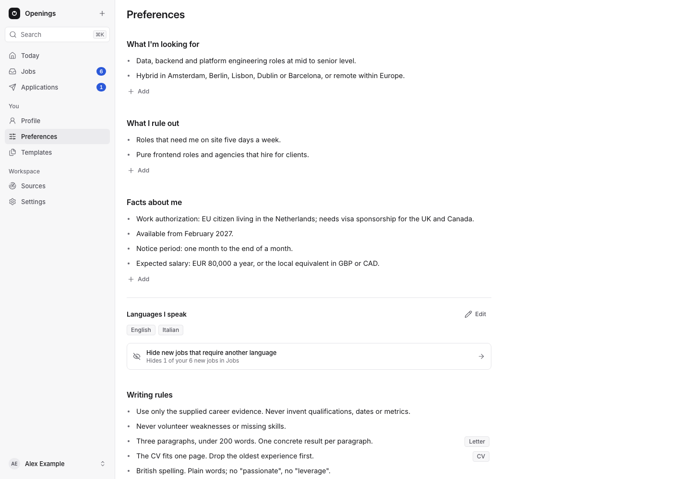
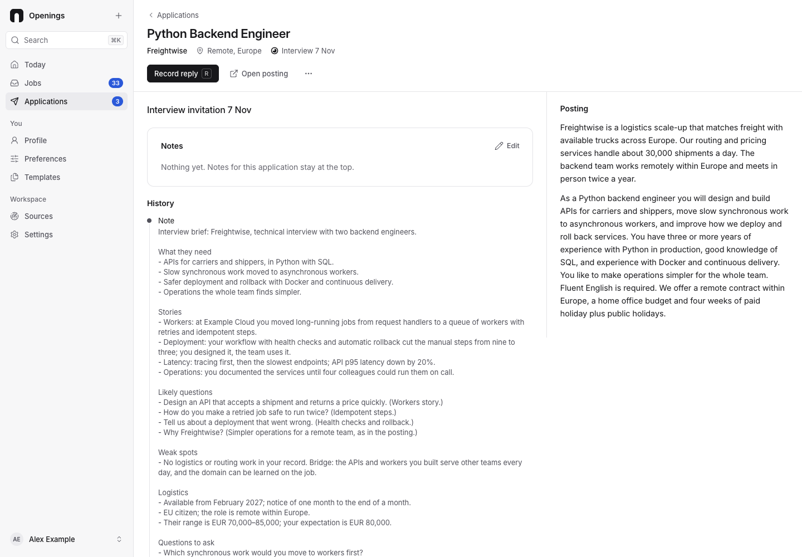
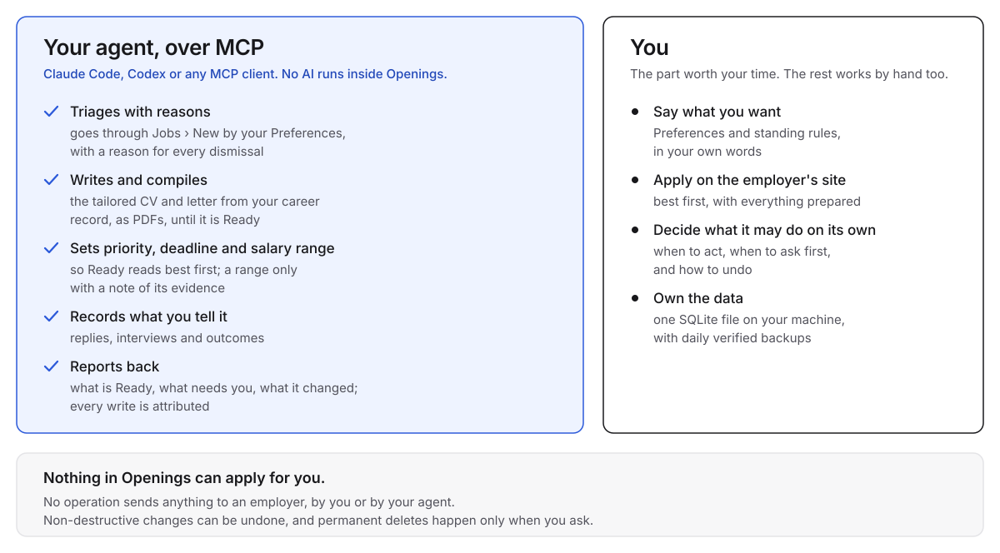
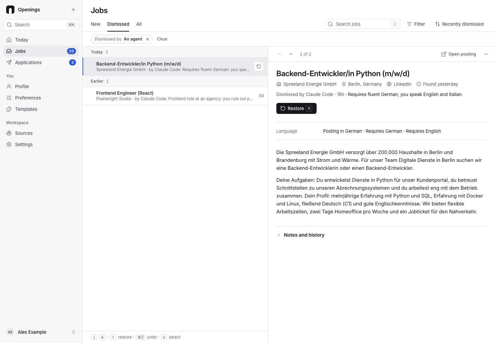
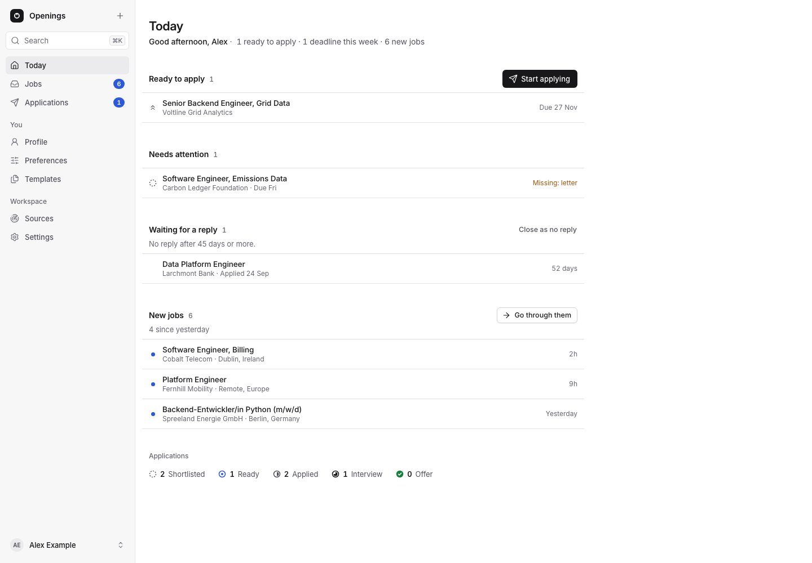
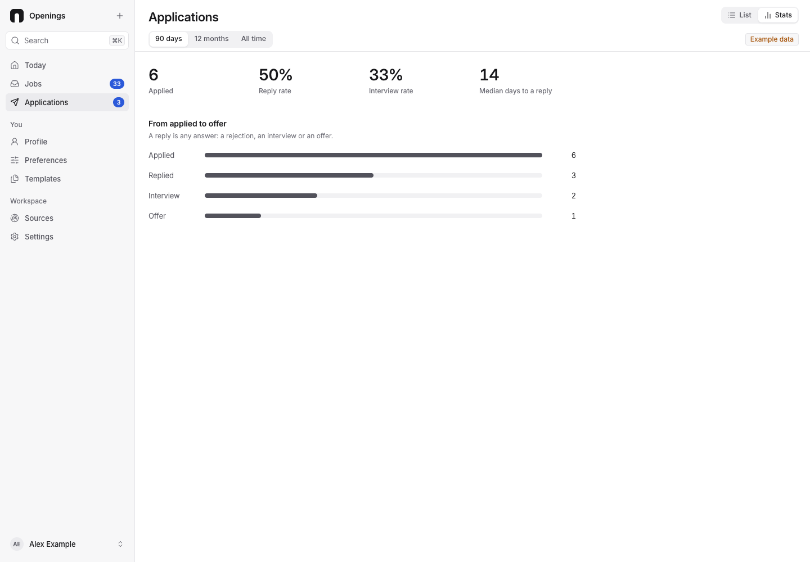

<p align="center"><picture><source media="(prefers-color-scheme: dark)" srcset="docs/brand/wordmark-mark-dark.svg"></picture></p>

<h3 align="center">Set up your job search once. Your AI agent works it by your rules. You just apply.</h3>

<p align="center">Openings keeps your career, your rules in your own words, your CV and letter templates and the searches you watch in one self-hosted app. Your own AI agent reads them to sort every new job, write a tailored CV and letter as PDFs, and rank what's ready. Everything also works by hand. Nothing in Openings can apply for you.</p>

<div align="center">

[Try the demo](#look-first) · [Quick start](#quick-start) · [Claude Code, Codex, any MCP client](#use-it-with-your-agent) · [REST API](docs/user/api.md) · [Compare](#compared) · [Docs](docs/README.md)

[](https://github.com/VincenzoImp/openings-job-search/releases/latest) [](https://hub.docker.com/r/vincenzoimp/openings) [](LICENSE)

</div>


<p align="center"><!-- video-link --><a href="https://www.youtube.com/watch?v=AJzw5OIvWTw">▶ Watch the walkthrough on YouTube, with voice</a></p>

## How a day goes

**Every new job, filtered, prepared and ranked.**

1. **Openings brings in fresh jobs** from your searches and watched companies, on your schedule. Repeats are left out and likely copies flagged.
2. **Your agent decides and prepares.** Your agent reads each job by your rules, dismisses with a reason and writes a CV and letter for the rest.
3. **You apply, best first.** Ready is ranked by priority, then deadline. You send each one yourself.

<picture><source media="(prefers-color-scheme: dark)" srcset="docs/images/flow-dark.svg"></picture>

Change a line in your Preferences, and your agent's next decisions change with it:

| Preferences › What I'm looking for | Jobs › Dismissed |
|---|---|
| "…or remote within Europe." | "Dismissed by Claude Code · On site in London five days a week; you look for … remote within Europe." |

## What Openings holds

You set these up once, by hand or with your agent.

**Profile.** Your career entries and highlights. ★ means always in your CV, and only approved highlights are used.


**Preferences.** Five sections in your own words: What I'm looking for, What I rule out, Facts about me, Writing rules (for the CV, the letter or both) and Working with me.



**Templates.** Your own TeX for the CV and the letter, with a Preview and Limits on pages, bullets per entry and bullet length.


**Sources.** LinkedIn, Indeed and Glassdoor searches (no login), careers pages on 12 hiring platforms, Hacker News, RSS feeds and job links. Each shows found · ever shortlisted · applied, to tune over time.


## After you apply

**Today** shows what is ready to send, what needs attention and what waits for a reply. Openings tracks replies, follow-ups and deadlines, and your agent briefs you before each interview, with a debrief saved after it.



## Quick start

<!-- quick-start: the same commands as docs/user/getting-started.md (test_docs.py) -->

### Look first

A disposable workspace of fictional data. It contacts no job site, is deleted when it stops, and prints a sign-in link, an agent token with its `export` line and the lines that connect Claude Code and Codex:

```bash
docker run --rm -p 127.0.0.1:8080:8080 vincenzoimp/openings demo
```

### Use it

One command keeps your workspace in the `openings` volume:

```bash
docker run -d --name openings -p 127.0.0.1:8080:8080 -v openings:/data --read-only --tmpfs /tmp --restart unless-stopped vincenzoimp/openings:latest
```

Or Docker Compose v2, in a folder of its own, with resource limits and the minor release pinned:

```bash
curl -fsSLO https://raw.githubusercontent.com/VincenzoImp/openings-job-search/main/docker-compose.yml && docker compose up -d
```

Open **http://127.0.0.1:8080**, enter the one-time setup code from the log and choose an owner password. The setup guide takes it from there.

```bash
docker logs openings            # with docker run
docker compose logs openings    # with Docker Compose
```

<details><summary><b>Port 8080 taken? On a server or NAS?</b></summary>

Map another host port and name the address agents and upload links use, or with Compose set `OPENINGS_PORT`:

```bash
docker run -d --name openings -p 127.0.0.1:18080:8080 -v openings:/data \
  -e OPENINGS_PUBLIC_URL=http://127.0.0.1:18080 \
  --read-only --tmpfs /tmp --restart unless-stopped vincenzoimp/openings:latest
```

```bash
OPENINGS_PORT=18080 docker compose up -d
```

On a server or NAS, publish the port and set the address other devices use; with Compose, in `.env`:

```bash
docker run -d --name openings -p 8080:8080 -v openings:/data \
  -e OPENINGS_PUBLIC_URL=http://nas.local:8080 \
  --read-only --tmpfs /tmp --restart unless-stopped vincenzoimp/openings:latest
```

```dotenv
OPENINGS_BIND=0.0.0.0
OPENINGS_PUBLIC_URL=http://nas.local:8080
```

Put HTTPS in front before you reach it from outside your home: [Operations](docs/user/operations.md#reach-it-from-other-devices).

</details>

<!-- /quick-start -->

## Use it with your agent

In **Settings › API & agents**, create an agent token and put it in your shell: `export OPENINGS_TOKEN=op_...`. Then install the Claude Code plugin, with the MCP connection and the skills:

```text
/plugin marketplace add VincenzoImp/openings-job-search
/plugin install openings@openings-job-search
```

Other clients connect to `http://127.0.0.1:8080/mcp/` with the token as a bearer header: [Work with an agent](docs/user/agents.md). The skills ship with the app:

| Skill | Your agent |
|---|---|
| `setup-openings` | Checks the connection, then records your career entries, Preferences, templates and first sources from your CV and a short interview. |
| `manage-sources` | Adds, previews, tunes and pauses your searches, company boards and feeds so new jobs fit what you want. |
| `triage-jobs` | Reads new jobs by your Preferences and experience, shortlists fits with a priority and dismisses mismatches with a reason. |
| `prepare-applications` | Writes, compiles and checks a tailored CV and letter for each shortlisted job until the application is Ready. |
| `review-applications` | Ranks your open applications by priority, gives each a salary range with its basis and flags employers you apply to too often. |
| `track-applications` | Records each reply, interview or rejection you report and tells you what is waiting on you or on an employer. |
| `prepare-interview` | Saves an interview brief on the application, with stories from your record and likely questions, then a debrief after the interview. |
| `run-job-search` | Triages new jobs, prepares and ranks the shortlist, checks deadlines and replies, and reports back, when you ask or on a schedule. |
| `maintain-career` | Keeps your Profile, career entries, highlights, templates and Preferences current from a CV or from what you say changed. |
| `maintain-workspace` | Takes and checks backups and exports, tidies stale items reversibly, deletes records only when you ask and undoes an agent run. |
| `openings` | Answers any question and makes any change in your job search, from jobs and applications to your Profile, career entries and Preferences. |

Then ask, in order: **"Set up my Openings workspace from my CV."**, **"Go through my new jobs."** and **"Prepare CV and letter for my shortlist."** Afterwards, **"Run my job search"** does it all in one go, also [on a schedule](docs/user/agents.md#run-it-on-a-schedule).

## By hand, by REST, by MCP

Every step is one operation, three ways. Shortlisting a job:

| By hand | REST | MCP |
|---|---|---|
| In **Jobs › New**: `j` `k` move, `s` shortlists, `d` dismisses, `z` undoes | `POST /api/v1/jobs/triage` | The `jobs_triage` tool |

```bash
curl -fsS http://127.0.0.1:8080/api/v1/jobs/triage -H "Authorization: Bearer $OPENINGS_TOKEN" \
  -H 'Content-Type: application/json' -d '{"items":[{"job_id":"'"$JOB_ID"'","to":"shortlisted"}]}'
```

```json
{"name": "jobs_triage", "arguments": {"items": [{"job_id": "<JOB_ID>", "to": "shortlisted"}]}}
```

`JOB_ID` is a job's `id` from `GET /api/v1/jobs?triage=new`.

## What stays yours

- **No submission.** Nothing in Openings can submit an application or contact an employer.
- **Attributed writes.** Every agent change carries its token's name, and non-destructive changes can be undone.
- **Deliberate deletes.** Records are deleted permanently only when you ask.
- **Your autonomy dial.** Working with me, in Preferences, says what your agent may do on its own.
- **One SQLite file.** Your workspace lives in a Docker volume, with verified daily backups.
- **No account and no telemetry.** Openings contacts only the job sites your sources name.
- **Any language, any country.** Postings, Preferences and documents can be in any language.

<picture><source media="(prefers-color-scheme: dark)" srcset="docs/images/agent-vs-you-dark.svg"></picture>

## Compared

| | Openings | Huntr, Teal, Simplify | Auto-apply bots | career-ops |
|---|---|---|---|---|
| Runs on your machine | Yes: one container, one SQLite file | No: hosted services | Yes | Yes: in your AI CLI |
| AI | Bring your own agent, over MCP | Built in, on paid plans | Built in | Your CLI's agent |
| Holds your career, rules and templates | Yes: Profile, Preferences, Templates | A profile and resumes | A profile for forms | Files in your CLI's folder |
| Collects from company job boards | 12 platforms, on your schedule | No: a browser extension saves jobs | Not documented | Ashby, Greenhouse, Lever, Wellfound |
| Auto-apply | No: you send each one | Autofill; Simplify+ "Autopilot" | Yes: fills and submits forms | No |

career-ops and Openings work well together. More tools, with sources: [Openings compared](docs/comparison.md).

## Screenshots

<details open><summary>The demo workspace, fictional data</summary>









</details>

## FAQ

**Which agents work?** Any MCP client: Claude Code, Codex, Cursor, Gemini CLI and others.

**How is this different from auto-apply?** No operation submits an application. You send each one yourself.

**Employer bans AI-written applications?** Record it as a blocking requirement; the application can't reach Ready until you settle it.

**What does it cost?** Nothing: MIT-licensed. Your agent costs what your plan costs.

**Which sites?** LinkedIn anywhere; Indeed and Glassdoor by country; [12 hiring platforms](docs/user/jobs-and-sources.md). Missing one? [Request a job site](https://github.com/VincenzoImp/openings-job-search/issues/new?template=job_site_request.yml).

**What if LinkedIn blocks me?** A refused site is paused and retried later ([details](docs/user/operations.md#a-job-site-refused-requests)).

**Do I need LaTeX?** No. Upload PDFs, or your agent compiles with [Tectonic](docs/user/agents.md#without-latex-tectonic).

**Prompt injection in postings?** Posting text is data: see the [security model](docs/user/agents.md#security-model).

**Is it vibe-coded?** The rules that matter are enforced in the services and in SQLite, not in prompts, and tests cover each one.

I built Openings for my own job search and use it every day. I built it with AI coding agents, mainly Claude Code: I decide what it does and how it behaves, and every change passes the full test suite before it ships.

**What it is not:** Openings has one user per installation, no hosted version and no auto-apply.

## Status

Pre-1.0 and released often (see the [changelog](CHANGELOG.md)). An upgrade converts your data automatically ([Operations](docs/user/operations.md#upgrades)); back up first.

## Documentation

All guides: [docs](docs/README.md). Start with [How it works](docs/user/how-it-works.md), [Getting started](docs/user/getting-started.md) and [Work with an agent](docs/user/agents.md).

## Project

Bug reports, job-site requests and pull requests are welcome: start with [CONTRIBUTING.md](CONTRIBUTING.md) and the [good first issues](https://github.com/VincenzoImp/openings-job-search/labels/good%20first%20issue). [Architecture](docs/developer/architecture.md) · [Code of conduct](CODE_OF_CONDUCT.md) · [Security](SECURITY.md) · [Brand](docs/brand/README.md) · [MIT license](LICENSE)

If Openings saves you time, a star helps other job seekers find it.
