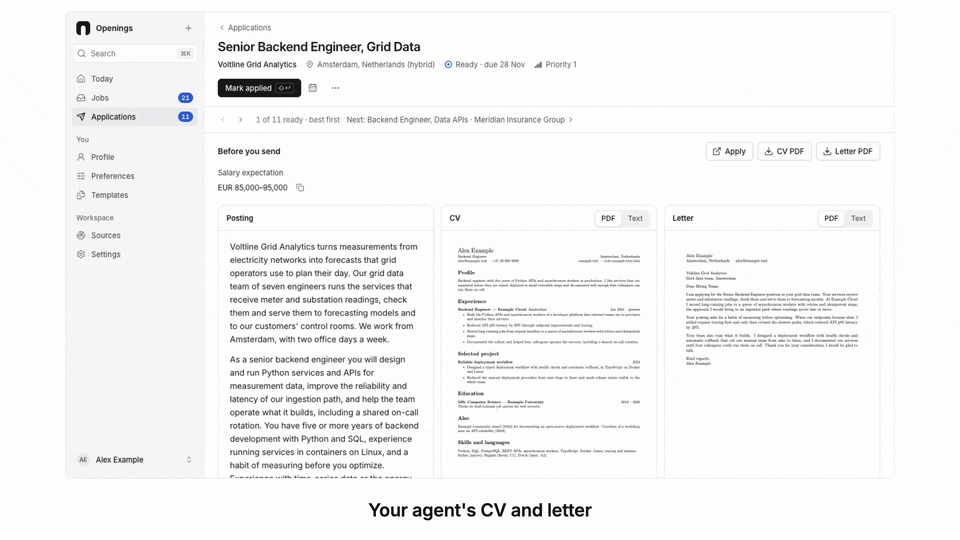
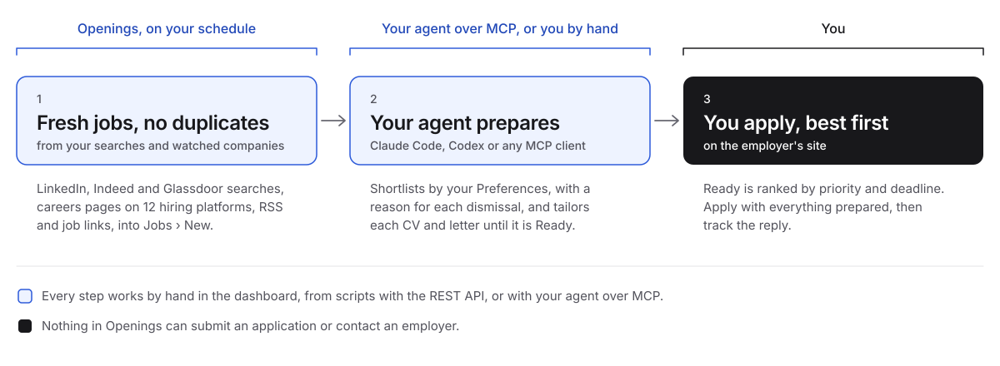
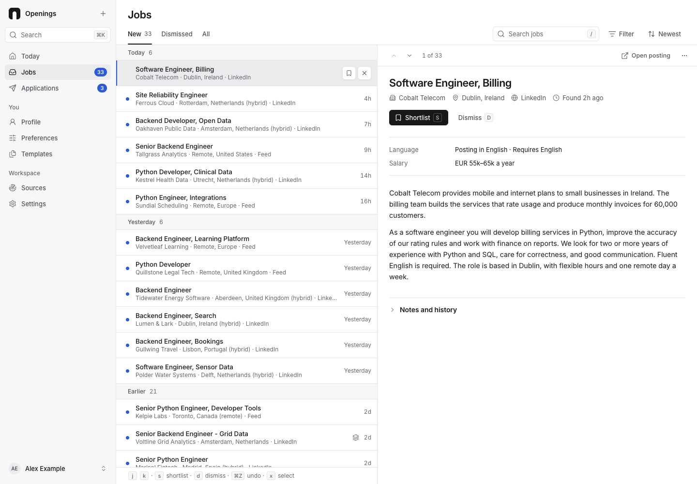
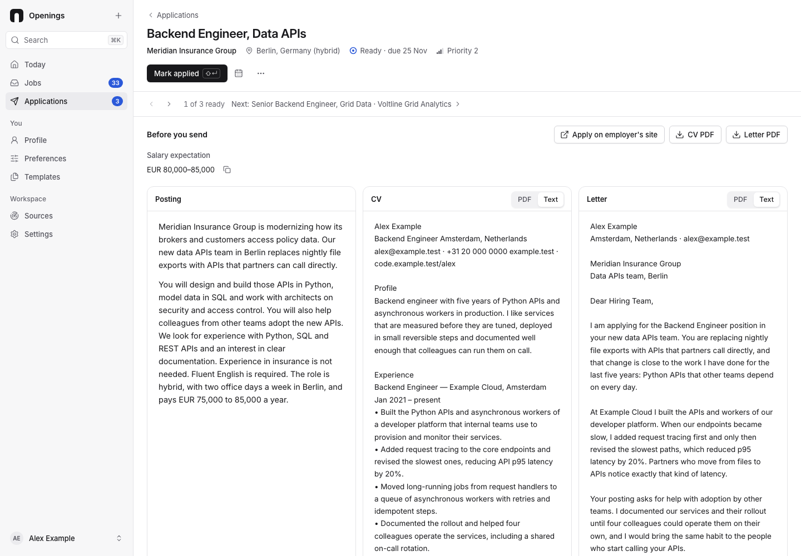
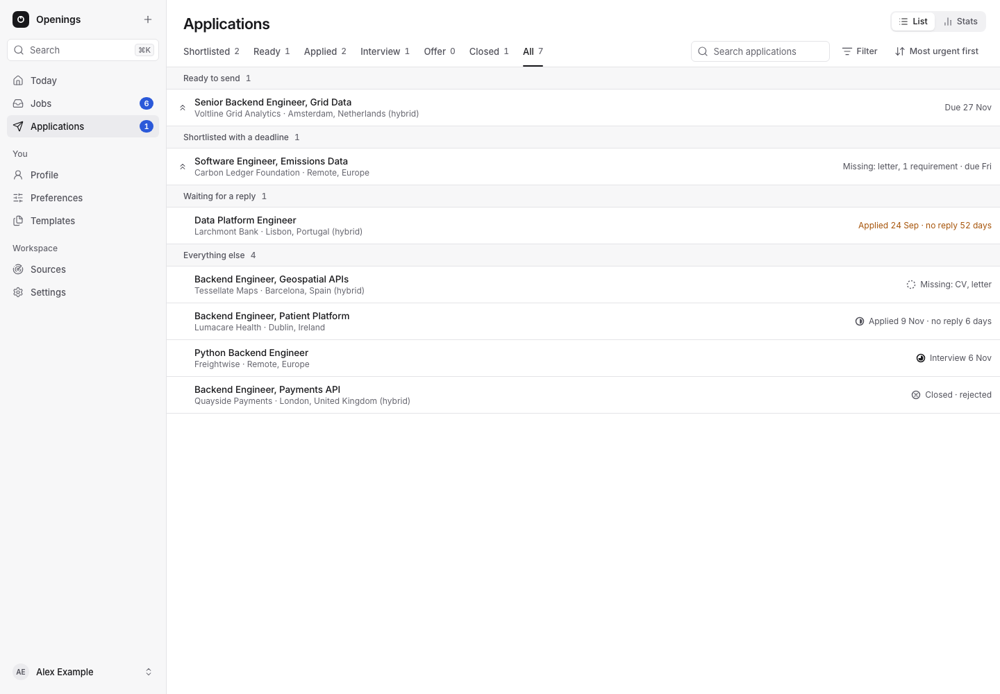
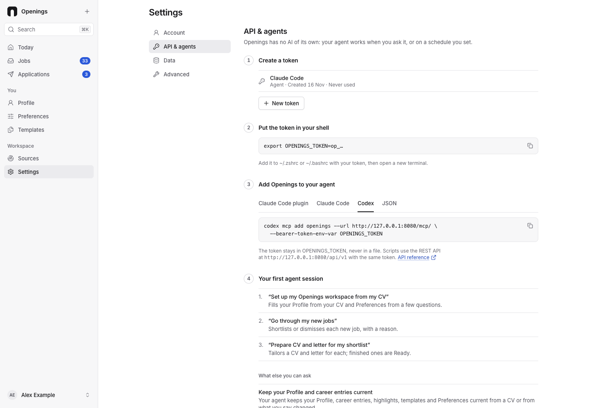
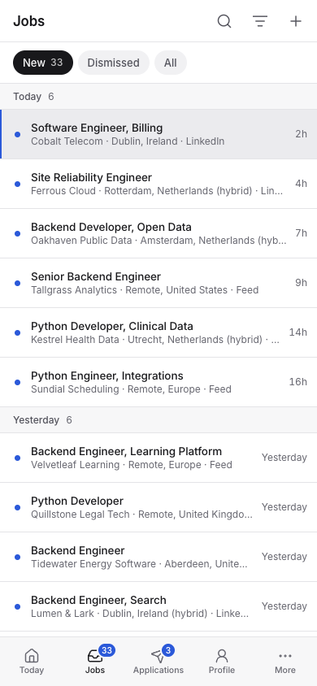

<p align="center"><picture><source media="(prefers-color-scheme: dark)" srcset="docs/brand/wordmark-mark-dark.svg"></picture></p>

<h3 align="center">Every new job, filtered, prepared and ranked. You just apply.</h3>

<p align="center">A self-hosted job-search app: fresh jobs from your searches and favorite companies, no duplicates. Your own AI agent (Claude Code, Codex, any MCP client) shortlists, tailors and ranks them. You apply, best first.</p>

<div align="center">

[Quick start](#quick-start) · [Try the demo](#look-first) · [Use with your agent](#mcp-server-for-your-ai-agent) · [Compare](#compared) · [Docs](docs/README.md) · [Changelog](CHANGELOG.md)

[](https://github.com/VincenzoImp/openings-job-search/releases/latest) [](https://hub.docker.com/r/vincenzoimp/openings) [](LICENSE)

</div>

<picture><source media="(prefers-color-scheme: dark)" srcset="docs/images/demo-dark.gif"></picture>

## Self-hosted job search, in three steps

Job hunting is mostly busywork: checking the same boards every day, skipping reposts, rewriting the CV for every role. Openings does that part and leaves you the step that matters.

1. **Fresh jobs, no duplicates.** Your searches and watched companies, on your schedule: LinkedIn, Indeed and Glassdoor searches (no login), careers pages on 12 hiring platforms, RSS feeds and job links, into **Jobs › New**.
2. **Your agent prepares.** It shortlists by fit, with a reason you can read, and tailors each CV and letter from your career record.
3. **You apply, best first.** Ready is ranked by priority and deadline. You send each application on the employer's site; your agent (or you) then tracks replies, follow-ups and deadlines, and prepares you for each interview.

<picture><source media="(prefers-color-scheme: dark)" srcset="docs/images/flow-dark.svg"></picture>

Use it by hand in the dashboard, from scripts with the [REST API](docs/user/api.md), or with your own AI agent over MCP: the same operations, everywhere. Built-in skills cover each workflow. Your searches, Preferences and templates shape every step, and your agent reads your corrections.

## Quick start

<!-- quick-start: the same commands as docs/user/getting-started.md (test_docs.py) -->

### Look first

A disposable workspace of fictional data. It contacts no job site, is deleted when it stops, and prints a sign-in link, an agent token with its `export` line and the lines that connect Claude Code and Codex:

```bash
docker run --rm -p 127.0.0.1:8080:8080 vincenzoimp/openings demo
```

### Use it

One command keeps your workspace in the `openings` volume:

```bash
docker run -d --name openings -p 127.0.0.1:8080:8080 -v openings:/data --read-only --tmpfs /tmp --restart unless-stopped vincenzoimp/openings:latest
```

Or Docker Compose v2, in a folder of its own, with resource limits and the minor release pinned:

```bash
curl -fsSLO https://raw.githubusercontent.com/VincenzoImp/openings-job-search/main/docker-compose.yml && docker compose up -d
```

Open **http://127.0.0.1:8080**, enter the one-time setup code from the log and choose an owner password. The setup guide takes it from there.

```bash
docker logs openings            # with docker run
docker compose logs openings    # with Docker Compose
```

<details><summary><b>Port 8080 taken? On a server or NAS?</b></summary>

Map another host port and name the address agents and upload links use, or with Compose set `OPENINGS_PORT`:

```bash
docker run -d --name openings -p 127.0.0.1:18080:8080 -v openings:/data \
  -e OPENINGS_PUBLIC_URL=http://127.0.0.1:18080 \
  --read-only --tmpfs /tmp --restart unless-stopped vincenzoimp/openings:latest
```

```bash
OPENINGS_PORT=18080 docker compose up -d
```

On a server or NAS, publish the port and set the address other devices use; with Compose, in `.env`:

```bash
docker run -d --name openings -p 8080:8080 -v openings:/data \
  -e OPENINGS_PUBLIC_URL=http://nas.local:8080 \
  --read-only --tmpfs /tmp --restart unless-stopped vincenzoimp/openings:latest
```

```dotenv
OPENINGS_BIND=0.0.0.0
OPENINGS_PUBLIC_URL=http://nas.local:8080
```

Put HTTPS in front before you reach it from outside your home: [Operations](docs/user/operations.md#reach-it-from-other-devices).

</details>

<!-- /quick-start -->

## MCP server for your AI agent

In **Settings › API & agents**, create an agent token and put it in your shell: `export OPENINGS_TOKEN=op_...`. Then install the Claude Code plugin, with the MCP connection and the skills:

```text
/plugin marketplace add VincenzoImp/openings-job-search
/plugin install openings@openings-job-search
```

Any other client connects to `http://127.0.0.1:8080/mcp/` with the token as a bearer header; [Work with an agent](docs/user/agents.md) has the lines for Claude Code without the plugin, Codex and the rest. Then ask, in order: **"Set up my Openings workspace from my CV."**, **"Go through my new jobs."** and **"Prepare CV and letter for my shortlist."** Afterwards, **"Run my job search"** does it all in one go, also [on a schedule](docs/user/agents.md#run-it-on-a-schedule).

<picture><source media="(prefers-color-scheme: dark)" srcset="docs/images/agent-vs-you-dark.svg"></picture>

## Compared

| | Openings | Huntr, Teal, Simplify | Auto-apply bots | career-ops |
|---|---|---|---|---|
| Runs on your machine | Yes: one container, one SQLite file | No: hosted services | Yes | Yes: in your AI CLI |
| AI | Bring your own agent, over MCP | Built in, on paid plans | Built in | Your CLI's agent |
| Collects from company job boards | 12 platforms, on your schedule | No: a browser extension saves jobs | Not documented | Ashby, Greenhouse, Lever, Wellfound |
| Applies for you | No: you send each one | Autofill; Simplify+ "Autopilot" | Yes: fills and submits forms | No |

career-ops and Openings work well together. Sources, dates and more tools (JobSync, job-ops, a spreadsheet): [Openings compared](docs/comparison.md).

<details><summary><b>Screenshots</b> (the demo workspace, fictional data)</summary>







</details>

## Your data

Everything lives in one SQLite file in a Docker volume on your machine, with every uploaded document. One container (an image of about 70 MB, amd64 and arm64), no account, no API key and no telemetry. Openings writes a verified backup every day and keeps the last three; you can download a backup or restore one in **Settings › Data**. Nothing leaves your machine except the requests to the job sites your sources name, and whatever your own agent sends to its AI service.

## FAQ

**Which agents work?** Any MCP client: Claude Code (with the plugin), Codex, Cursor, Gemini CLI and others. The skills ship with the app.

**How is this different from auto-apply?** Nothing in Openings can submit an application or contact an employer: no such operation exists. Every application is tailored, one per job is enforced, and you send each one yourself.

**What does it cost?** Openings is free and MIT-licensed. Your agent costs what your plan already costs, and the whole app works by hand without one.

**Which countries and sites?** LinkedIn searches anywhere; Indeed and Glassdoor by country. Careers pages on Greenhouse, Lever, Ashby, Workday, SmartRecruiters, Personio, Recruitee, Workable, BambooHR, Rippling, Oracle and JOIN, and any RSS feed. Missing one? [Request a job site](https://github.com/VincenzoImp/openings-job-search/issues/new?template=job_site_request.yml).

**What if LinkedIn blocks me?** Searches use the sites' public guest pages, spaced out through one rate gate. A refused site is paused and retried later; careers pages are not affected ([details](docs/user/operations.md#a-job-site-refused-requests)).

**Do I need LaTeX?** No. Upload your CV and letter as PDFs, or let your agent compile them with [Tectonic](docs/user/agents.md#without-latex-tectonic): no TeX distribution needed.

**Is the dashboard in English only?** Yes. Postings, Preferences and documents can be in any language.

**Is this more AI slop for recruiters?** It is the opposite of mass-applying: each application is tailored to the posting, and a person sends every one.

**What about prompt injection in postings?** Posting text is treated as data, and the skills tell your agent when to ask first. Agent writes are attributed, non-destructive changes can be undone, and backups run daily. See the [security model](docs/user/agents.md#security-model).

**Is it vibe-coded?** The rules that matter are enforced in the services and in SQLite, not in prompts: one open application per job, version checks, no operation that submits. Tests cover each of them, and complete workflows run in a browser.

I built Openings for my own job search and use it every day. I built it with AI coding agents, mainly Claude Code: I decide what it does and how it behaves, and every change passes the full test suite before it ships.

**What it is not:** Openings has one user per installation, no hosted version and no auto-apply.

## Status

Pre-1.0 and released often (see the [changelog](CHANGELOG.md)). An upgrade converts your data automatically ([Operations](docs/user/operations.md#upgrades)); back up first.

## Documentation

All guides: [docs](docs/README.md). Start with [How it works](docs/user/how-it-works.md), [Getting started](docs/user/getting-started.md) and [Work with an agent](docs/user/agents.md).

## Project

Bug reports, job-site requests and pull requests are welcome: start with [CONTRIBUTING.md](CONTRIBUTING.md) and the [good first issues](https://github.com/VincenzoImp/openings-job-search/labels/good%20first%20issue). [Architecture](docs/developer/architecture.md) · [Code of conduct](CODE_OF_CONDUCT.md) · [Security](SECURITY.md) · [Brand](docs/brand/README.md) · [MIT license](LICENSE)

If Openings saves you time, a star helps other job seekers find it.
