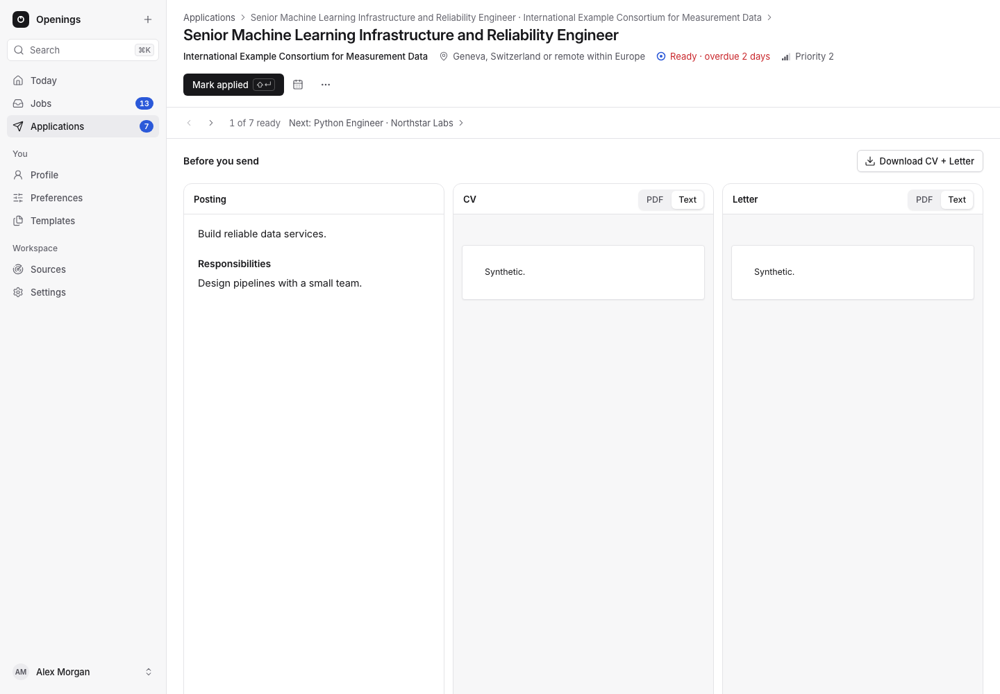
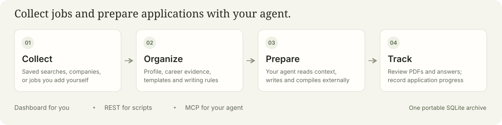
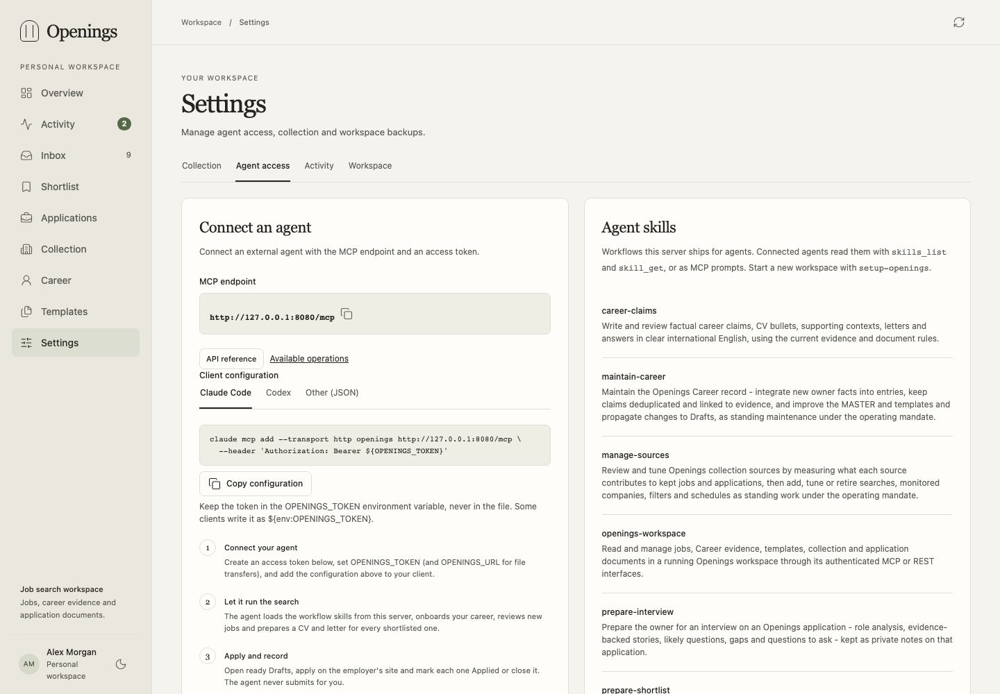
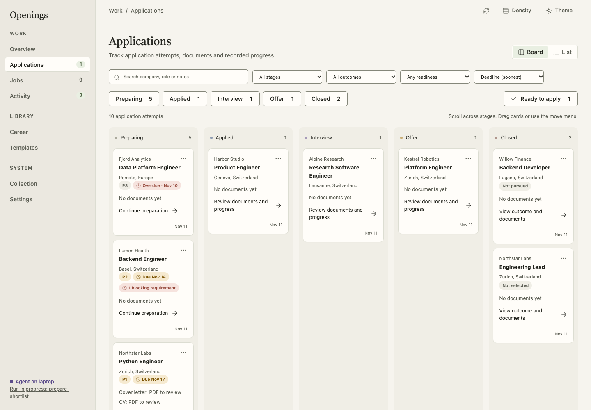

# Openings

[](https://github.com/VincenzoImp/openings/actions/workflows/ci.yml)
[](https://github.com/VincenzoImp/openings/releases/latest)
[](https://hub.docker.com/r/vincenzoimp/openings)
[](LICENSE)

A self-hosted job search workspace. Collect offers, keep your career knowledge and
templates together, and let your own AI agent prepare applications that you review
and submit. Jobs, documents and file bytes live in one portable SQLite database.

**[Start with Docker](#start-with-docker)** · [Connect an agent](#connect-an-agent) ·
[Documentation](docs/README.md) · [Changelog](CHANGELOG.md)


## Features

- **Collect:** scheduled keyword/location searches on LinkedIn, Indeed and Glassdoor,
  or selected company boards (Greenhouse, Lever, Ashby, Workday and more) and RSS
  feeds. Role, location and `exclude_titles` filters skip noise before it reaches
  your New jobs. You can also add any job by URL or pasted text.
- **Triage:** review new jobs beside their posting, shortlist them (which starts
  the application) or dismiss them with a reason; dismissed jobs stay remembered and can be restored.
  Each job arrives with signals computed without a model: the posting's language,
  the languages it requires, a likely duplicate of an earlier job (merged only
  when you confirm) and a company-board posting no longer listed. Signals label
  and filter jobs, for example hiding jobs that require languages you don't
  speak; nothing is dismissed automatically. Bulk actions work on up to 200 jobs.
- **Measure sources:** each source shows how many jobs it found and how many of
  them you shortlisted, applied to and got a reply for.
- **Decide once:** **Preferences** hold, in your own words, what you are looking
  for, what you rule out, the facts employers ask about, your writing rules and
  how the agent should work with you. Your agent reads and applies them.
- **Prepare:** store your Profile, Career entries, approved claims (★ always
  include in your CV), LaTeX templates with guidance and typed limits. A CV or
  letter revision records the claims and Career entries it cites and is a PDF,
  with the `.tex` source it was built from when there is one, so no LaTeX is
  needed; Openings reads its text from the source, or else from the PDF, for
  search and comparison between revisions, without running TeX.
- **Plan:** give applications a priority, a deadline, the documents they need and
  the employer's requirements (authorship rules, attachments, references,
  language, eligibility), and sort by deadline or priority. Close, reopen or
  delete applications in bulk.
- **Hand over:** a Shortlisted application is **Ready** as soon as each document
  it needs has a complete revision and nothing blocks it; nobody marks it. Its
  review page shows the posting, CV and letter side by side with the open
  requirements, and says what is missing otherwise; download the PDFs, apply on
  the employer's site and **Mark applied**.
- **Stay consistent:** each revision records the claims and Career entries it
  cites, and a PDF built from another source than its revision's is refused.
- **Track:** follow applications through Shortlisted, Ready, Applied, Interview,
  Offer and Closed. **Record reply** stores the employer's
  interview, offer or rejection with its date and moves the stage with it; close
  the ones that never answered as **No reply** after a period you set in Preferences.
- **Learn:** **Stats** shows, for the last 90 days, 12 months or all time, how many
  applications you sent, the share that got a reply or led to an interview, the
  median days to a reply, the funnel and, once two sources have enough
  applications, replies by source.
- **See what the agent did:** every change records who made it (you, the agent
  token by name, or job sources), and job and application histories say so.
  Jobs the agent dismissed can be filtered under **Jobs › Dismissed** and
  restored in one action. You talk to your agent in its own chat; Settings ›
  Skills lists what you can ask it.
- **Automate:** the dashboard, REST API and MCP share one service layer and the same
  operations.



## Agent-operated

Openings works best when your own AI agent runs it. The server ships
[workflow skills](skills/) and serves them to any connected agent (`skills_list`,
`skills_get` and one MCP prompt per skill). With them, an agent reviews new jobs
against your Preferences, prepares a CV and letter for every shortlisted job, records
employer requirements, tunes searches and keeps your Career record current. You
answer its questions in the chat, apply to the Ready applications and mark them Applied.

The agent uses its own model access and tools and never submits applications for
you. Read [Agent-operated job search](docs/user/agent-operated.md).



## Start with Docker

Requires Docker with Compose v2. Published images support Linux amd64 and arm64.

```bash
git clone https://github.com/VincenzoImp/openings.git
cd openings
cp .env.example .env
docker compose pull
docker compose up -d --no-build
```

Open **http://127.0.0.1:8080**, choose an owner password and add your first job in
**Jobs**. Set up **Collection** when you want scheduled searches; new sources start
paused. Build your **Career** and **Templates** library before preparing documents.

The Compose limit is **0.5 CPU / 512 MiB**; allow host resources beyond this
container budget. [Setup and first use](docs/user/getting-started.md) covers LAN
access, storage and upgrades.

## Connect an agent

1. A new workspace opens on the setup guide; its first step, like **Settings →
   Agent access**, creates an agent token and gives the configuration for Claude
   Code, Codex or another MCP client. An agent token cannot change
   your password, manage tokens or restore a backup. The endpoint is
   `http://127.0.0.1:8080/mcp` with `Authorization: Bearer <token>`.
2. Ask the agent to load the `setup-openings` skill to onboard your career,
   templates and first searches.
3. For a persistent setup, copy the
   [operator workspace template](examples/operator-workspace/README.md): it holds the
   operating mandate and generates MCP configuration for six clients.

[Agents and MCP](docs/user/agents.md) explains the tools, transfers and state rules.



## Documentation

[Collection](docs/user/sources.md) · [Career](docs/user/career.md) ·
[Applications](docs/user/applications.md) · [Agents and MCP](docs/user/agents.md) ·
[REST API](docs/user/api.md) · [Operations](docs/user/operations.md)



## Project

[Contributing](CONTRIBUTING.md) · [Code of conduct](CODE_OF_CONDUCT.md) ·
[Architecture](docs/developer/architecture.md) · [Security](SECURITY.md) ·
[Changelog](CHANGELOG.md) · [MIT license](LICENSE)
