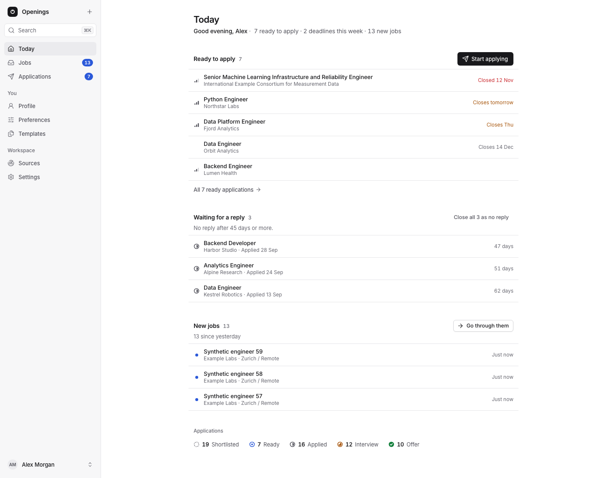

# Openings

[](https://github.com/VincenzoImp/openings/actions/workflows/ci.yml)
[](https://github.com/VincenzoImp/openings/releases/latest)
[](https://hub.docker.com/r/vincenzoimp/openings)
[](LICENSE)

**A self-hosted job-search workspace: collect jobs, prepare applications and
track replies, by hand or with your own AI agent.**

Openings collects postings from job portals and company careers pages, helps you
decide fast, keeps your CV and letter for each application, and tracks every
reply. It is one Docker container and one SQLite file, with no account and no
telemetry. Openings has no AI inside: use it by hand, or connect your own agent
(Claude Code, Codex, ...) through MCP.

<picture>
  <source media="(prefers-color-scheme: dark)" srcset="docs/images/today-dark.png">
  
</picture>

## How it works

**Find → Decide → Prepare → Apply on the employer's site → Track.**

- **Find jobs.** Scheduled searches on LinkedIn, Indeed and Glassdoor, company
  careers pages on 12 hiring platforms (Greenhouse, Lever, Workday, ...), RSS
  feeds, or any job by its link or pasted text.
- **Decide fast.** Read each new job beside the list and shortlist or dismiss it
  with one key. Every decision can be undone; labels show the language and likely
  duplicates, and nothing is dismissed automatically.
- **Keep your record.** Profile, career entries, highlights, Preferences in your
  own words, and CV and letter templates.
- **Prepare each application.** Upload your CV and letter as PDFs (LaTeX is
  optional). Openings tells you when an application is Ready to send.
- **Track the outcome.** Record each reply, close the silent ones as No reply,
  and see how many applications got an answer.

Openings never sends anything. You apply on the employer's site and mark the
application applied.

## Quick start

You need Docker with Compose v2 (amd64 or arm64) and a browser.

```bash
git clone https://github.com/VincenzoImp/openings.git
cd openings
docker compose up -d
```

Open **http://127.0.0.1:8080**, choose an owner password, and the setup guide
takes it from there. `curl http://127.0.0.1:8080/health` tells you it runs.
[Getting started](docs/user/getting-started.md) walks through your first
application; [Operations](docs/user/operations.md) covers updates and backups.

## Use it with your AI agent (optional)

1. In **Settings › API & agents**, create an agent token and copy it.
2. Put it in the environment variable `OPENINGS_TOKEN` of your agent's machine,
   then add Openings to your agent. For Claude Code:

   ```bash
   claude mcp add --transport http openings http://127.0.0.1:8080/mcp/ \
     --header 'Authorization: Bearer ${OPENINGS_TOKEN}'
   ```

3. Tell your agent: **"Set up my Openings workspace."**

The agent can triage jobs, write tailored documents and keep your sources
healthy. It never submits an application, never marks one applied unless you
say you applied, and never deletes anything unless you ask. An agent token
cannot change your password, manage tokens or restore a backup.
[Work with an agent](docs/user/agents.md) has the details.

## Your data

Everything lives in one SQLite file in a Docker volume on your machine, with
every uploaded document. Openings writes a verified backup every day and keeps
the last three; you can download a backup or restore one in **Settings › Data**.
Nothing leaves your machine except the requests to the job sites your sources
and job links name, and whatever your own agent sends to its AI service.

## FAQ

**Does it apply for me?** No. You send every application yourself.

**Do I need LaTeX?** No. A PDF of your CV and letter is enough. LaTeX helps only
if an agent builds your documents.

**Is it allowed to search LinkedIn, Indeed or Glassdoor?** Requests to each site
are spaced out (one every 5 seconds by default) and may still be blocked. You are
responsible for respecting each site's terms.

**Can several people use it?** No. One installation is one person's job search.

## Status

Single user, pre-1.0, released often (see the [changelog](CHANGELOG.md)). An
upgrade converts your data automatically
([Operations](docs/user/operations.md#upgrades)); back up first.

## Documentation

All guides: [docs](docs/README.md). Start with
[How it works](docs/user/how-it-works.md) and
[Getting started](docs/user/getting-started.md).

## Project

Bug reports and pull requests are welcome: start with
[CONTRIBUTING.md](CONTRIBUTING.md). [Architecture](docs/developer/architecture.md) ·
[Code of conduct](CODE_OF_CONDUCT.md) · [Security](SECURITY.md) ·
[Changelog](CHANGELOG.md) · [MIT license](LICENSE)
