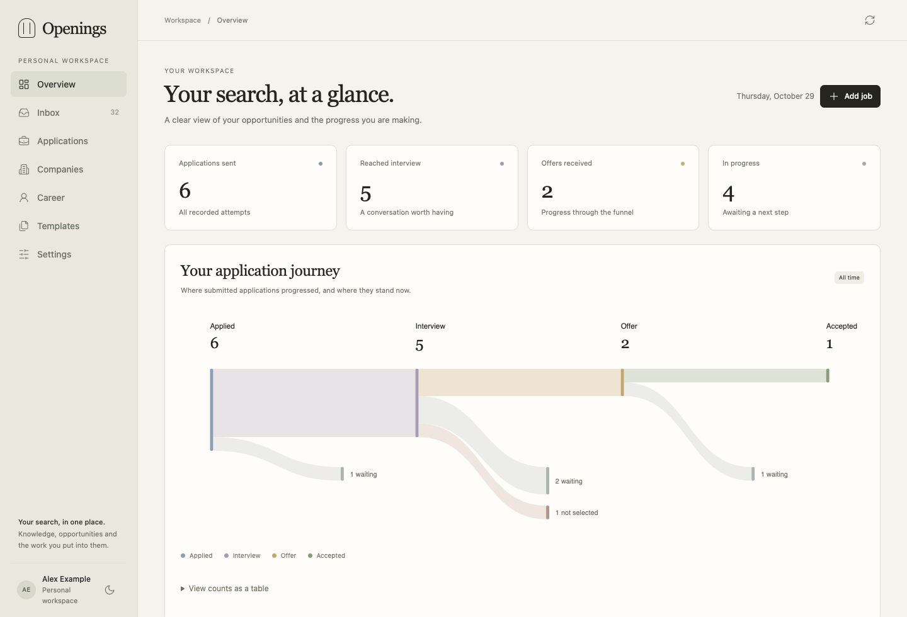
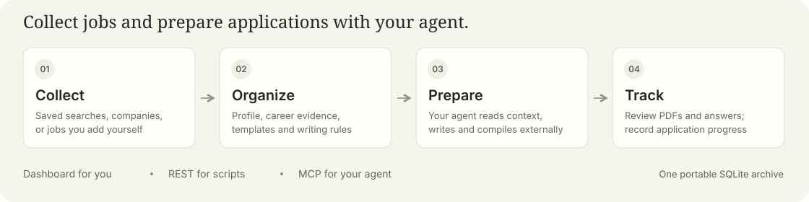
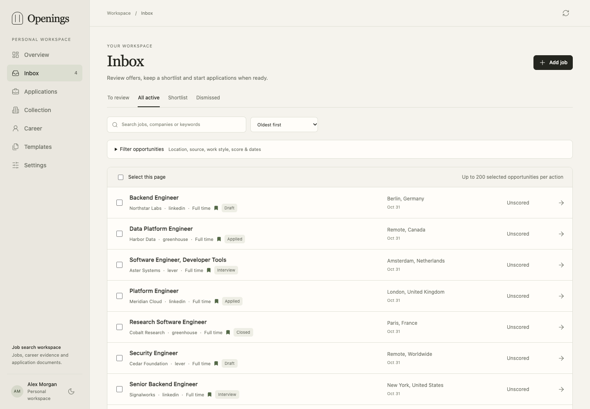
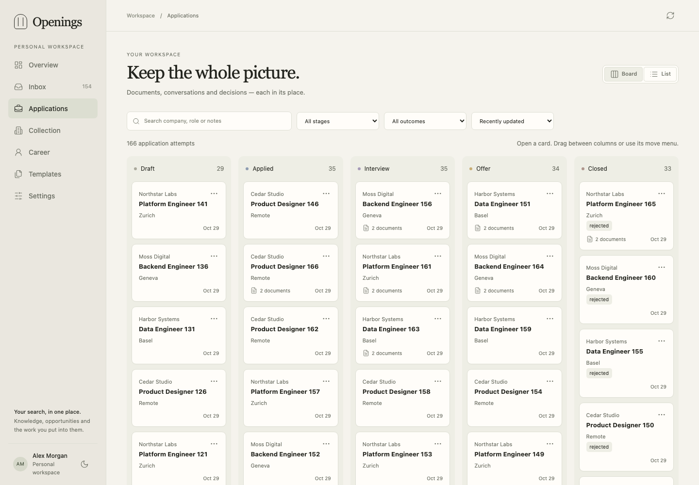

# Openings

A self-hosted job search workspace. Collect offers, keep your career knowledge and
templates together, and prepare applications with your own AI agent. Jobs,
documents and file bytes live in one portable SQLite database.

[Get started](docs/user/getting-started.md) · [Documentation](docs/README.md) · [Connect your agent](docs/user/agents.md)



## From job search to application

- **Collect:** schedule keyword/location searches on LinkedIn, Indeed and Glassdoor,
  or follow selected company ATS boards and feeds. Automatic results enter the
  archive with their posting text; you can also add individual jobs yourself.
- **Organize:** search, filter and shortlist offers individually or in bulk.
  Dismissed jobs stay remembered when collected again.
- **Prepare:** store career entries, approved claims, multiple LaTeX templates,
  assets and writing instructions for your external agent.
- **Review:** keep CVs, cover letters, form answers and their exact PDF/source
  revisions with each application.
- **Track:** move applications through a Kanban board and inspect their recorded
  journey, outcomes and funnel.
- **Automate:** use the dashboard, REST API or MCP with shared operations. Optional
  CPU fit scoring runs in a separate container or a compatible remote service.



Your agent reads a frozen application context, writes and compiles documents on
its own machine, then uploads the result. You review the files and record the
submission. The [agent guide](docs/user/agents.md) and optional
[skill](skills/openings-workspace/SKILL.md) explain the workflow; your agent supplies
its own model access and tools.

## Start with Docker

Requires Docker with Compose v2. Published images support Linux amd64 and arm64.

```bash
git clone https://github.com/VincenzoImp/openings.git
cd openings
cp .env.example .env
docker compose pull
docker compose up -d --no-build
```

Open **http://127.0.0.1:8080**, choose an owner password and add your first job in
**Inbox**. Set up **Collection** when you want scheduled searches; new sources start
paused. Build your **Career** and **Templates** library before preparing documents.

The core Compose limit is **0.5 CPU / 512 MiB**. The optional local scorer adds
**1.5 CPU / 3584 MiB**; allow host resources beyond these container budgets.
[Setup](docs/user/getting-started.md) covers LAN access, storage and scoring modes.

## Explore

[Collection and schedules](docs/user/sources.md) · [Career knowledge](docs/user/career.md) · [Application documents](docs/user/applications.md) · [Scoring](docs/user/scoring.md) · [REST API](docs/user/api.md) · [Operations](docs/user/operations.md)





[Contributing](CONTRIBUTING.md) · [Architecture](docs/developer/architecture.md) · [Security](SECURITY.md) · [Changelog](CHANGELOG.md) · [MIT license](LICENSE)
