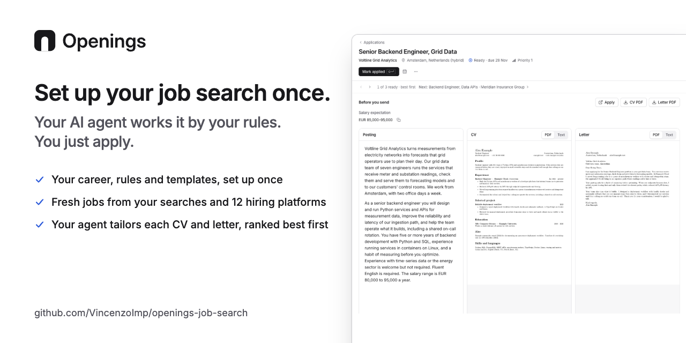
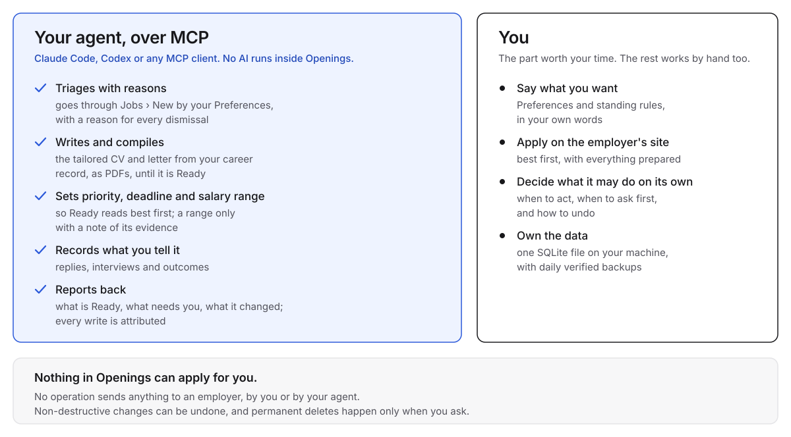

# Openings brand

The brand is the product. `frontend/src/ui/tokens.css` is the single source of
color, type, spacing and radii; [tokens.md](tokens.md) is its table for both
themes, generated from it. Every image here is drawn from those tokens or is a
screenshot of the real dashboard, so a product change flows into the next
regeneration. This page holds what tokens cannot express.

## Files

| File | What it is |
|---|---|
| [mark.svg](mark.svg), [mark-dark.svg](mark-dark.svg) | The Doorway mark: the tile is a wall, the mark the light through an opening at its foot. Tile in `--primary`, opening in `--on-primary` |
| [mark-outline.svg](mark-outline.svg) | The same in one color (`currentColor`), for any surface |
| [wordmark.svg](wordmark.svg), [wordmark-dark.svg](wordmark-dark.svg) | "Openings" in Inter 600, outlined to paths, in `--text` |
| [wordmark-mark.svg](wordmark-mark.svg), [wordmark-mark-dark.svg](wordmark-mark-dark.svg) | The wordmark with the mark |
| [tokens.md](tokens.md) | Every token, light and dark. Generated: do not edit |
| `docs/images/social-preview.png` | The GitHub social preview, 1280×640 |
| `docs/images/flow.svg`, `agent-vs-you.svg`, `funnel.svg` | The diagrams, each with a `-dark` twin |

## Regenerate

```bash
python3 scripts/brand_tokens.py               # docs/brand/tokens.md
npm --prefix frontend ci                      # the dashboard's Inter and Playwright
uv run python scripts/brand_diagrams.py       # the diagrams, both themes
npm --prefix frontend run screenshots -- --docs   # the real screens, docs/images/
node frontend/scripts/social-preview.mjs      # the social preview, from the Ready screen
```

`backend/tests/test_brand.py` fails when `tokens.md` is out of date, when an SVG
here or in `docs/images/` uses a color that is not a token value, when diagram
text is under 14 px at 1200 px wide, or when the funnel's counts differ from the
demo seed.

## Rules

- **Accent.** One blue (`--accent`) marks what can be acted on and the agent's
  part of a diagram, never decoration. Success, warning and danger mean exactly
  that; "Example data" uses warning. Everything else is the neutral greys.
- **Type.** Inter only, weights 400, 500 and 600. Never 700.
- **Real UI only.** An image of the product is a screenshot of the dashboard
  showing the synthetic demo workspace, never a mock or a redrawn screen.
- **Synthetic data only.** No real person, company or job search in any image.
  Numbers come from the demo seed and say "Example data".
- **Voice.** The grammar rule and the tone rules under [Message](#message).

## Message

- **Tagline:** "Set up your job search once. Your AI agent works it by your rules. You just
  apply."
- **Short form:** "Your rules. Your agent. You apply."
- **How-it-works headline:** "Every new job, filtered, prepared and ranked."
- **One sentence:** "Openings is a self-hosted app that holds your job search: your career, your
  rules in your own words, your CV and letter templates, the sources you watch and every
  application. Your own AI agent reads all of it to bring in fresh jobs, decide each one
  with a reason, write a tailored CV and letter as PDFs and rank them, and you apply."
- **Tie line,** where a piece needs one: "Change a line in your Preferences, and your
  agent's next decisions change with it."

### The grammar rule

Openings *holds, collects, labels, tracks and enforces*. Your agent *reads, decides,
writes and ranks*. You *set up, approve, correct and apply*. Never use "it" for both
Openings and the agent; inside a sentence, "it" refers back only to the subject that
sentence named.

### Five pillars

Each pillar has a fixed subject: Openings, your agent or you.

1. **Openings holds who you are.** Your career, your highlights and your rules, written
   once, in your own words. Profile marks a highlight ★ "Always include in my CV", and
   only approved highlights reach an application. Preferences has five sections: *What
   I'm looking for*, *What I rule out*, *Facts about me*, *Writing rules* scoped
   All/CV/Letter, and *Working with me*. Templates hold your own TeX, its Limits and one
   default per kind.
2. **Openings brings in the jobs.** Your searches and watched companies bring in fresh
   jobs every day. Repeats are left out and likely copies are flagged. Sources cover
   LinkedIn, Indeed and Glassdoor guest searches, careers pages on 12 hiring platforms,
   HN "Who is hiring?", RSS and job links. Each source shows *found · ever shortlisted ·
   applied*, and language labels come with a filter.
3. **Your agent decides, prepares and ranks.** Your agent reads each new job by your
   rules, dismisses with a reason you can read, writes a CV and letter from your
   templates, and ranks the rest best first. Jobs shows "Dismissed by Claude Code ·
   reason" with **Restore**. Each application gets a priority from 1 to 5, a salary range
   with its basis and real PDFs; a blocking requirement keeps it out of Ready.
4. **You apply; Openings follows through.** You send each application yourself. Openings
   tracks replies and follow-ups, and your agent briefs you before each interview.
   **Mark applied** comes with Undo, Today shows what needs you, and `prepare-interview`
   saves a brief and a debrief as notes on the application.
5. **Yours, every way in.** Every step works by hand, from scripts over REST, or through
   your agent over MCP, on your machine. One SQLite file, verified daily backups,
   attributed agent writes and undo. No account, no telemetry, MIT, and nothing in
   Openings can submit to an employer.

**Ordering rule for long pieces:** the result first, then pillars 1 to 5.

### Tone and rhythm

- **Voice.** "You" for the reader, "your agent" for theirs. Name Openings, never "it",
  wherever an agent appears in the same paragraph.
- **Sentences.** Plain and concrete, mostly 8 to 20 words, one idea each. Name what the
  product does, not what it promises.
- **Paragraphs.** At most 4 sentences; the lead sentence states the point.
- **Page openings.** One sentence on what you can do there, then the steps. No
  preamble, history or "In this guide".
- **Headings.** Sentence case. Task headings start with a verb ("Run it on a NAS");
  concept headings are nouns ("What stays yours").
- **Lists.** Parallel grammar; each item starts with the same part of speech. Bold only
  the lead phrase of an item, never inside a sentence.
- **Tables.** Comparisons and references only, never narrative.
- **Punctuation.** No em dashes, no exclamation marks; colons only to introduce a list
  or an example.
- **UI names.** Exactly as on screen, bold for actions (**Mark applied**, **Restore**);
  `›` for paths (Jobs › New, Settings › API & agents).
- **Spelling.** American. The demo persona's "British spelling" rule is data, not house
  style.
- **Numbers.** Product facts only (12 hiring platforms, 11 skills). No personal or
  outcome numbers; demo numbers are labelled "Example data".
- **Say:** fresh, deduplicated (repeats left out, likely copies flagged), tailored,
  ranked, best first, by your rules, in your own words, by hand · REST · MCP. The queue
  of new jobs is **Jobs › New**.
- **Never say:** autopilot, applies for you, it learns, "no duplicates" unqualified,
  magic, effortless, seamless, supercharge, revolutionary, the mail word for Jobs › New.
- **Never imply** that you must re-filter what the agent prepared, or that the
  dashboard is only an Apply button: every action works by hand too.
- **Links.** Descriptive text, never "here". Code blocks run as shown.

## Claims register

Product facts only. No personal usage or outcome numbers anywhere.

**Allowed, true today:**

- Nothing in Openings can submit an application to an employer or contact one: no
  such operation exists. Mark applied only records what you did, and agents may
  use it.
- Every agent write is attributed, and History names the token.
- Non-destructive changes can be undone: dismiss ↔ New; close ↔ reopen; Applied →
  Shortlisted while there is no reply; pause ↔ resume.
- Permanent deletes happen only when the owner asks, in chat or through a
  standing rule. Daily verified backups exist, and the last three are kept.
- No AI inside, no API key, no account, no telemetry. You bring your own agent
  (Claude Code, Codex, any MCP client).
- One container, one SQLite file, amd64 and arm64, an image under 100 MB.
- Openings collects from LinkedIn, Indeed and Glassdoor searches (guest endpoints, no
  login), company careers pages on 12 platforms that collect automatically (13
  adapters; Breezy is preview-only), the Hacker News "Who is hiring?" thread,
  RSS, and job links.
- `docker run … demo` (#331).
- "Run my job search" runs triage → prepare → priority and deadline → report
  (#359).
- A priority and a salary range per application, with an evidence note (#360,
  #348).
- Runs on a schedule from your own machine (#378).
- A first check right away (#332).
- No TeX distribution needed (#346).
- Only approved highlights reach an application.
- Writing rules are scoped to All, CV or Letter.
- Each source shows found · ever shortlisted · applied.
- `prepare-interview` saves a brief and a debrief as notes on the application.
- A blocking requirement keeps an application out of Ready until you settle it.
- 11 built-in skills. Recount them at each release.
- Repeats are left out and likely copies are flagged.
- Ready is ranked best first, by priority then deadline, in the dashboard, REST
  and MCP (#448).

**Banned:**

- "The agent can't mark applied" or "can't delete": both are false by decision.
- "It learns": say "your agent reads your corrections".
- "No duplicates" unqualified: say "repeats left out, likely copies flagged".
- "It" for both Openings and the agent in one sentence or paragraph.
- "Every day" for the agent: your agent runs when you ask or on your schedule.
  Openings checks your sources on their own schedule.
- "Autopilot", "applies for you", and "scrapes LinkedIn" as a lead.
- "Every job from every platform".
- Any salary figure not drawn from a stated basis.
- The mail word for Jobs › New, in the README and docs (`test_docs.py` refuses
  it).
- JobSync "has no ATS collection" or "needs a cloud account". It collects from
  Greenhouse, Lever and Ashby, uses Postgres with a local sign-in, and has an MCP
  server that adds jobs and questions.
- Personal usage or outcome numbers (jobs collected, applications prepared or
  sent, replies, offers). Diagrams that need numbers use the synthetic demo
  workspace, labelled "Example data".

## The images

The social preview, uploaded in the repository settings on release day:



<picture>
  <source media="(prefers-color-scheme: dark)" srcset="../images/flow-dark.svg">
  
</picture>

<picture>
  <source media="(prefers-color-scheme: dark)" srcset="../images/agent-vs-you-dark.svg">
  
</picture>

<picture>
  <source media="(prefers-color-scheme: dark)" srcset="../images/funnel-dark.svg">
  
</picture>
