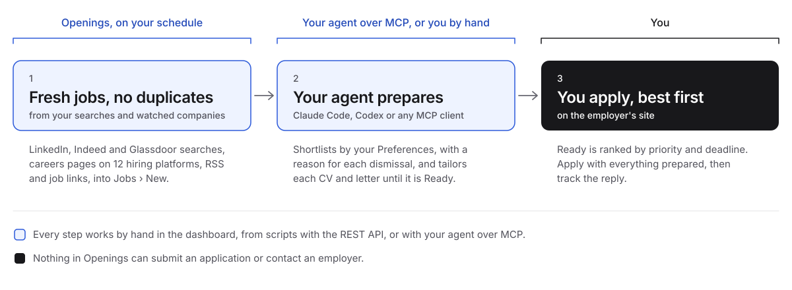
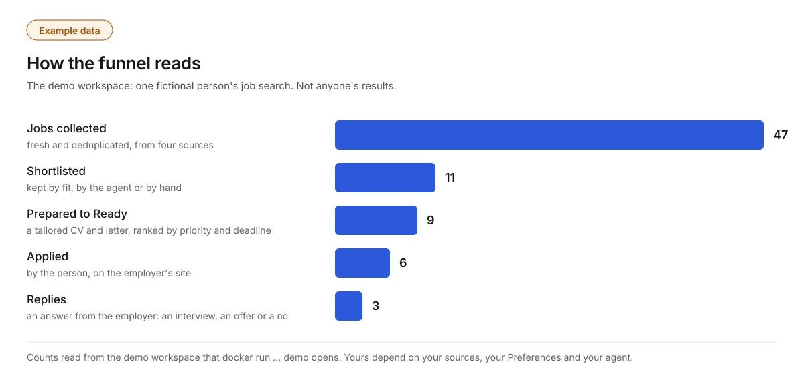

# Openings brand

The brand is the product. `frontend/src/ui/tokens.css` is the single source of
colour, type, spacing and radii; [tokens.md](tokens.md) is its table for both
themes, generated from it. Every image here is drawn from those tokens or is a
screenshot of the real dashboard, so a product change flows into the next
regeneration. This page holds what tokens cannot express.

## Files

| File | What it is |
|---|---|
| [mark.svg](mark.svg), [mark-dark.svg](mark-dark.svg) | The Doorway mark: the tile is a wall, the mark the light through an opening at its foot. Tile in `--primary`, opening in `--on-primary` |
| [mark-outline.svg](mark-outline.svg) | The same in one colour (`currentColor`), for any surface |
| [wordmark.svg](wordmark.svg), [wordmark-dark.svg](wordmark-dark.svg) | "Openings" in Inter 600, outlined to paths, in `--text` |
| [wordmark-mark.svg](wordmark-mark.svg), [wordmark-mark-dark.svg](wordmark-mark-dark.svg) | The wordmark with the mark |
| [tokens.md](tokens.md) | Every token, light and dark. Generated: do not edit |
| `docs/images/social-preview.png` | The GitHub social preview, 1280×640 |
| `docs/images/flow.svg`, `agent-vs-you.svg`, `funnel.svg` | The diagrams, each with a `-dark` twin |

## Regenerate

```bash
python3 scripts/brand_tokens.py               # docs/brand/tokens.md
npm --prefix frontend ci                      # the dashboard's Inter and Playwright
uv run python scripts/brand_diagrams.py       # the diagrams, both themes
npm --prefix frontend run screenshots -- --docs   # the real screens, docs/images/
node frontend/scripts/social-preview.mjs      # the social preview, from the Ready screen
```

`backend/tests/test_brand.py` fails when `tokens.md` is out of date, when an SVG
here or in `docs/images/` uses a colour that is not a token value, when diagram
text is under 14 px at 1200 px wide, or when the funnel's counts differ from the
demo seed.

## Rules

- **Accent.** One blue (`--accent`) marks what can be acted on and the agent's
  part of a diagram, never decoration. Success, warning and danger mean exactly
  that; "Example data" uses warning. Everything else is the neutral greys.
- **Type.** Inter only, weights 400, 500 and 600. Never 700.
- **Real UI only.** An image of the product is a screenshot of the dashboard
  showing the synthetic demo workspace, never a mock or a redrawn screen.
- **Synthetic data only.** No real person, company or job search in any image.
  Numbers come from the demo seed and say "Example data".
- **Voice.** Plain, short, concrete sentences. Name what the product does, not
  what it promises. Say "you" to the reader; "your agent" is the reader's own.

## Message

- **Tagline:** "Every new job, filtered, prepared and ranked. You just apply."
- **Short form:** "Collect. Prepare. Rank. You apply."
- **Three steps:**
  1. **Fresh jobs, no duplicates.** Your searches and watched companies, on your
     schedule.
  2. **Your agent prepares.** It shortlists by fit and tailors each CV and letter.
  3. **You apply, best first.** Ready is ranked by priority and deadline.
- **Three ways in:** use it by hand in the dashboard, from scripts with the REST
  API, or with your own AI agent over MCP. The operations are the same
  everywhere, and built-in skills cover each workflow.
- **Say:** fresh, deduplicated, tailored, ranked, best first; your agent, your
  Preferences; by hand, by API, by MCP. The queue of new jobs is **Jobs › New**.
- **Never imply** that you must re-filter what the agent prepared, or that the
  dashboard is only an Apply button: every action works by hand too.

## Claims register

Product facts only. No personal usage or outcome numbers anywhere.

**Allowed, true today:**

- Nothing in Openings can submit an application to an employer or contact one: no
  such operation exists. Mark applied only records what you did, and agents may
  use it.
- Every agent write is attributed, and History names the token.
- Non-destructive changes can be undone: dismiss ↔ New; close ↔ reopen; Applied →
  Shortlisted while there is no reply; pause ↔ resume.
- Permanent deletes happen only when the owner asks, in chat or through a
  standing rule. Daily verified backups exist, and the last three are kept.
- No AI inside, no API key, no account, no telemetry. You bring your own agent
  (Claude Code, Codex, any MCP client).
- One container, one SQLite file, amd64 and arm64, an image of about 70 MB.
- It collects from LinkedIn, Indeed and Glassdoor searches (guest endpoints, no
  login), company careers pages on 12 platforms that collect automatically (13
  adapters; Breezy is preview-only), the Hacker News "Who is hiring?" thread,
  RSS, and job links.

**True once 0.28.0 ships:**

- `docker run … demo` (#331).
- "Go through my new jobs" runs triage → prepare → priority and deadline → report
  (#359).
- A priority and a salary range per application, with an evidence note (#360,
  #348).
- Runs on a schedule from your own machine (#378).
- A first check right away (#332).
- No TeX distribution needed (#346).

**Banned:**

- "The agent can't mark applied" or "can't delete": both are false by decision.
- "It learns": say "your agent reads your corrections".
- "Autopilot", "applies for you", and "scrapes LinkedIn" as a lead.
- "Every job from every platform".
- Any salary figure not drawn from a stated basis.
- The mail word for Jobs › New, in the README and docs (`test_docs.py` refuses
  it).
- JobSync "has no ATS collection" or "needs a cloud account". It collects from
  Greenhouse, Lever and Ashby, uses Postgres with a local sign-in, and has an MCP
  server that adds jobs and questions.
- Personal usage or outcome numbers (jobs collected, applications prepared or
  sent, replies, offers). Diagrams that need numbers use the synthetic demo
  workspace, labelled "Example data".

## The images

The social preview, uploaded in the repository settings on release day:


<picture>
  <source media="(prefers-color-scheme: dark)" srcset="../images/flow-dark.svg">
  
</picture>

<picture>
  <source media="(prefers-color-scheme: dark)" srcset="../images/agent-vs-you-dark.svg">
  
</picture>

<picture>
  <source media="(prefers-color-scheme: dark)" srcset="../images/funnel-dark.svg">
  
</picture>
