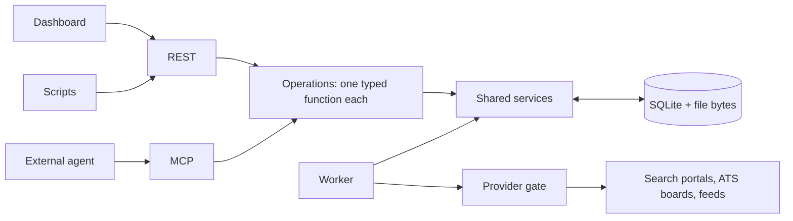
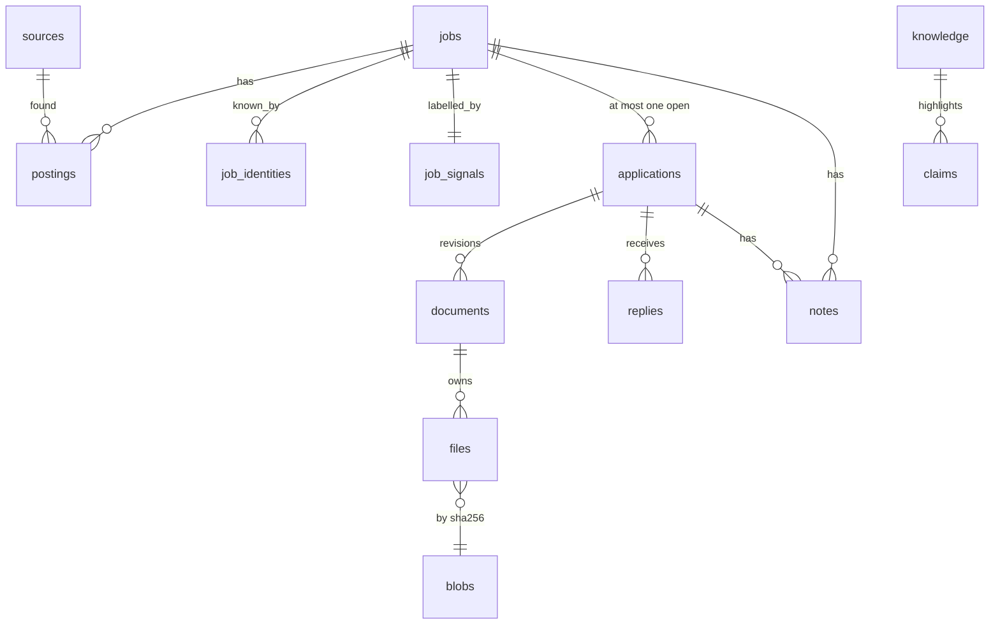

# Architecture

Openings is a FastAPI application, a React dashboard and one SQLite file. The core
runs no model, browser or TeX: an external agent generates and compiles, and uploads
the result.

## Layers



| Location | Responsibility |
|---|---|
| `backend/openings/interfaces/` | One module of typed operation functions per area, bound to REST and MCP; `transport.py` holds the hand-written routes |
| `backend/openings/workspace/` | Jobs, identities, triage, notes, applications, replies, readiness, timeline |
| `backend/openings/career/` | Profile, career entries, highlights, templates, import |
| `backend/openings/documents/` | Revisions, upload grants, file bytes, readable text of TeX and PDF |
| `backend/openings/discovery/`, `collectors/` | Sources, schedules, the provider gate, adapters |
| `backend/openings/preferences.py`, `stats.py`, `context.py` | Preferences and settings, Stats, the `workspace_context` start read |
| `backend/openings/events.py`, `actors.py` | The attributed change log; the actor label and batch id of a request |
| `backend/openings/backups.py`, `operations.py`, `compaction.py`, `retention.py` | Daily backups, restore, storage, pruning |
| `backend/openings/app.py`, `auth.py`, `mcp_server.py` | HTTP host, authentication, MCP server and its `instructions` |
| `backend/openings/schema.sql`, `migrations/` | The whole schema; the one supported upgrade |
| `frontend/src` | Dashboard calling REST through a client generated from OpenAPI |
| `skills/` | Agent skills (Agent Skills format), served read-only |

Services never import FastAPI routing or MCP registration; `interfaces/` binds
them. No module exceeds about 800 lines.

## Data model



Other tables: `settings`, `preference_sections`, `api_tokens`, `templates`,
`providers`, `collection_runs`, `tasks`, `transfer_grants`, `idempotency_keys`.
`knowledge` and `claims` hold career entries and highlights; visible names follow
`docs/user/how-it-works.md`. SQLite uses WAL and SHA-256-deduplicated blobs.

## Operations

Each operation is one typed function under `@operation` (`interfaces/operation.py`):

```python
@operation("PATCH /jobs/{job_id}", access=WRITE, tags=["jobs"])
def jobs_update(ws: WS, job_id: str, body: JobPatch) -> JobSummary:
    """Correct a job's fields. With the version jobs_get returned."""
    return ws.update_job(job_id, body)
```

- **REST:** FastAPI reads the function. The name is the `operationId`; the docstring
  is the summary and description; the return annotation is the response model.
- **MCP:** the tool has the function's name and description (at most 250
  characters) and flat arguments, the model's fields beside the path ids. Unknown
  arguments are refused. Schemas and results are compacted. `mcp="<tool>"` keeps an
  operation off MCP and names the tool that does its work.
- **Access:** `READ`, `WRITE`, `DESTRUCTIVE` set annotations and documented errors.
  `OWNER` operations call `actors.require_owner`, refuse an agent token and are REST
  only. `GET /api/v1/capabilities` lists each operation's name, route and access.
- **Transport routes** (sign-in, backup, restore, export, file transfers, `/health`,
  `/mcp/`) are written by hand and listed in `TRANSPORT_ONLY` with a reason.
- **Conventions:** tools are `<resource>_<verb>`. A batch write takes `items`,
  applies each on its own and returns a `BatchResult`. Updates and deletes name
  `expected_version`; every 409 names `details.current_version`; creates take an
  `idempotency_key`. Every request or tool call has one `batch_id`.

Parity runs one way: every dashboard action is a REST operation, and every
operation that is not owner-only is an MCP tool or names one. REST is the superset.
`openapi.py` completes the document (tags, `bearerAuth`, the `Error` model,
examples); the dashboard's types are generated from it (`npm --prefix frontend run
api:gen`; CI fails on a stale `schema.d.ts`). The agent's interface is 44 tools. The server sends `instructions` on initialize
(`mcp_server.INSTRUCTIONS`): start with `workspace_context`, load the skill for the
task, and the hard limits. `workspace_context` returns the workspace, counts,
settings, profile, Preferences, a career summary, templates, skills and `feedback`:
the owner's corrections of agent work since the token's last read.

## Invariants

- **Identity:** normalized URLs and external keys resolve through retained aliases.
  Conflicting identities need an explicit merge; similarity never merges. Duplicate
  candidates are read-only suggestions.
- **Triage and applications:** triage is `new`, `shortlisted` or `dismissed`.
  Shortlisting starts the application in the same transaction; starting one
  shortlists its job. Each job has at most one non-Closed application, enforced by
  the service and a partial unique index. Closing needs an outcome. Mark applied is
  the owner's act, never automatic. Forget removes job-owned records.
- **Ready** is computed in one SQL expression and one function
  (`workspace/readiness.py`): Shortlisted, every required document (`cv`, `letter`)
  has a complete current revision, no blocking requirement is open.
- **Documents:** a CV or letter revision is a required PDF and an optional TeX
  source. It is incomplete until its PDF is stored, then complete and immutable.
  With a source, the PDF names its SHA-256 and a mismatch is refused. Readable text
  comes from the source (`documents/text.py`) or the PDF (pypdf), never a TeX runtime.
- **Preferences:** five free-text sections, replaced whole under a version; only
  `no_reply_days` and `spoken_languages` are typed. Signals label and filter; nothing
  dismisses a job automatically.
- **Attribution and concurrency:** each write records an actor label (`owner`,
  `agent:<token name>`, `system`) and the batch, never content. Typed inputs,
  versions, idempotency keys and short transactions; one process per workspace.

## Provider gate

Every provider request goes through the persisted gate (`discovery/service.py`,
`collectors/pinning.py`): previews, URL imports, runs, redirects and detail fetches.
It stores spacing and cooldowns, honours 429 and `Retry-After` and pins resolved
addresses against DNS rebinding. Never use an unguarded HTTP client. Incomplete
automatic candidates stay in the run's checkpoint until usable text exists.

## Upgrades

`schema.sql` is the whole layout and runs once, on a new file. A workspace of the
previous schema is upgraded by the one migration in `migrations/` (`MIGRATIONS` has
one key, `SCHEMA_VERSION - 1`); older ones are refused with the release to open
first. The migration is frozen with its release, imports only the standard library
and builds a new file from `schema.sql`, copying data in one transaction. It writes
removed records to a JSON archive beside the database, verifies the result, then
keeps the original as the pre-upgrade copy. `test_upgrade.py` upgrades a real fixture
(`backend/tests/fixtures/workspace-<schema>.sql.gz`) and compares it to a new file.
Until its release ships, edit the migration instead of adding one.

## Backups and tests

The worker writes a daily verified `VACUUM INTO` copy, rotated by `OPENINGS_BACKUP_KEEP`
and skipped when room is short; an agent token's backup drops credentials, and restore
keeps the destination's authentication. Guards: `test_parity.py` (one-way parity),
`test_mcp_budget.py`, `test_openapi.py`, `test_migration_policy.py`, `test_upgrade.py`
and `test_docs.py` (user docs size, links and vocabulary).
