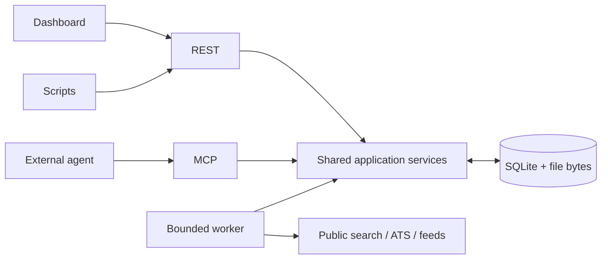

# Architecture

Openings is a FastAPI application, React dashboard and SQLite workspace. Agents, browser automation and
TeX compilation run externally; the core uses no model runtime.

## Code map

| Location | Responsibility |
|---|---|
| `backend/openings/workspace/` | Job identities, triage, notes, application attempts and reporting |
| `backend/openings/duplicates.py`, `duplicate_signals.py` | Read-only duplicate candidates: per-job signals, pair confidence and groups |
| `backend/openings/language_signals.py` | Deterministic text signals: the posting's language and the languages it requires or welcomes |
| `backend/openings/job_signals.py` | Ingest signals of each job (stored, backfilled), listing observations, the dismissal record and policy rules applied to new jobs |
| `backend/openings/source_yield.py` | Yield of each collection source and search, from collected jobs to employer answers |
| `backend/openings/career/` | Profile, detailed evidence, claims, templates and instructions |
| `backend/openings/policy/` | The owner's policy: four sections of items, section versions, owner confirmation, signal rules |
| `backend/openings/documents/` | Frozen contexts, document revisions and scoped file transfers |
| `backend/openings/snapshots.py`, `compaction.py` | Content-addressed storage of frozen contexts; giving freed pages back to the data volume |
| `backend/openings/retention.py` | Refresh events, what an observation stores, pruning of finished collection runs and tasks |
| `backend/openings/operations.py` | Backup credentials, restore, the room a restore needs and storage status |
| `backend/openings/idempotency.py` | Idempotency keys of the creates whose records have no key column |
| `backend/openings/activity.py`, `actors.py` | Actor of each change, agent runs with reports, questions for the owner, change log |
| `backend/openings/agent_requests.py`, `subjects.py` | Requests for the agent; the subject reference shared with questions |
| `backend/openings/discovery/` | Typed sources, schedules and queue operations |
| `backend/openings/collectors` | Adapter capability catalog, typed options and shared HTTP policy/runtime |
| `backend/openings/worker.py` | Independent scheduling and acquisition lanes |
| `backend/openings/interfaces/` | REST routes and MCP tools of each area, bound to the shared services |
| `backend/openings/app.py`, `auth.py` | HTTP host: authentication, middleware, error bodies, the MCP mount and dashboard hosting |
| `backend/openings/schema.sql` | Relational ownership, SQLite indexes and JSON payloads |
| `frontend/src` | Dashboard using REST; no duplicated domain decisions |
| `backend/openings/skills.py`, `skill_notes.py` | Shipped skills served read-only; per-workspace local notes appended when a skill is served |
| `skills/` | Agent workflow skills (Agent Skills format) and their shared references |

The [operation inventory](../../backend/openings/operation-inventory.json) is
generated from the operation declarations (see below), packaged with the app and
served by authenticated `GET /api/v1/capabilities` and `capabilities_get`. OpenAPI at `/api/openapi.json` and discovered MCP schemas are
authoritative for individual input fields. The generated
[parity matrix](parity.md) shows each operation's REST route, MCP tool and real
dashboard path with the browser tests that used it, and the documented
exemptions; `pytest` and the browser tests in CI fail on any other difference
(see [Contributing](../../CONTRIBUTING.md#parity)). Read [REST](../user/api.md) and
[agent](../user/agents.md) guides for usable examples.

## Module map

No backend module exceeds about 800 lines. A large service is a package whose
`service.py` defines the class other code uses; that class is composed of one
class per concern, each in its own module, and the package's `__init__.py`
re-exports the service and its inputs, so `from openings.workspace import
Workspace` keeps working. The composed classes share the service's state
(`self.db`, `self.workspace`) and call each other through `self`; a method
belongs to the module of its concern.

| Package | Modules |
|---|---|
| `workspace/` | `service.py` settings and the attributed change log; `jobs.py` job reads, filters and search; `job_changes.py` ingest, corrections, triage, rule dismissals and Forget; `identity.py` URL lookup, duplicate candidates, distinct marks and Merge; `notes.py` notes, their author, run and pin, and the deprecated application note; `timeline.py` the timeline of a job or an application; `timeline_upgrade.py` the timeline part of the schema 12 to 13 step; `applications.py` derived readiness, preparation summaries, lists and history; `application_changes.py` one open attempt per job, stages, responses, Ready and deletion; `bulk.py` per-item bulk results; `overview.py` the funnel |
| `discovery/` | `service.py` the provider gate (`http_budget`, `fetch_bytes`); `models.py` typed inputs; `network.py` the public-address policy and the bounded fetch; `resolution.py` board detection and source configuration; `feeds.py` posting readers (Lever, Ashby, RSS) and adapter dispatch; `sources.py` source schemas, preview and writes; `runs.py` the global switch, provider policies, queueing, scheduling and run records; `tasks.py` leases, retry and running one collection |
| `documents/` | `contexts.py` frozen contexts and their staleness reports; `revisions.py` creation, cited evidence, review, comparison and deletion; `sources.py` the source and PDF of a CV or letter and its derived text; `text.py` readable text of a TeX source; `latex.py` what CV and letter class commands print; `files.py` owned files and scoped transfer grants; `models.py` inputs; `upgrade.py` the schema 12 to 13 step |
| `career/` | `profile.py` Profile and instructions; `entries.py` Career entries; `claims.py`; `templates.py`; `imports.py`; `models.py` inputs and defaults; `records.py` row helpers shared with documents |
| `policy/` | `service.py` item writes, confirmation and rule preview; `models.py` sections, the signal registry `SIGNALS` and inputs; `records.py` records as read and the frozen policy; `upgrade.py` the schema 9 to 10 step |
| `interfaces/` | One module per area declaring its operations and binding them to its service: `core.py` (workspace, jobs, notes, applications, overview), `career.py`, `documents.py`, `discovery.py`, `activity.py`, `agent_requests.py`, `policy.py`, `outcomes.py`, `insights.py`, `source_yield.py`, `skills.py` and `system.py` (sign-in, tokens, inventory, backup, restore, examples, export); `registry.py` the declaration and its binding |

Services never import FastAPI routing or MCP registration; `interfaces/` binds
them, and `app.py` calls each area in a fixed order. Smaller concerns stay single
modules (`activity.py`, `outcomes.py`, `insights.py`, `staleness.py`,
`job_signals.py` and the others in the code map). When a module approaches the
limit, split it the same way rather than growing it.

## Operation declarations

Each logical operation is declared once, as an `Operation` in its area's
`interfaces/` module (`OPERATIONS`): its inventory id, group and label, its
`resource` and `verb`, its parameters (`Param`), the service call, its REST
routes (`Route`: method, path, route name, status code) and its MCP tool
(`Tool`: annotations, description), and `access="owner"` where the service
requires owner authority. `registry.bind_rest` and `registry.bind_mcp` generate
the FastAPI routes and MCP tools from it, both calling the same service code:

- A parameter is declared once with its MCP annotation and default; `Param.rest`
  gives REST's when it differs (a query model through `query_model`, a bounded
  integer). A route or tool can replace the parameters or the call for itself,
  as when one tool has two REST routes.
- `Tool.method` makes the service method itself the tool (Career, documents);
  `Tool.offload` runs the call in a worker thread from an async tool, for tools
  that reach the network; an async call makes both transports async.
- `custom=True` marks a route or tool registered by hand next to the
  declarations, because it needs the HTTP request, cookies, streamed bytes or
  the MCP context: browser sessions, the password change, the inventory,
  backup, restore, export, file transfers and `workspace_info`. It is still
  declared, so the inventory lists it.
- `EXEMPTIONS` declare the documented transport differences (session routes,
  health, the MCP transport, examples, raw transfers, immutable records) and
  `SURFACES` the hand-registered MCP resource and prompts.

REST routes are registered in declaration order, which matters for matching
(`/jobs/resolve` before `/jobs/{job_id}`); MCP tools follow the same order within
an area. A tool is named `canonical_name`, `<resource>_<verb>` with a plural
resource (decision 11); no tool is named by hand, so a clearer name means a
clearer `resource` or `verb` (`files_reserve_upload`, `workspace_backup`,
`tokens_revoke`). A singular resource names one record of the workspace or a
mass noun (`profile`, `policy`, `workspace`, `knowledge`, `staleness`).

A tool's arguments have one shape: the record ids a REST path names, flat;
`expected_version` of a delete, flat; and one `value`, the REST body of a write
or the query string of a read (`query_model`). Every paged list returns `items`,
`total`, `limit` and `offset` and summaries by default; every delete names
`expected_version` (a file's version is always 1: files never change); every
create accepts `idempotency_key`. Records without a key column keep their key
in `idempotency_keys` (`idempotency.py`: the table, the key, a SHA-256 of the
request and the record's id; a key whose record is gone is free again).

The names and shapes before 0.22 stay until 0.23. `aliases` lists a tool's
earlier names: `bind_mcp` registers each as the same tool, its description
starting "Deprecated alias of <name>; removed in 0.23.", and the inventory lists
it after the tool's name. An `Alias` with `params` keeps the arguments the
earlier tool took, where the new tool takes them differently.
`Tool.legacy` names the `value` fields a tool still accepts as deprecated flat
arguments, for the lists that took flat filters before. `scripts/inventory.py`
writes the tables of both into the [upgrade guide](../user/upgrading-0.22.md).

`scripts/inventory.py` writes `operation-inventory.json` from the declarations
and `interfaces/inventory-notes.json`, which holds the inventory's order,
dashboard locations and remarks. `pytest` fails while the file or the upgrade
guide's tables are out of date, or when a declared route, tool or surface is not
registered.

## Data and workflow rules

- **Identity:** normalized URLs and stable external keys resolve through retained
  aliases. Conflicting identities require explicit Merge; title/company similarity
  alone never merges jobs. Dismissal survives URL changes. Duplicate candidates
  are a separate, read-only suggestion: deterministic signals (requisition IDs,
  apply targets, location, posting text, company and title) give each pair a
  confidence in [0, 1], and nothing is merged or stored. Per-job signals are kept
  in memory and recomputed only for jobs whose version changed.
- **Corrections:** source refreshes preserve user edits, triage and application
  attempts.
- **Refreshes:** seeing a posting again updates its observation (`last_seen_at`,
  `content_hash`) and leaves no event. A refresh that changes the title, company,
  location or posting text leaves one `job_refreshed` event naming those fields.
  An observation's `payload` holds only what is read back: `source_key` (finding
  the observation again) and `raw.job_url_direct` (the employer's apply link used
  by duplicate scoring); add a field there only together with its reader.
- **Lifecycle:** triage (`inbox`/`saved`/`dismissed`) stores interest independently.
  The derived `queue=inbox` and `queue=shortlist` exclude any application history;
  Shortlist requires saved interest. Starting an application retains saved interest
  and creates Preparing (`draft`), removing it from pending queues. Closed attempts
  stay in Applications. Deleting the final attempt deliberately restores pending
  queue membership; closing as not pursued preserves preparation history.
  Draft/Applied/Interview/Offer/Closed belongs to the application; each job permits
  one non-Closed attempt, enforced by the shared service and a partial unique
  index. Reopening and merging respect that constraint. Closing requires an
  explicit outcome. Forget permanently removes job-owned records.
- **Snapshots:** preparing a context freezes the job, career evidence, instructions,
  questions, selected templates and exact assets. Later profile edits affect new
  contexts. A changed document is a new revision with its own uploaded files.
  Attachment changes increment the document version; approval checks that version
  so concurrent uploads cannot be approved unseen.
- **Documents:** a CV or letter revision (`SOURCE_KINDS`) is its files: one
  `.tex` source and one PDF, whose upload names the source's SHA-256
  (`files.source_sha256`); a PDF of another source is refused before its bytes
  are stored (`documents/sources.py`). It stores no content (`content` stays
  `{}`), only the claim and Career entry ids it cites, an optional note and the
  text derived from its source when the source arrives (`documents.text`).
  `documents/text.py` derives it without a TeX runtime, as a reader sees the
  PDF: the body after `\begin{document}`, the source's own `\newcommand`/`\def`
  macros expanded a bounded number of times, the commands of CV and letter
  classes printed as they print (`documents/latex.py`: the moderncv title from
  the preamble's personal data at `\makecvtitle`, `\cventry`/`\cvitem` columns,
  the moderncv, `letter` and `scrlttr2` openings, closings and sender details,
  link text), comments, settings and the options of unknown commands removed
  (their brace arguments stay as text), accents composed, and the breaks TeX
  makes kept as lines. The same source always gives
  the same text, so the stored text can be checked against it; a parser change
  needs a schema step that derives it again. Approval of a CV or letter requires
  its source and PDF. `compare_documents` diffs two revisions' text by line with
  `difflib`; form answers keep structured content and compare it as
  `path: value` lines. Content a CV or letter stored before schema 13 is kept
  read-only in `legacy_content`.
- **Snapshot storage:** a context's payload is one canonical JSON text, and its
  signature is the SHA-256 of that text. `snapshots.py` stores the text as a frame
  of literals with one part between each pair: every Career entry, claim and
  template, the Profile, the job and the general instructions are parts, stored
  once in `snapshot_parts` under the SHA-256 of their own text and shared by all
  contexts (`context_parts`; a list part names its items in `snapshot_list_items`).
  Reading a context concatenates frame and parts, so payload and signature are
  reproduced byte for byte without re-encoding; a payload without the canonical
  form is kept whole. A context's asset files are parts too: the part names the
  blob, the reference keeps the file id the payload exposes, and the `all_files`
  view serves them beside the rows of `files`. Deleting an application or job
  removes the parts and bytes nothing references any more, in the same transaction
  or once per bulk run. Foreign keys make a dangling reference impossible.
- **Staleness:** contexts are never rewritten. `context_inputs` is derived from
  each payload: the versions it froze, the policy section versions (NULL before
  schema 10) and `parts`, a 16-hex-digit SHA-256 prefix of each Profile part,
  each policy item (with its label, scope and confirmation), the general
  instructions and the content of each template, entry and claim. `staleness.py`
  compares them with the live records on read, only for what documents use
  (`DOCUMENT_PROFILE_PARTS`, the confirmed items of `DOCUMENT_POLICY_SECTIONS`,
  `RECORD_FIELDS` of templates, entries and claims, prose with whitespace runs
  collapsed): a moved version settles on its content hash, an equal version needs
  no read. It filters a scoped writing item per document kind. Rows without part hashes, or of another
  `PARTS_FORMAT`, are derived again from the frozen payload when the workspace
  opens or a report reads them; a payload that cannot be read stores no part
  and is compared by whole Profile version. Refreshing means a new context and
  new revisions.
- **Policy:** `policy_sections` holds one version per section (`decision`,
  `eligibility`, `writing`, `facts`) and `policy_items` their items in a dense
  order. An item write names its section's version and bumps it by one; a move
  names and bumps both sections. `confirmed_at` is set only by owner authority:
  a content write (label, statement, value, scope, rule) by the session or an
  owner token confirms, the same write by an agent token clears the
  confirmation and switches the rule off, and `policy_confirm` and enabling a
  rule call `actors.require_owner`. A value is typed (text, number, date,
  boolean, list); `structured` exists only for a value copied by the upgrade and
  cannot be written. A decision rule `{signal, condition, action}` is validated
  against the registry `policy.SIGNALS`; `job_signals.SignalService` applies an
  enabled, confirmed rule once to a new job when its signal arrives (see Signals).
  Preparing a context freezes the four sections (`payload.policy`), each as its
  own content-addressed part, so a section is stored again only when it changes.
- **Signals:** `job_signals` holds one row per job: the posting's language and
  confidence, required language groups (one language of a group suffices) and
  welcome languages from `language_signals` (weighted function words and phrase
  cues in English, German, French and Italian; no model), computed in the
  ingest transaction and again when the title or posting changes
  (`content_version`, `format`). The likely duplicate (`duplicate_of`,
  `duplicate_confidence`, from the medium tier up, only against jobs collected
  earlier) is computed after the ingest transaction from the cached
  `DuplicateIndex`, which gains each new job in place; `distinct_from` keeps the
  pairs the owner or an agent declared different. `postings.unlisted_at` is set
  when an uncapped run of a company board completes without listing a posting
  whose job matches the source's filters, and cleared when it is seen again.
  Rules act only on an untouched job (Inbox, no application, no triage change)
  collected by a source or an agent, never on one the owner added in the
  dashboard: `dismiss` sets the dismissal record with the rule's item id and
  label (`jobs.dismissed_*`, also written for every manual dismissal and cleared
  on restore), `flag` records the rule in `job_signals.rules`. Duplicates are
  never merged. A restored job keeps its triage event, so a rule never acts on
  it again. `PolicyService.preview_rule` counts the Inbox jobs a rule would
  match. `source_yield` attributes each job to the source of its earliest
  observation and counts its outcome once.
- **Truth:** approved claims and narrative evidence guide an external agent;
  reference/length validation does not establish factual accuracy. Review outputs.
- **Career:** entries have structured organizations, nullable partial dates, skill
  tags and ordering. Descriptions are optional; claims contain free reusable text.
  Reserved structured fields are stored once, outside arbitrary metadata.
- **Attribution:** authentication sets the actor (owner session, named API token
  with its kind, or system) in a context variable (`actors.py`) that reaches the
  shared services through thread offloading; worker threads start with an empty context and
  record the system. Every write leaves one event with its subject, actor and,
  for a token with an open run, that run. Payloads hold identifiers, field names
  and versions, never content. Events of a job or application are deleted with
  it; the deletion itself stays recorded.
- **Timeline:** a note belongs to a job, or to one of its applications
  (`application_id`), and records its author and run. A job and an application
  each have at most one pinned note (`pinned_at`; two partial unique indexes);
  pinning a note unpins the previous one, both recorded as `note_pinned` and
  `note_unpinned`. `Workspace.timeline` is the one read of a job's or an
  application's notes and events: a `UNION ALL` of both tables with the scope
  (`job`, or `application` when the row has an `application_id`), the kind
  (`note`, `event`, or `response` for an event whose subject is a response), the
  actor and the run, filtered by kind, who, scope and period, ordered pinned
  first and then by time, with counts by kind. An application's timeline holds
  its rows and its job's rows without an application. `note_added` and
  `note_edited` are not entries: the note is. The application's pinned note is
  what the deprecated `application.note` reads and writes until 0.23, and what
  a new context freezes as `application.note` and
  `instructions.application_note`.
- **Runs and questions:** a token has one open run (a partial unique index); its
  writes attach to it. A run without activity is reported as interrupted but
  only an explicit supersede closes it. A finished run stores its report and
  change counts. Questions reference a job, application or Career entry with
  `ON DELETE SET NULL` and keep a label, so they outlive their subject.
- **Requests:** the mirror of questions. The owner writes a request (owner
  authority), an API token takes it and completes or declines it, and the owner
  may withdraw it until then. The request records the run of the token that
  handled it when that token has an open run; taking without a run is allowed.
  Like questions, requests reference a job, application or Career entry with
  `ON DELETE SET NULL`, keep a label and follow a job through a merge. The
  server runs no agent: a request is only read.
- **Skill notes:** skills ship with the server and are never edited. A
  workspace keeps local notes per skill in `skill_notes`, one immutable row per
  version (at most 2,000 characters; the highest version is current, so the
  earlier versions are the history). A save names the version it replaces (0
  for the first) and leaves an attributed `skill_notes_updated` event with the
  skill and version only. `skill_notes.serve` is the one place that appends the
  notes to `SKILL.md` under "Local notes for this workspace", for REST,
  `skills_get` and the MCP prompts alike; reference files are served as shipped.
  Any authenticated actor may write: the agent discovers what a workflow lacks
  while running it, the notes stay in the workspace, and each version names its
  author and can be restored. A finished run's `method` is listed with the run
  so the owner can turn it into notes.
- **Token scope:** a token is `owner` or `agent`. Owner-only operations call
  `actors.require_owner` in the shared service, so REST and MCP refuse an agent
  token alike with `403 forbidden`; the inventory marks them `access: owner` and
  `test_interfaces.py` calls each one. Scoped operational grants (backup, export,
  restore) carry the requesting actor. A backup made for an agent token has the
  installation's password hash, session secret and tokens removed from the copy.
- **Ready:** every shared service that changes what Ready was judged on clears it
  in its own transaction through `Workspace.clear_ready`: a new revision or
  context, a deleted revision, a file added to a current revision, an unresolved
  blocking requirement, leaving Preparing. Each clearing bumps the application
  version and leaves an attributed `application_ready_cleared` event with its
  reason. A new operation that changes current revisions must call it too.
- **Concurrency:** typed inputs, optimistic versions, idempotency keys, foreign
  keys and short transactions protect shared state. Run one application process
  per workspace; database connections do not cross threads. Every deletion
  names the current version; a note, revision or file deleted without one is
  accepted until 0.23.

SQLite uses WAL and stores SHA-256-deduplicated BLOBs for attachments. Lists return
compact paginated summaries; full postings, narratives, contexts and file bytes
are separate reads. Application preparation summaries count current revision leaves
and their exact PDF/review state; derived readiness combines them with unresolved
blocking employer requirements stored on the application. Ready is a stored step
on top of that derivation (`ready_at` and who set it): marking is refused while a
check fails, `readiness` reports `ready` only while the mark and every check hold,
and `reviewed` when the checks pass without the mark. Byte downloads and record exports prepare a
temporary snapshot on the database thread before streaming, preserving bounded
memory and releasing SQLite readers before cancellation or thread changes.
Backups use SQLite's online backup API. A restore preserves
installation authentication, recent provider request history and later cooldowns.

Workspaces and backups use schema 13 (0.22), the breaking group. The timeline
part of `_migrate_12_to_13` (`workspace/timeline_upgrade.py`) adds `run_id`,
`pinned_at` and `origin` to `notes`, copies each non-empty `applications.note`
into one pinned note of its application (`origin='upgrade'`) attributed to the
actor and run of the last event that set it (the last `application_updated`
naming `note`, else `application_created`) and dated by it, else by the
application's `updated_at`, compares every copy with its source byte for byte,
then drops `applications.note`. It writes no event and changes no other value;
frozen contexts are not touched. Restore accepts schema 13 and upgrades a copy
of a schema 5 to 12 backup.

The documents part (`documents/upgrade.py`, `migrate_to_13`, run after the
timeline part in the same transaction): documents gain `text`, `legacy_content`,
`note`, `claim_ids` and `knowledge_ids`, files gain `source_sha256` (NULL for
every existing file) and the `all_files` and `context_files` views are built
again with it. A CV or letter revision's content moves byte for byte to
`legacy_content` (`{}` to NULL) and `content` becomes `{}`; the ids any
revision's content cited are copied to `claim_ids` and `knowledge_ids`; the text
of every revision with a `.tex` source is derived and stored (several sources:
each in file-name order). Ids, files, hashes, review states and versions do not
change. Measured on a synthetic workspace of 4,000 CV and letter revisions with
8,000 files on a laptop: 0.8 s.

Schema 12 (0.21) was an additive change. Opening schema 11 is an additive
change in one transaction (`_migrate_11_to_12`): it adds the `skill_notes` table
(`skill_notes.migrate`) and, through `job_signals.migrate`, the `job_signals`
table, the dismissal record columns of `jobs` (`dismissed_at`, `dismissed_by_*`,
`dismissed_rule_id`, `dismissed_rule_label`, `dismissed_reason`),
`postings.unlisted_at` and their indexes. Dismissed jobs get the time and actor
of their last dismissal event (none when no event exists: they count as
"other"), and the postings each company board's last complete run did not list
are marked. No other value changes. The text and duplicate signals of existing
jobs are computed after the upgrade by `SignalService.backfill` on the warm-up
thread, in batches of 200 jobs, without applying rules; jobs read
`computed: false` until then. Measured on a synthetic workspace of 25,000 jobs
with postings of about 3,000 characters on a laptop: the migration takes 0.3 s,
the text signals 7 s, the duplicate index 3 s and the duplicate signals 0.5 s;
a small host takes several times longer, in the background.

Schema 11 (0.20) was an additive change with one table rebuild. Opening schema 10 adds the
`responses` table (an employer's answer to a sent application: kind, date, note,
whether the date is estimated, how it was recorded, attribution, version and
idempotency key; one per application, kind and day except `other`) and rebuilds
`applications` to allow the `no_response` outcome and add `concluded_on`. The
rebuild copies every row with its rowid, recreates the table's indexes and
triggers from their saved SQL and runs with foreign keys off; the upgrade fails
unless `foreign_key_check` reports nothing it did not report before. It then
records one response, by the system and without an event, for each application
in Interview or Offer and each rejected one with a sent date: dated by the last
event that moved it to that stage, else its last change with `estimated` set.
Nothing else changes. `outcomes.no_reply_period` is the only definition of the
no-reply period (the days of the Policy decision item labelled "No reply",
confirmed items first, else 30); `insights.py` maps titles to role family and
seniority with fixed keyword tables and no model.

Schema 10 (0.19) was an additive change. Opening schema 9
creates the policy tables, adds `default_in_cv`, `role` and `group` to `claims`
and `policy` to `context_inputs`, and copies the Profile's free-form values:
one unconfirmed `facts` item per top-level `metadata` key, holding the original
value (`origin`, `origin_key`), and one unconfirmed `decision` item each for the
`preferences` and `roles` text. The Profile row, every Career entry, claim and
template and every frozen context are left as they were. A claim field is
filled from `metadata` only when a key has the field's name and a valid value
of the field (`db.CLAIM_FIELDS_FROM_METADATA`).

Schema 9 (0.18) was a storage-only change: opening schema 8
moves every frozen context into content-addressed parts and its asset files out of
`files`, compares each rebuilt payload with the stored text, and then drops the
old column, all in the upgrade transaction; contexts gain summary columns for
lists. When at least a quarter of the file (and `OPENINGS_COMPACT_MIN_MB`, default
32) is free afterwards, or after large deletions, `compaction.py` rewrites the file
at start: a compact copy beside the database is copied back in one transaction, so
an interruption leaves the previous file valid and the next start tries again.
The same upgrade step (`retention.trim_history`) deletes `posting_updated` events
that recorded a re-sighting, turns the others into `job_refreshed`, and reduces
stored provider payloads to the two values above; the compaction returns the
freed pages. A database already at the unreleased schema 9 does not get this.

Retention is one environment setting, `OPENINGS_RETENTION_DAYS` (default 90, 0
off). The scheduler thread calls `retention.prune` at start and every six hours;
a pass is one short transaction that removes at most 500 finished collection
runs (their tasks cascade), finished tasks without a run and the change records
of removed runs and tasks, and repeats after a minute while more remain. A run
with a queued or running task is never finished, the 20 most recent finished
runs of every source stay, and events of jobs, applications and agent runs are
never pruned.

A restore of *B* bytes over a database of *D* bytes needs 3 *B* + *D* +
max(0, *B* − *D*) + 64 MiB free on the data volume: the upload, the upgraded
copy, the rollback copy, the write-ahead log that receives the restored pages
and the growth of the file. `operations.restore_limit` inverts that for the
free space; `OPENINGS_MAX_RESTORE_MB` only lowers it. The route refuses a larger
upload before writing it and the service checks the replacement's room again
with the real sizes. `storage_status` feeds `GET /workspace` and
`workspace_info`.

Schema 8 shipped with 0.17.0. Opening schema 7 upgrades it in the same
transaction: events gain a subject, an actor and a run, notes gain an author,
applications gain `ready_at` with who set it, API tokens gain a kind, and the
`runs`, `questions` and `requests` tables are added; existing rows keep every value, read as
"unknown (before 0.17)" and are not marked ready, and existing tokens become
owner tokens with unchanged access. Schema 6 is upgraded through schema 7 in the same
transaction (application priority, deadline and requirements), and schema 5
through schema 6 (removing obsolete derived data and preserving owned records and
immutable snapshots). Restore accepts schema 13 and upgrades a copy of a schema 5,
6, 7, 8, 9, 10, 11 or 12 backup. Other historical formats require the matching release.

## Acquisition

A saved search has one explicit query/location and provider selection. Company
sources watch selected ATS boards/feeds with optional title/location filters.
Collected candidates reach the shared ingestion service only after usable posting
text is available. Pending descriptions remain in the existing task checkpoint;
manual job input can intentionally be incomplete. New sources start paused.
A shared adapter catalog drives typed configuration and description capabilities.
Metadata-only adapters can be previewed but cannot create automatic watches;
unavailable public Ashby boards receive an actionable permanent error. Source service is immutable;
versioned bulk patches merge compatible fields without replacing untouched config.

A collection invocation freezes effective source configuration and optional run-only
overrides, then groups provider tasks under one run ID. Each task persists its
pagination/detail checkpoint between bounded attempts. Counts accumulate across
retries and waits; source summaries reference one invocation. Daily schedules store
local time slots and timezone, independently of execution timestamps; missed slots
coalesce while a run is active. Pausing automation stops future enqueueing;
explicit cancellation stops an active run.

Every HTTP attempt uses the persisted provider gate: search, detail, preview,
manual import and redirects. Provider settings contain enable/pause and minimum
request spacing, defaulting to five seconds. Recent request counts are informative.
Internal bounded attempts yield with their checkpoint intact; ready tasks are
ordered by next execution time. Actual 429/503 responses can set durable
Retry-After cooldowns, with increasing delays for a 429 lacking that header.
Long waits release the collection lane. Provider-wide access challenges and
individual unavailable postings have distinct diagnostics.

All outbound fetch paths share one address policy. A host is resolved, every
address must be public, and the connection is made to a checked address on each
attempt and redirect hop: httpx through its network backend, provider `requests`
sessions through a connection adapter and `curl_cffi` sessions through curl's
resolve pinning. TLS still verifies the requested host name.

The scheduler and collector progress independently. Network-capable MCP tools
run outside the event loop. Queued tasks have leases and cancellation; stale work
cannot overwrite a current result. See [source configuration](../user/sources.md).

## Extending the app

Add behavior in the shared service before exposing it through REST, MCP and the
dashboard: the method goes in the module of its concern (see the module map),
and one `Operation` declaration in the area's `interfaces/` module gives its
route and tool. Add its dashboard location to `interfaces/inventory-notes.json`
and run `uv run python scripts/inventory.py`; build its dashboard path with a
browser test that uses it and record the evidence with
`uv run python scripts/parity_matrix.py --e2e`. Keep
operator/bootstrap and raw-byte transport differences explicit.

Provider adapters emit bounded structured postings and use the shared HTTP gate.
Keep endpoint-specific parsing in the adapter, preserve partial successful results
and canonical filter metadata, and test failed/empty/malformed responses. The
[vendored JobSpy subset](../../backend/openings/_vendor/jobspy/PROVENANCE.md) records
its pinned upstream source and local transport changes.

Use the focused checks and manual workflow guidance in [Contributing](../../CONTRIBUTING.md).

The accepted product direction is in the [redesign proposal](proposal-redesign.md);
the dashboard design and its static prototypes are in [dashboard design](dashboard-design.md).
