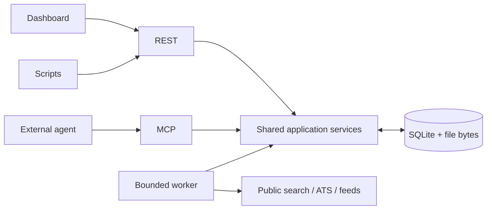

# Architecture

Openings is a FastAPI application, React dashboard and SQLite workspace. Agents, browser automation and
TeX compilation run externally; the core uses no model runtime.

## Code map

| Location | Responsibility |
|---|---|
| `backend/openings/workspace/` | Job identities, triage, notes, application attempts and reporting |
| `backend/openings/duplicates.py`, `duplicate_signals.py` | Read-only duplicate candidates: per-job signals, pair confidence and groups |
| `backend/openings/language_signals.py` | Deterministic text signals: the posting's language and the languages it requires |
| `backend/openings/job_signals.py` | Ingest signals of each job (stored, backfilled), listing observations and the dismissal record; labels and filters, never a dismissal |
| `backend/openings/stats.py` | Stats of sent applications in a period: replies, interviews, the median days to a reply, the funnel and replies by source |
| `backend/openings/career/` | Profile, detailed evidence, claims and templates |
| `backend/openings/preferences.py` | The owner's Preferences: five free-text sections with their versions, and the settings `no_reply_days` and `spoken_languages` |
| `backend/openings/documents/` | Frozen contexts, document revisions and scoped file transfers |
| `backend/openings/snapshots.py`, `compaction.py` | Content-addressed storage of frozen contexts; giving freed pages back to the data volume |
| `backend/openings/retention.py` | Refresh events, what an observation stores, pruning of finished collection runs and tasks |
| `backend/openings/operations.py` | Backup credentials, restore, the room a restore needs and storage status |
| `backend/openings/backups.py` | Scheduled local backups run by the worker, their rotation and status, and the owner's access to them and to the pre-upgrade copies `db.py` keeps |
| `backend/openings/idempotency.py` | Idempotency keys of the creates whose records have no key column |
| `backend/openings/activity.py`, `actors.py` | Actor of each change, agent runs with reports, questions for the owner, change log |
| `backend/openings/agent_requests.py`, `subjects.py` | Requests for the agent; the subject reference shared with questions |
| `backend/openings/discovery/` | Typed sources, schedules and queue operations |
| `backend/openings/collectors` | Adapter capability catalog, typed options and shared HTTP policy/runtime |
| `backend/openings/worker.py` | Independent scheduling and acquisition lanes |
| `backend/openings/interfaces/` | REST routes and MCP tools of each area, bound to the shared services |
| `backend/openings/app.py`, `auth.py` | HTTP host: authentication, middleware, error bodies, the MCP mount and dashboard hosting |
| `backend/openings/schema.sql` | The whole schema of a new workspace: relational ownership, SQLite indexes and JSON payloads |
| `backend/openings/migrations/` | The one supported upgrade, from the previous schema (`m15.py`: a new file with the data copied in, the archive and the pre-upgrade copy) |
| `frontend/src` | Dashboard using REST; no duplicated domain decisions |
| `frontend/src/ui/` | Design system of the new dashboard: tokens, Inter, Lucide icons and the primitives, in cascade layers; `ui.html` is its gallery |
| `backend/openings/skills.py`, `skill_notes.py` | Shipped skills served read-only; per-workspace local notes appended when a skill is served |
| `skills/` | Agent workflow skills (Agent Skills format) and their shared references |

The running OpenAPI schema at `/api/openapi.json` and MCP `tools/list` are the
contract. Authenticated `GET /api/v1/capabilities` and `capabilities_get` list,
computed from the operation declarations (see below), the version, the schema,
the caller's token kind and each operation's MCP name, main REST route and
owner-only access. Parity runs one way: every dashboard action is a REST
operation, and every operation that is not owner-only is also an MCP tool;
`backend/tests/test_parity.py` checks it. Read [REST](../user/api.md) and
[agent](../user/agents.md) guides for usable examples.

## Module map

No backend module exceeds about 800 lines. A large service is a package whose
`service.py` defines the class other code uses; that class is composed of one
class per concern, each in its own module, and the package's `__init__.py`
re-exports the service and its inputs, so `from openings.workspace import
Workspace` keeps working. The composed classes share the service's state
(`self.db`, `self.workspace`) and call each other through `self`; a method
belongs to the module of its concern.

| Package | Modules |
|---|---|
| `workspace/` | `service.py` settings and the attributed change log; `jobs.py` job reads, filters and search; `job_changes.py` ingest, corrections, triage and Forget; `identity.py` URL lookup, duplicate candidates, distinct marks and Merge; `notes.py` notes, their author, run and pin; `timeline.py` the timeline of a job or an application; `readiness.py` computed Ready (the one rule lists, reads, counts and filters use); `applications.py` preparation summaries, lists and history; `application_changes.py` one open attempt per job, stages, Mark applied and its undo, deletion; `shortlist.py` the application a shortlist starts and its undo; `replies.py` employer replies through the application update; `bulk.py` per-item bulk results |
| `discovery/` | `service.py` the provider gate (`http_budget`, `fetch_bytes`); `models.py` typed inputs; `network.py` the public-address policy and the bounded fetch; `resolution.py` board detection and source configuration; `feeds.py` posting readers (Lever, Ashby, RSS) and adapter dispatch; `sources.py` source schemas, preview and writes; `runs.py` the global switch, provider policies, queueing, scheduling and run records; `tasks.py` leases, retry and running one collection |
| `documents/` | `contexts.py` frozen contexts and their staleness reports; `revisions.py` creation with upload grants, cited evidence, comparison and deletion; `sources.py` when a CV or letter is complete, the pairing of its source and PDF and its text; `text.py` readable text of a TeX source; `pdf.py` readable text of a PDF (pypdf); `latex.py` what CV and letter class commands print; `files.py` owned files and scoped transfer grants; `models.py` inputs |
| `career/` | `profile.py` the Profile; `entries.py` Career entries; `claims.py`; `templates.py`; `imports.py`; `models.py` inputs and defaults; `records.py` row helpers shared with documents |
| `interfaces/` | One module per area declaring its operations and binding them to its service: `core.py` (workspace, jobs, notes, applications), `career.py`, `documents.py`, `discovery.py`, `activity.py`, `agent_requests.py`, `preferences.py`, `stats.py`, `skills.py` and `system.py` (sign-in, tokens, capabilities, backup, restore, examples, export); `registry.py` the declaration and its binding |

Services never import FastAPI routing or MCP registration; `interfaces/` binds
them, and `app.py` calls each area in a fixed order. Smaller concerns stay single
modules (`activity.py`, `outcomes.py`, `stats.py`, `staleness.py`,
`job_signals.py` and the others in the code map). When a module approaches the
limit, split it the same way rather than growing it.

## Operation declarations

Each logical operation is declared once, as an `Operation` in its area's
`interfaces/` module (`OPERATIONS`): its id, group and label, its
`resource` and `verb`, its parameters (`Param`), the service call, its REST
routes (`Route`: method, path, route name, status code) and its MCP tool
(`Tool`: annotations, description), and `access="owner"` where the service
requires owner authority. An owner-only operation may have no tool (REST only);
every other operation has one. `registry.bind_rest` and `registry.bind_mcp` generate
the FastAPI routes and MCP tools from it, both calling the same service code:

- A parameter is declared once with its MCP annotation and default; `Param.rest`
  gives REST's when it differs (a query model through `query_model`, a bounded
  integer). A route or tool can replace the parameters or the call for itself,
  as when one tool has two REST routes.
- `Tool.method` makes the service method itself the tool (Career, documents);
  `Tool.offload` runs the call in a worker thread from an async tool, for tools
  that reach the network; an async call makes both transports async.
- `custom=True` marks a route or tool registered by hand next to the
  declarations, because it needs the HTTP request, cookies, streamed bytes or
  the MCP context: browser sessions, the password change, the capabilities,
  backup, restore, export, file transfers and `workspace_info`. It is still
  declared, so the parity test and the capabilities list cover it.
- `EXEMPTIONS` declare the transport-only routes with a one-line reason
  (session routes, health, the MCP transport, examples) and
  `SURFACES` the hand-registered MCP resource and prompts.

REST routes are registered in declaration order, which matters for matching
(`/jobs/resolve` before `/jobs/{job_id}`); MCP tools follow the same order within
an area. A tool is named `canonical_name`, `<resource>_<verb>` with a plural
resource (decision 11); no tool is named by hand, so a clearer name means a
clearer `resource` or `verb` (`files_reserve_upload`, `workspace_backup`,
`tokens_revoke`). A singular resource names one record of the workspace or a
mass noun (`profile`, `preferences`, `workspace`, `knowledge`, `staleness`).

A tool's arguments have one shape: the record ids a REST path names, flat;
`expected_version` of a delete, flat; and one `value`, the REST body of a write
or the query string of a read (`query_model`). Every paged list returns `items`,
`total`, `limit` and `offset` and summaries by default; every delete names
`expected_version` (a file's version is always 1: files never change); every
create accepts `idempotency_key`, kept in `idempotency_keys` (`idempotency.py`:
the table, the key, a SHA-256 of the request and the record's id). A retry of the
same request returns the same record, the key with another request is a 409 and
a key whose record is gone is free again.

A tool has that one name and that one shape. The earlier names and the flat
list arguments, kept as deprecated aliases in 0.22, were removed in 0.23 (see
[CHANGELOG.md](../../CHANGELOG.md)), and
`OpeningsMCP.call_tool` refuses an argument a tool does not take with
`422 validation` instead of ignoring it, so a filter passed beside `value` is
never dropped silently.

`backend/tests/test_parity.py` fails when an `/api/v1` route belongs to no
operation or transport exemption, or to more than one, or when an operation that
is not owner-only has no MCP tool; `test_interfaces.py` fails when a declared
route, tool or surface is not registered.

## Data and workflow rules

- **Identity:** normalized URLs and stable external keys resolve through retained
  aliases. Conflicting identities require explicit Merge; title/company similarity
  alone never merges jobs. Dismissal survives URL changes. Duplicate candidates
  are a separate, read-only suggestion: deterministic signals (requisition IDs,
  apply targets, location, posting text, company and title) give each pair a
  confidence in [0, 1], and nothing is merged or stored. Per-job signals are kept
  in memory and recomputed only for jobs whose version changed.
- **Corrections:** source refreshes preserve user edits, triage and application
  attempts.
- **Refreshes:** seeing a posting again updates its observation (`last_seen_at`,
  `content_hash`) and leaves no event. A refresh that changes the title, company,
  location or posting text leaves one `job_refreshed` event naming those fields.
  An observation's `payload` holds only what is read back: `source_key` (finding
  the observation again) and `raw.job_url_direct` (the employer's apply link used
  by duplicate scoring); add a field there only together with its reader.
- **Lifecycle:** triage is `new`, `shortlisted` or `dismissed`. Shortlisting starts
  the application (stage Shortlisted, `from_shortlist`) in the triage's transaction
  when the job has no open one; starting an application shortlists its job. Undoing
  a shortlist (back to `new` or `dismissed`) deletes that application only while it
  is empty, otherwise `409 application_has_work` names what it holds
  (`workspace/shortlist.py`). Closing an application never changes the job's
  triage; deleting a job's last application returns it to New.
  Shortlisted/Applied/Interview/Offer/Closed belongs to the application; each job
  permits one non-Closed attempt, enforced by the shared service and a partial
  unique index. Reopening and merging respect that constraint (a merge drops an
  empty shortlist application of the two). Closing requires an explicit outcome.
  Mark applied (`status=applied`, `applied_at` defaulting to now) is the owner's
  act and never automatic; going back to Shortlisted undoes it while no reply
  exists. Forget permanently removes job-owned records.
- **Snapshots:** preparing a context freezes the job, career evidence, instructions,
  questions, selected templates and exact assets. Later profile edits affect new
  contexts. A changed document is a new revision with its own uploaded files.
  Attachment changes increment the document version.
- **Documents:** a CV or letter revision (`SOURCE_KINDS`: `cv`, `letter`) is its
  files: a required PDF and an optional `.tex` source (inline at creation, at most
  256 KB, or uploaded). Creating it returns one-shot upload grants (`uploads.pdf`,
  and `uploads.source` for a source file); it is incomplete until its PDF is
  stored, then complete and immutable (`409 revision_complete`). With a source, the
  PDF upload names the source's SHA-256 (`files.source_sha256`) and a PDF of
  another source is refused before its bytes are stored (`documents/sources.py`);
  a PDF-only revision names none. It stores no content (`content` stays `{}`), only
  the claim and Career entry ids it cites, an optional note and its readable text
  (`documents.text`, `text_from`): derived from the source when there is one
  (`tex`), otherwise read from the PDF with pypdf, pure Python and pinned
  (`documents/pdf.py`, `pdf`). A PDF without readable text leaves `text` NULL and
  is still complete; a PDF-only revision stored without text (an upgraded one) is
  read on its first read.
  `documents/text.py` derives it without a TeX runtime, as a reader sees the
  PDF: the body after `\begin{document}`, the source's own `\newcommand`/`\def`
  macros expanded a bounded number of times, the commands of CV and letter
  classes printed as they print (`documents/latex.py`: the moderncv title from
  the preamble's personal data at `\makecvtitle`, `\cventry`/`\cvitem` columns,
  the moderncv, `letter` and `scrlttr2` openings, closings and sender details,
  link text), comments, settings and the options of unknown commands removed
  (their brace arguments stay as text), accents composed, and the breaks TeX
  makes kept as lines. The same source always gives
  the same text, so the stored text can be checked against it; a parser change
  needs a schema step that derives it again. `compare_documents` diffs two revisions' text by line with
  `difflib`; form answers keep structured content and compare it as
  `path: value` lines. Content a CV or letter stored before schema 13 is kept
  read-only in `legacy_content`.
- **Snapshot storage:** a context's payload is one canonical JSON text, and its
  signature is the SHA-256 of that text. `snapshots.py` stores the text as a frame
  of literals with one part between each pair: every Career entry, claim and
  template, the Profile, the job, the template guidance and each Preferences section are parts, stored
  once in `snapshot_parts` under the SHA-256 of their own text and shared by all
  contexts (`context_parts`; a list part names its items in `snapshot_list_items`).
  Reading a context concatenates frame and parts, so payload and signature are
  reproduced byte for byte without re-encoding; a payload without the canonical
  form is kept whole. A context's asset files are parts too: the part names the
  blob, the reference keeps the file id the payload exposes, and the `all_files`
  view serves them beside the rows of `files`. Deleting an application or job
  removes the parts and bytes nothing references any more, in the same transaction
  or once per bulk run. Foreign keys make a dangling reference impossible.
- **Staleness:** contexts are never rewritten. `context_inputs` is derived from
  each payload: the versions it froze and `parts`, a 16-hex-digit SHA-256 prefix
  of each Profile part, each Preferences statement of `facts` and `writing` (with
  its scope) and the content of each template, entry and claim. `staleness.py`
  compares them with the live records on read, only for what documents use
  (`DOCUMENT_PROFILE_PARTS`, the statements of `DOCUMENT_SECTIONS`, identified by
  content, so an edit is a removal and an addition,
  `RECORD_FIELDS` of templates, entries and claims, prose with whitespace runs
  collapsed): a moved version settles on its content hash, an equal version needs
  no read. It filters a scoped writing rule per document kind. Rows without part hashes, or of another
  `PARTS_FORMAT`, are derived again from the frozen payload when the workspace
  opens or a report reads them; a payload that cannot be read stores no part
  and is compared by whole Profile version. Refreshing means a new context and
  new revisions.
- **Preferences:** `preference_sections` holds one row per section
  (`looking_for`, `ruled_out`, `facts`, `writing`, `working_with_me`) with its
  statements as a JSON array (`{text}`, and `{text, scope}` in `writing`), its
  version and the actor label of the last write. A write replaces the whole
  section, names its version and bumps it by one; an unchanged list writes
  nothing. Nothing is typed or applied automatically: the agent reads the text.
  The two values the product itself uses live in the `workspace` setting:
  `no_reply_days` and `spoken_languages`. Preparing a context freezes the
  sections (`payload.preferences`), each as its own content-addressed part.
- **Signals:** `job_signals` holds one row per job: the posting's language and
  confidence and the required language groups (one language of a group suffices;
  a language stated only as an advantage is not required) from `language_signals` (weighted function words and phrase
  cues in English, German, French and Italian; no model), computed in the
  ingest transaction and again when the title or posting changes
  (`content_version`, `format`). The likely duplicate (`duplicate_of`,
  `duplicate_confidence`, from the medium tier up, only against jobs collected
  earlier) is computed after the ingest transaction from the cached
  `DuplicateIndex`, which gains each new job in place; `distinct_from` keeps the
  pairs the owner or an agent declared different. `postings.unlisted_at` is set
  when an uncapped run of a company board completes without listing a posting
  whose job matches the source's filters, and cleared when it is seen again.
  Signals are labels and filters only: nothing dismisses a job automatically.
  `jobs.dismissed_*` records every dismissal (who, when, why) and is cleared on
  restore. Duplicates are never merged. `jobs_list` with
  `hide_unspoken_required` leaves out jobs with a required language group none
  of whose languages is in `spoken_languages`, and reports how many. `sources_list` counts, per source, the jobs it found
  (each once) and how many were shortlisted, applied to and got a reply, in one
  grouped query on `postings_source(source_id,job_id)`.
- **Truth:** approved claims and narrative evidence guide an external agent;
  reference/length validation does not establish factual accuracy. Review outputs.
- **Career:** entries have structured organizations, nullable partial dates, skill
  tags and ordering. Descriptions are optional; claims contain free reusable text.
  A claim's one typed selection field is `always_include` (★ in the dashboard);
  any other hint an agent keeps (such as a role or group) goes in its `metadata`.
  Reserved structured fields are stored once, outside arbitrary metadata.
- **Attribution:** authentication sets the actor (owner session, named API token
  with its kind, or system) in a context variable (`actors.py`) that reaches the
  shared services through thread offloading; worker threads start with an empty context and
  record the system. Every write leaves one event with its subject, actor and,
  for a token with an open run, that run. Payloads hold identifiers, field names
  and versions, never content. Events of a job or application are deleted with
  it; the deletion itself stays recorded.
- **Timeline:** a note belongs to a job, or to one of its applications
  (`application_id`), and records its author and run. A job and an application
  each have at most one pinned note (`pinned_at`; two partial unique indexes);
  pinning a note unpins the previous one, both recorded as `note_pinned` and
  `note_unpinned`. `Workspace.timeline` is the one read of a job's or an
  application's notes and events: a `UNION ALL` of both tables with the scope
  (`job`, or `application` when the row has an `application_id`), the kind
  (`note`, `event`, or `reply` for an event whose subject is a reply, or a response
  before 0.24), the
  actor and the run, filtered by kind, who, scope and period, ordered pinned
  first and then by time, with counts by kind. An application's timeline holds
  its rows and its job's rows without an application. `note_added` and
  `note_edited` are not entries: the note is. The application's pinned note is
  its standing guidance, which a new context freezes as `application.note` and
  `instructions.application_note`; an application has no note field of its own.
- **Runs and questions:** a token has one open run (a partial unique index); its
  writes attach to it. A run without activity is reported as interrupted but
  only an explicit supersede closes it. A finished run stores its report and
  change counts. Questions reference a job, application or Career entry with
  `ON DELETE SET NULL` and keep a label, so they outlive their subject.
- **Requests:** the mirror of questions. The owner writes a request (owner
  authority), an API token takes it and completes or declines it, and the owner
  may withdraw it until then. The request records the run of the token that
  handled it when that token has an open run; taking without a run is allowed.
  Like questions, requests reference a job, application or Career entry with
  `ON DELETE SET NULL`, keep a label and follow a job through a merge. The
  server runs no agent: a request is only read.
- **Skill notes:** skills ship with the server and are never edited. A
  workspace keeps local notes per skill in `skill_notes`, one immutable row per
  version (at most 2,000 characters; the highest version is current, so the
  earlier versions are the history). A save names the version it replaces (0
  for the first) and leaves an attributed `skill_notes_updated` event with the
  skill and version only. `skill_notes.serve` is the one place that appends the
  notes to `SKILL.md` under "Local notes for this workspace", for REST,
  `skills_get` and the MCP prompts alike; reference files are served as shipped.
  Any authenticated actor may write: the agent discovers what a workflow lacks
  while running it, the notes stay in the workspace, and each version names its
  author and can be restored. A finished run's `method` is listed with the run
  so the owner can turn it into notes.
- **Token scope:** a token is `owner` or `agent`. Owner-only operations call
  `actors.require_owner` in the shared service, so REST and MCP refuse an agent
  token alike with `403 forbidden`; `/api/v1/capabilities` marks them `access: owner` and
  `test_interfaces.py` calls each one. Scoped operational grants (backup, export,
  restore) carry the requesting actor. A backup made for an agent token has the
  installation's password hash, session secret and tokens removed from the copy.
- **Ready:** computed, never stored (`workspace/readiness.py`, one SQL expression and
  one function used by lists, reads, counts and filters): an application is Ready
  when it is Shortlisted, every kind in `required_documents` (a subset of `cv`,
  `letter`, both by default, CHECK-enforced) has a current complete revision (no
  revision names it as `previous_id`, its PDF is stored) and no blocking
  requirement is unresolved. `missing` names what is lacking (`cv`, `letter`,
  `requirement:<id>`). Form answers never affect it.
- **Replies:** one write path, `applications_update` with `reply`
  (`workspace/replies.py`): recording one moves the stage when its kind implies it
  (`interview`, `offer`, `rejection` closes as rejected; `other` never) in the same
  transaction with one `reply_added` event naming the stage it moved; a correction
  or removal (`reply.id`) never moves it. No reply is an outcome closed by hand
  (`needs=reply_overdue` lists the Applied applications without a reply past the
  period); nothing closes automatically.
- **Concurrency:** typed inputs, optimistic versions, idempotency keys, foreign
  keys and short transactions protect shared state. Run one application process
  per workspace; database connections do not cross threads. Every deletion
  names the current version.

SQLite uses WAL and stores SHA-256-deduplicated BLOBs for attachments. Lists return
compact paginated summaries; full postings, narratives, contexts and file bytes
are separate reads. Application preparation summaries count current revision leaves
by kind and how many are complete; Ready and `missing` are computed from the same
leaves and the unresolved blocking requirements. Byte downloads and record exports prepare a
temporary snapshot on the database thread before streaming, preserving bounded
memory and releasing SQLite readers before cancellation or thread changes.
Backups use SQLite's online backup API. A restore preserves
installation authentication, recent provider request history and later cooldowns.

Workspaces and backups use schema 15 (0.24). `schema.sql` is the whole layout
and runs once, on a new file (`db.create`, one transaction); nothing is created or
backfilled on a later start. `db.prepare` opens schema 15, creates a new
workspace, upgrades the previous schema through its migration and refuses any
other version with what to do: a workspace older than 0.23 opens once with the
0.23 image first, a newer one needs a newer Openings.

`backend/openings/migrations/` holds exactly one migration, from the previous
schema (`MIGRATIONS = {14: m15.upgrade}`). `m15.py` is frozen with its release
and imports only the standard library. It does not change the workspace in
place: it creates `<db>.next` from `schema.sql`, attaches the schema-14 file
read-only and copies every kept table with one `INSERT ... SELECT` in one
transaction (`TABLES`: per-table column expressions and row filters; `FOLDS`:
rows the upgrade creates, such as the Shortlisted application of each shortlisted
job without an open one and an event per stored Ready mark), then rebuilds the
search index. Values that leave the
schema go to `<stem>.pre-0.24-archive.json` beside the database (mode 0600,
written through a temporary name): `SECTIONS` of removed records, every
non-default value of a dropped column (`dropped_columns`), stored texts that were
not JSON (`repaired_json`) and any table nothing copies (`dropped_tables`).
Before the swap it checks the new file's integrity, that no reference broke that
was not broken before, the row count of every table (copied plus created), the
`INVARIANTS` (applications not Closed besides those it starts, shortlisted jobs,
CV and letter revisions with a PDF, bytes of stored files) and the archive
read back against its sources; any failure removes the new file and the archive
and refuses the start. The swap renames the original to
`<stem>.pre-0.24.sqlite` (the pre-upgrade copy, byte for byte the schema-14 file,
listed by `backups.py` and never deleted automatically) and the new file to the
database's name. `m15.recover` finishes a swap interrupted between its two
renames or removes an unfinished new file at the next start. A room check (2.2
times the database plus the estimated archive) runs before anything is written.
Restore converts a copy of a schema-14 backup the same way (`CONVERSIONS`),
reading the upload only and keeping its archive beside the database.
`db.copy_before_upgrade` (a verified `VACUUM INTO` copy, the two newest kept) is
kept for a later migration that changes a file in place; 0.24 does not need it.

When at least a quarter of the file (and `OPENINGS_COMPACT_MIN_MB`, default 32)
is free after large deletions, `compaction.py` rewrites the file at start: a
compact copy beside the database is copied back in one transaction, so an
interruption leaves the previous file valid and the next start tries again.
`outcomes.no_reply_period` is the only definition of the no-reply period (the
setting `no_reply_days`, else 30).

Retention is one environment setting, `OPENINGS_RETENTION_DAYS` (default 90, 0
off). The scheduler thread calls `retention.prune` at start and every six hours;
a pass is one short transaction that removes at most 500 finished collection
runs (their tasks cascade), finished tasks without a run and the change records
of removed runs and tasks, and repeats after a minute while more remain. A run
with a queued or running task is never finished, the 20 most recent finished
runs of every source stay, and events of jobs, applications and agent runs are
never pruned.

A restore of *B* bytes over a database of *D* bytes needs 3 *B* + *D* +
max(0, *B* − *D*) + 64 MiB free on the data volume: the upload, the upgraded
copy, the rollback copy, the write-ahead log that receives the restored pages
and the growth of the file. `operations.restore_limit` inverts that for the
free space; `OPENINGS_MAX_RESTORE_MB` only lowers it. The route refuses a larger
upload before writing it and the service checks the replacement's room again
with the real sizes. `storage_status` feeds `GET /workspace` and
`workspace_info`.

## Acquisition

A saved search has one explicit query/location and provider selection. Company
sources watch selected ATS boards/feeds with optional title/location filters.
Collected candidates reach the shared ingestion service only after usable posting
text is available. Pending descriptions remain in the existing task checkpoint;
manual job input can intentionally be incomplete. New sources start paused.
A shared adapter catalog drives typed configuration and description capabilities.
Metadata-only adapters can be previewed but cannot create automatic watches;
unavailable public Ashby boards receive an actionable permanent error. Source service is immutable;
versioned bulk patches merge compatible fields without replacing untouched config.

A collection invocation freezes effective source configuration and optional run-only
overrides, then groups provider tasks under one run ID. Each task persists its
pagination/detail checkpoint between bounded attempts. Counts accumulate across
retries and waits; source summaries reference one invocation. Daily schedules store
local time slots and timezone, independently of execution timestamps; missed slots
coalesce while a run is active. Pausing automation stops future enqueueing;
explicit cancellation stops an active run.

Every HTTP attempt uses the persisted provider gate: search, detail, preview,
manual import and redirects. Provider settings contain enable/pause and minimum
request spacing, defaulting to five seconds. Recent request counts are informative.
Internal bounded attempts yield with their checkpoint intact; ready tasks are
ordered by next execution time. Actual 429/503 responses can set durable
Retry-After cooldowns, with increasing delays for a 429 lacking that header.
Long waits release the collection lane. Provider-wide access challenges and
individual unavailable postings have distinct diagnostics.

All outbound fetch paths share one address policy. A host is resolved, every
address must be public, and the connection is made to a checked address on each
attempt and redirect hop: httpx through its network backend, provider `requests`
sessions through a connection adapter and `curl_cffi` sessions through curl's
resolve pinning. TLS still verifies the requested host name.

The scheduler and collector progress independently. Network-capable MCP tools
run outside the event loop. Queued tasks have leases and cancellation; stale work
cannot overwrite a current result. See [source configuration](../user/sources.md).

## Extending the app

Add behavior in the shared service before exposing it through REST, MCP and the
dashboard: the method goes in the module of its concern (see the module map),
and one `Operation` declaration in the area's `interfaces/` module gives its
route and tool. A dashboard action calls that REST operation; a browser test
covers the workflow. Keep operator/bootstrap and raw-byte transport differences
explicit.

Provider adapters emit bounded structured postings and use the shared HTTP gate.
Keep endpoint-specific parsing in the adapter, preserve partial successful results
and canonical filter metadata, and test failed/empty/malformed responses. The
[vendored JobSpy subset](../../backend/openings/_vendor/jobspy/PROVENANCE.md) records
its pinned upstream source and local transport changes.

Use the focused checks and manual workflow guidance in [Contributing](../../CONTRIBUTING.md).
