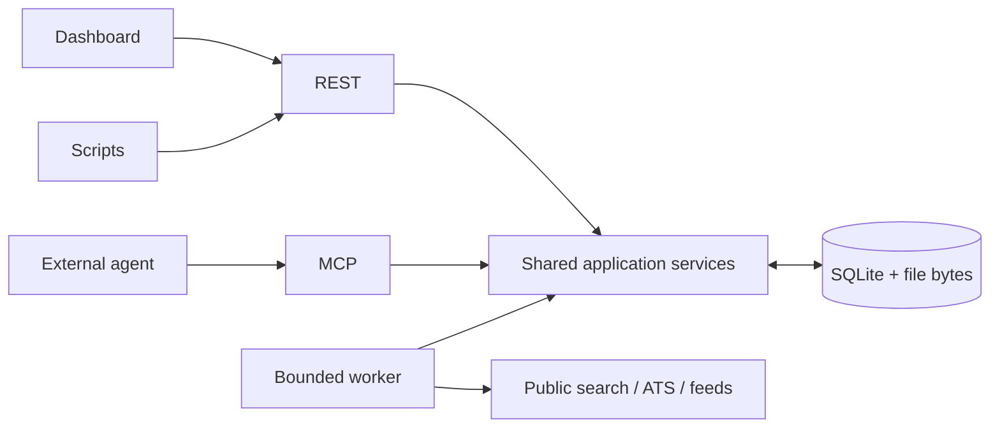

# Architecture

Openings is a FastAPI application, React dashboard and SQLite workspace. Agents, browser automation and
TeX compilation run externally; the core uses no model runtime.

## Code map

| Location | Responsibility |
|---|---|
| `backend/openings/workspace.py` | Job identities, triage, notes, application attempts and reporting |
| `backend/openings/career.py` | Profile, detailed evidence, claims, templates and instructions |
| `backend/openings/documents.py` | Frozen contexts, document revisions and scoped file transfers |
| `backend/openings/discovery.py` | Typed sources, schedules and queue operations |
| `backend/openings/collectors` | Adapter capability catalog, typed options and shared HTTP policy/runtime |
| `backend/openings/worker.py` | Independent scheduling and acquisition lanes |
| `backend/openings/app.py`, `api.py` | Authentication, REST/MCP registration and dashboard hosting |
| `backend/openings/schema.sql` | Relational ownership, SQLite indexes and JSON payloads |
| `frontend/src` | Dashboard using REST; no duplicated domain decisions |
| `skills/` | Agent workflow skills (Agent Skills format) and their shared references |

The [operation inventory](../../backend/openings/operation-inventory.json) is
packaged with the app and served by authenticated `GET /api/v1/capabilities` and
`capabilities_get`. OpenAPI at `/api/openapi.json` and discovered MCP schemas are
authoritative for individual input fields. Read [REST](../user/api.md) and
[agent](../user/agents.md) guides for usable examples.

## Data and workflow rules

- **Identity:** normalized URLs and stable external keys resolve through retained
  aliases. Conflicting identities require explicit Merge; title/company similarity
  alone never merges jobs. Dismissal survives URL changes.
- **Corrections:** source refreshes preserve user edits, triage and application
  attempts.
- **Lifecycle:** triage (`inbox`/`saved`/`dismissed`) stores interest independently.
  The derived `queue=inbox` and `queue=shortlist` exclude any application history;
  Shortlist requires saved interest. Starting an application retains saved interest
  and creates Preparing (`draft`), removing it from pending queues. Closed attempts
  stay in Applications. Deleting the final attempt deliberately restores pending
  queue membership; closing as not pursued preserves preparation history.
  Draft/Applied/Interview/Offer/Closed belongs to the application; each job permits
  one non-Closed attempt, enforced by the shared service and a partial unique
  index. Reopening and merging respect that constraint. Closing requires an
  explicit outcome. Forget permanently removes job-owned records.
- **Snapshots:** preparing a context freezes the job, career evidence, instructions,
  questions, selected templates and exact assets. Later profile edits affect new
  contexts. Changed document content creates a revision with its own uploaded files.
  Attachment changes increment the document version; approval checks that version
  so concurrent uploads cannot be approved unseen. Approval also compares the
  structured content's text with the attached `.tex` source (`consistency.py`,
  no TeX runtime) unless an explicit override is sent.
- **Staleness:** contexts are never rewritten. `staleness.py` compares the Profile,
  instructions, template, entry and claim versions recorded in each current
  leaf's context with the live records on read; refreshing means a new context
  and new revisions.
- **Truth:** approved claims and narrative evidence guide an external agent;
  reference/length validation does not establish factual accuracy. Review outputs.
- **Career:** entries have structured organizations, nullable partial dates, skill
  tags and ordering. Descriptions are optional; claims contain free reusable text.
  Reserved structured fields are stored once, outside arbitrary metadata.
- **Concurrency:** typed inputs, optimistic versions, idempotency keys, foreign
  keys and short transactions protect shared state. Run one application process
  per workspace; database connections do not cross threads. Mutable job and
  application deletion requires the current version as well.

SQLite uses WAL and stores SHA-256-deduplicated BLOBs for attachments. Lists return
compact paginated summaries; full postings, narratives, contexts and file bytes
are separate reads. Application preparation summaries count current revision leaves
and their exact PDF/review state; derived readiness combines them with unresolved
blocking employer requirements stored on the application. Byte downloads and record exports prepare a
temporary snapshot on the database thread before streaming, preserving bounded
memory and releasing SQLite readers before cancellation or thread changes.
Backups use SQLite's online backup API. A restore preserves
installation authentication, recent provider request history and later cooldowns.

Workspaces and backups use schema 7. Opening schema 6 upgrades it in one
transaction, adding application priority, deadline and requirements while keeping
records and versions. Schema 5 is upgraded through schema 6 in the same
transaction, removing obsolete derived data and preserving owned records and
immutable snapshots. Restore accepts schema 7 and upgrades a copy of a schema 5 or
6 backup. Other historical formats require the matching release.

## Acquisition

A saved search has one explicit query/location and provider selection. Company
sources watch selected ATS boards/feeds with optional title/location filters.
Collected candidates reach the shared ingestion service only after usable posting
text is available. Pending descriptions remain in the existing task checkpoint;
manual job input can intentionally be incomplete. New sources start paused.
A shared adapter catalog drives typed configuration and description capabilities.
Metadata-only adapters can be previewed but cannot create automatic watches;
unavailable public Ashby boards receive an actionable permanent error. Source service is immutable;
versioned bulk patches merge compatible fields without replacing untouched config.

A collection invocation freezes effective source configuration and optional run-only
overrides, then groups provider tasks under one run ID. Each task persists its
pagination/detail checkpoint between bounded attempts. Counts accumulate across
retries and waits; source summaries reference one invocation. Daily schedules store
local time slots and timezone, independently of execution timestamps; missed slots
coalesce while a run is active. Pausing automation stops future enqueueing;
explicit cancellation stops an active run.

Every HTTP attempt uses the persisted provider gate: search, detail, preview,
manual import and redirects. Provider settings contain enable/pause and minimum
request spacing, defaulting to five seconds. Recent request counts are informative.
Internal bounded attempts yield with their checkpoint intact; ready tasks are
ordered by next execution time. Actual 429/503 responses can set durable
Retry-After cooldowns, with increasing delays for a 429 lacking that header.
Long waits release the collection lane. Provider-wide access challenges and
individual unavailable postings have distinct diagnostics.

The scheduler and collector progress independently. Network-capable MCP tools
run outside the event loop. Queued tasks have leases and cancellation; stale work
cannot overwrite a current result. See [source configuration](../user/sources.md).

## Extending the app

Add behavior in the shared service before exposing it through REST, MCP and the
dashboard. Update the operation inventory when adding an operation. Keep
operator/bootstrap and raw-byte transport differences explicit.

Provider adapters emit bounded structured postings and use the shared HTTP gate.
Keep endpoint-specific parsing in the adapter, preserve partial successful results
and canonical filter metadata, and test failed/empty/malformed responses. The
[vendored JobSpy subset](../../backend/openings/_vendor/jobspy/PROVENANCE.md) records
its pinned upstream source and local transport changes.

Use the focused checks and manual workflow guidance in [Contributing](../../CONTRIBUTING.md).
