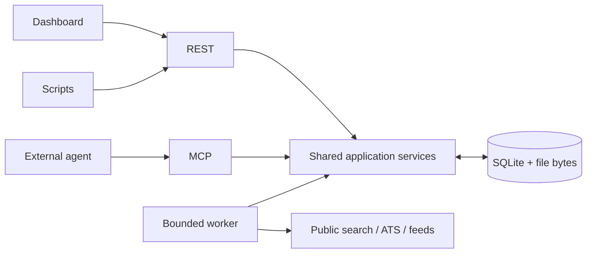

# Architecture

Openings is a FastAPI application, React dashboard and SQLite workspace. Agents, browser automation and
TeX compilation run externally; the core uses no model runtime.

## Code map

| Location | Responsibility |
|---|---|
| `backend/openings/workspace.py` | Job identities, triage, notes, application attempts and reporting |
| `backend/openings/duplicates.py`, `duplicate_signals.py` | Read-only duplicate candidates: per-job signals, pair confidence and groups |
| `backend/openings/career.py` | Profile, detailed evidence, claims, templates and instructions |
| `backend/openings/policy.py` | The owner's policy: four sections of items, section versions, owner confirmation, signal rules |
| `backend/openings/documents.py` | Frozen contexts, document revisions and scoped file transfers |
| `backend/openings/snapshots.py`, `compaction.py` | Content-addressed storage of frozen contexts; giving freed pages back to the data volume |
| `backend/openings/retention.py` | Refresh events, what an observation stores, pruning of finished collection runs and tasks |
| `backend/openings/operations.py` | Backup credentials, restore, the room a restore needs and storage status |
| `backend/openings/activity.py`, `actors.py` | Actor of each change, agent runs with reports, questions for the owner, change log |
| `backend/openings/agent_requests.py`, `subjects.py` | Requests for the agent; the subject reference shared with questions |
| `backend/openings/discovery.py` | Typed sources, schedules and queue operations |
| `backend/openings/collectors` | Adapter capability catalog, typed options and shared HTTP policy/runtime |
| `backend/openings/worker.py` | Independent scheduling and acquisition lanes |
| `backend/openings/app.py`, `api.py` | Authentication, REST/MCP registration and dashboard hosting |
| `backend/openings/schema.sql` | Relational ownership, SQLite indexes and JSON payloads |
| `frontend/src` | Dashboard using REST; no duplicated domain decisions |
| `skills/` | Agent workflow skills (Agent Skills format) and their shared references |

The [operation inventory](../../backend/openings/operation-inventory.json) is
packaged with the app and served by authenticated `GET /api/v1/capabilities` and
`capabilities_get`. OpenAPI at `/api/openapi.json` and discovered MCP schemas are
authoritative for individual input fields. The generated
[parity matrix](parity.md) shows each operation's REST route, MCP tool and real
dashboard path, and lists every gap. Read [REST](../user/api.md) and
[agent](../user/agents.md) guides for usable examples.

## Data and workflow rules

- **Identity:** normalized URLs and stable external keys resolve through retained
  aliases. Conflicting identities require explicit Merge; title/company similarity
  alone never merges jobs. Dismissal survives URL changes. Duplicate candidates
  are a separate, read-only suggestion: deterministic signals (requisition IDs,
  apply targets, location, posting text, company and title) give each pair a
  confidence in [0, 1], and nothing is merged or stored. Per-job signals are kept
  in memory and recomputed only for jobs whose version changed.
- **Corrections:** source refreshes preserve user edits, triage and application
  attempts.
- **Refreshes:** seeing a posting again updates its observation (`last_seen_at`,
  `content_hash`) and leaves no event. A refresh that changes the title, company,
  location or posting text leaves one `job_refreshed` event naming those fields.
  An observation's `payload` holds only what is read back: `source_key` (finding
  the observation again) and `raw.job_url_direct` (the employer's apply link used
  by duplicate scoring); add a field there only together with its reader.
- **Lifecycle:** triage (`inbox`/`saved`/`dismissed`) stores interest independently.
  The derived `queue=inbox` and `queue=shortlist` exclude any application history;
  Shortlist requires saved interest. Starting an application retains saved interest
  and creates Preparing (`draft`), removing it from pending queues. Closed attempts
  stay in Applications. Deleting the final attempt deliberately restores pending
  queue membership; closing as not pursued preserves preparation history.
  Draft/Applied/Interview/Offer/Closed belongs to the application; each job permits
  one non-Closed attempt, enforced by the shared service and a partial unique
  index. Reopening and merging respect that constraint. Closing requires an
  explicit outcome. Forget permanently removes job-owned records.
- **Snapshots:** preparing a context freezes the job, career evidence, instructions,
  questions, selected templates and exact assets. Later profile edits affect new
  contexts. Changed document content creates a revision with its own uploaded files.
  Attachment changes increment the document version; approval checks that version
  so concurrent uploads cannot be approved unseen. Approval also compares the
  structured content's text with the attached `.tex` source (`consistency.py`,
  no TeX runtime) unless an explicit override is sent.
- **Snapshot storage:** a context's payload is one canonical JSON text, and its
  signature is the SHA-256 of that text. `snapshots.py` stores the text as a frame
  of literals with one part between each pair: every Career entry, claim and
  template, the Profile, the job and the general instructions are parts, stored
  once in `snapshot_parts` under the SHA-256 of their own text and shared by all
  contexts (`context_parts`; a list part names its items in `snapshot_list_items`).
  Reading a context concatenates frame and parts, so payload and signature are
  reproduced byte for byte without re-encoding; a payload without the canonical
  form is kept whole. A context's asset files are parts too: the part names the
  blob, the reference keeps the file id the payload exposes, and the `all_files`
  view serves them beside the rows of `files`. Deleting an application or job
  removes the parts and bytes nothing references any more, in the same transaction
  or once per bulk run. Foreign keys make a dangling reference impossible.
- **Staleness:** contexts are never rewritten. `staleness.py` compares the Profile,
  instructions, template, entry and claim versions recorded in each current
  leaf's context with the live records on read; refreshing means a new context
  and new revisions. `context_inputs.policy` records the policy section
  versions a context froze (NULL before schema 10); the report does not compare
  them yet.
- **Policy:** `policy_sections` holds one version per section (`decision`,
  `eligibility`, `writing`, `facts`) and `policy_items` their items in a dense
  order. An item write names its section's version and bumps it by one; a move
  names and bumps both sections. `confirmed_at` is set only by owner authority:
  a content write (label, statement, value, scope, rule) by the session or an
  owner token confirms, the same write by an agent token clears the
  confirmation and switches the rule off, and `policy_confirm` and enabling a
  rule call `actors.require_owner`. A value is typed (text, number, date,
  boolean, list); `structured` exists only for a value copied by the upgrade and
  cannot be written. A decision rule `{signal, condition, action}` is validated
  against the registry `policy.SIGNALS`; nothing applies it at ingest yet.
  Preparing a context freezes the four sections (`payload.policy`), each as its
  own content-addressed part, so a section is stored again only when it changes.
- **Truth:** approved claims and narrative evidence guide an external agent;
  reference/length validation does not establish factual accuracy. Review outputs.
- **Career:** entries have structured organizations, nullable partial dates, skill
  tags and ordering. Descriptions are optional; claims contain free reusable text.
  Reserved structured fields are stored once, outside arbitrary metadata.
- **Attribution:** authentication sets the actor (owner session, named API token
  with its kind, or system) in a context variable (`actors.py`) that reaches the
  shared services through thread offloading; worker threads start with an empty context and
  record the system. Every write leaves one event with its subject, actor and,
  for a token with an open run, that run. Payloads hold identifiers, field names
  and versions, never content. Events of a job or application are deleted with
  it; the deletion itself stays recorded.
- **Runs and questions:** a token has one open run (a partial unique index); its
  writes attach to it. A run without activity is reported as interrupted but
  only an explicit supersede closes it. A finished run stores its report and
  change counts. Questions reference a job, application or Career entry with
  `ON DELETE SET NULL` and keep a label, so they outlive their subject.
- **Requests:** the mirror of questions. The owner writes a request (owner
  authority), an API token takes it and completes or declines it, and the owner
  may withdraw it until then. The request records the run of the token that
  handled it when that token has an open run; taking without a run is allowed.
  Like questions, requests reference a job, application or Career entry with
  `ON DELETE SET NULL`, keep a label and follow a job through a merge. The
  server runs no agent: a request is only read.
- **Token scope:** a token is `owner` or `agent`. Owner-only operations call
  `actors.require_owner` in the shared service, so REST and MCP refuse an agent
  token alike with `403 forbidden`; the inventory marks them `access: owner` and
  `test_interfaces.py` calls each one. Scoped operational grants (backup, export,
  restore) carry the requesting actor. A backup made for an agent token has the
  installation's password hash, session secret and tokens removed from the copy.
- **Ready:** every shared service that changes what Ready was judged on clears it
  in its own transaction through `Workspace.clear_ready`: a new revision or
  context, a deleted revision, a file added to a current revision, an unresolved
  blocking requirement, leaving Preparing. Each clearing bumps the application
  version and leaves an attributed `application_ready_cleared` event with its
  reason. A new operation that changes current revisions must call it too.
- **Concurrency:** typed inputs, optimistic versions, idempotency keys, foreign
  keys and short transactions protect shared state. Run one application process
  per workspace; database connections do not cross threads. Mutable job and
  application deletion requires the current version as well.

SQLite uses WAL and stores SHA-256-deduplicated BLOBs for attachments. Lists return
compact paginated summaries; full postings, narratives, contexts and file bytes
are separate reads. Application preparation summaries count current revision leaves
and their exact PDF/review state; derived readiness combines them with unresolved
blocking employer requirements stored on the application. Ready is a stored step
on top of that derivation (`ready_at` and who set it): marking is refused while a
check fails, `readiness` reports `ready` only while the mark and every check hold,
and `reviewed` when the checks pass without the mark. Byte downloads and record exports prepare a
temporary snapshot on the database thread before streaming, preserving bounded
memory and releasing SQLite readers before cancellation or thread changes.
Backups use SQLite's online backup API. A restore preserves
installation authentication, recent provider request history and later cooldowns.

Workspaces and backups use schema 11 (0.20). Opening schema 10 adds the
`responses` table (an employer's answer to a sent application: kind, date, note,
whether the date is estimated, how it was recorded, attribution, version and
idempotency key; one per application, kind and day except `other`) and rebuilds
`applications` to allow the `no_response` outcome and add `concluded_on`. The
rebuild copies every row with its rowid, recreates the table's indexes and
triggers from their saved SQL and runs with foreign keys off; the upgrade fails
unless `foreign_key_check` reports nothing it did not report before. It then
records one response, by the system and without an event, for each application
in Interview or Offer and each rejected one with a sent date: dated by the last
event that moved it to that stage, else its last change with `estimated` set.
Nothing else changes. `outcomes.no_reply_period` is the only definition of the
no-reply period (the days of the Policy decision item labelled "No reply",
confirmed items first, else 30); `insights.py` maps titles to role family and
seniority with fixed keyword tables and no model.

Schema 10 (0.19) was an additive change. Opening schema 9
creates the policy tables, adds `default_in_cv`, `role` and `group` to `claims`
and `policy` to `context_inputs`, and copies the Profile's free-form values:
one unconfirmed `facts` item per top-level `metadata` key, holding the original
value (`origin`, `origin_key`), and one unconfirmed `decision` item each for the
`preferences` and `roles` text. The Profile row, every Career entry, claim and
template and every frozen context are left as they were. A claim field is
filled from `metadata` only when a key has the field's name and a valid value
of the field (`db.CLAIM_FIELDS_FROM_METADATA`).

Schema 9 (0.18) was a storage-only change: opening schema 8
moves every frozen context into content-addressed parts and its asset files out of
`files`, compares each rebuilt payload with the stored text, and then drops the
old column, all in the upgrade transaction; contexts gain summary columns for
lists. When at least a quarter of the file (and `OPENINGS_COMPACT_MIN_MB`, default
32) is free afterwards, or after large deletions, `compaction.py` rewrites the file
at start: a compact copy beside the database is copied back in one transaction, so
an interruption leaves the previous file valid and the next start tries again.
The same upgrade step (`retention.trim_history`) deletes `posting_updated` events
that recorded a re-sighting, turns the others into `job_refreshed`, and reduces
stored provider payloads to the two values above; the compaction returns the
freed pages. A database already at the unreleased schema 9 does not get this.

Retention is one environment setting, `OPENINGS_RETENTION_DAYS` (default 90, 0
off). The scheduler thread calls `retention.prune` at start and every six hours;
a pass is one short transaction that removes at most 500 finished collection
runs (their tasks cascade), finished tasks without a run and the change records
of removed runs and tasks, and repeats after a minute while more remain. A run
with a queued or running task is never finished, the 20 most recent finished
runs of every source stay, and events of jobs, applications and agent runs are
never pruned.

A restore of *B* bytes over a database of *D* bytes needs 3 *B* + *D* +
max(0, *B* − *D*) + 64 MiB free on the data volume: the upload, the upgraded
copy, the rollback copy, the write-ahead log that receives the restored pages
and the growth of the file. `operations.restore_limit` inverts that for the
free space; `OPENINGS_MAX_RESTORE_MB` only lowers it. The route refuses a larger
upload before writing it and the service checks the replacement's room again
with the real sizes. `storage_status` feeds `GET /workspace` and
`workspace_info`.

Schema 8 shipped with 0.17.0. Opening schema 7 upgrades it in the same
transaction: events gain a subject, an actor and a run, notes gain an author,
applications gain `ready_at` with who set it, API tokens gain a kind, and the
`runs`, `questions` and `requests` tables are added; existing rows keep every value, read as
"unknown (before 0.17)" and are not marked ready, and existing tokens become
owner tokens with unchanged access. Schema 6 is upgraded through schema 7 in the same
transaction (application priority, deadline and requirements), and schema 5
through schema 6 (removing obsolete derived data and preserving owned records and
immutable snapshots). Restore accepts schema 11 and upgrades a copy of a schema 5,
6, 7, 8, 9 or 10 backup. Other historical formats require the matching release.

## Acquisition

A saved search has one explicit query/location and provider selection. Company
sources watch selected ATS boards/feeds with optional title/location filters.
Collected candidates reach the shared ingestion service only after usable posting
text is available. Pending descriptions remain in the existing task checkpoint;
manual job input can intentionally be incomplete. New sources start paused.
A shared adapter catalog drives typed configuration and description capabilities.
Metadata-only adapters can be previewed but cannot create automatic watches;
unavailable public Ashby boards receive an actionable permanent error. Source service is immutable;
versioned bulk patches merge compatible fields without replacing untouched config.

A collection invocation freezes effective source configuration and optional run-only
overrides, then groups provider tasks under one run ID. Each task persists its
pagination/detail checkpoint between bounded attempts. Counts accumulate across
retries and waits; source summaries reference one invocation. Daily schedules store
local time slots and timezone, independently of execution timestamps; missed slots
coalesce while a run is active. Pausing automation stops future enqueueing;
explicit cancellation stops an active run.

Every HTTP attempt uses the persisted provider gate: search, detail, preview,
manual import and redirects. Provider settings contain enable/pause and minimum
request spacing, defaulting to five seconds. Recent request counts are informative.
Internal bounded attempts yield with their checkpoint intact; ready tasks are
ordered by next execution time. Actual 429/503 responses can set durable
Retry-After cooldowns, with increasing delays for a 429 lacking that header.
Long waits release the collection lane. Provider-wide access challenges and
individual unavailable postings have distinct diagnostics.

All outbound fetch paths share one address policy. A host is resolved, every
address must be public, and the connection is made to a checked address on each
attempt and redirect hop: httpx through its network backend, provider `requests`
sessions through a connection adapter and `curl_cffi` sessions through curl's
resolve pinning. TLS still verifies the requested host name.

The scheduler and collector progress independently. Network-capable MCP tools
run outside the event loop. Queued tasks have leases and cancellation; stale work
cannot overwrite a current result. See [source configuration](../user/sources.md).

## Extending the app

Add behavior in the shared service before exposing it through REST, MCP and the
dashboard. Update the operation inventory when adding an operation. Keep
operator/bootstrap and raw-byte transport differences explicit.

Provider adapters emit bounded structured postings and use the shared HTTP gate.
Keep endpoint-specific parsing in the adapter, preserve partial successful results
and canonical filter metadata, and test failed/empty/malformed responses. The
[vendored JobSpy subset](../../backend/openings/_vendor/jobspy/PROVENANCE.md) records
its pinned upstream source and local transport changes.

Use the focused checks and manual workflow guidance in [Contributing](../../CONTRIBUTING.md).

The accepted product direction is in the [redesign proposal](proposal-redesign.md);
the dashboard design and its static prototypes are in [dashboard design](dashboard-design.md).
