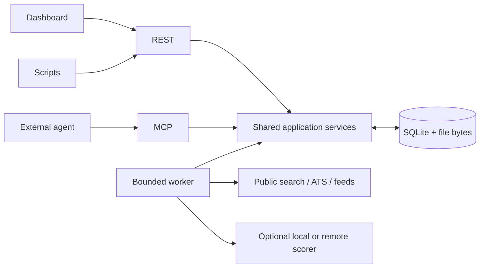

# Architecture

Openings is a FastAPI application, React dashboard and SQLite workspace. An
optional CPU scorer runs as a separate service. Agents, browser automation and
TeX compilation run externally; the core uses no model runtime.

## Code map

| Location | Responsibility |
|---|---|
| `backend/openings/workspace.py` | Job identities, triage, notes, application attempts and reporting |
| `backend/openings/career.py` | Profile, detailed evidence, claims, templates and instructions |
| `backend/openings/documents.py` | Frozen contexts, document revisions and scoped file transfers |
| `backend/openings/discovery.py` | Typed sources, schedules, scoring configuration and queue operations |
| `backend/openings/collectors` | Narrow provider adapters and shared HTTP policy/runtime |
| `backend/openings/worker.py` | Independent scheduling, acquisition and inference lanes |
| `backend/openings/app.py`, `api.py` | Authentication, REST/MCP registration and dashboard hosting |
| `backend/openings/schema.sql` | Relational ownership, SQLite indexes and JSON payloads |
| `frontend/src` | Dashboard using REST; no duplicated domain decisions |
| `scorer` | Optional isolated Laya/System One-compatible CPU classification service |
| `skills/openings-workspace` | Optional external-agent workflow guidance |

The [operation inventory](../../backend/openings/operation-inventory.json) is
packaged with the app and served by authenticated `GET /api/v1/capabilities` and
`capabilities_get`. OpenAPI at `/api/openapi.json` and discovered MCP schemas are
authoritative for individual input fields. Read [REST](../user/api.md) and
[agent](../user/agents.md) guides for usable examples.

## Data and workflow rules

- **Identity:** normalized URLs and stable external keys resolve through retained
  aliases. Conflicting identities require explicit Merge; title/company similarity
  alone never merges jobs. Dismissal survives URL changes.
- **Corrections:** source refreshes preserve user edits, triage and application
  attempts. Unchanged content does not trigger another classification.
- **Lifecycle:** Inbox/Saved/Dismissed is job triage. Draft/Applied/Interview/Offer/
  Closed belongs to an independent application attempt. Uploading documents does
  not mark an attempt submitted. Forget permanently removes job-owned records.
- **Snapshots:** preparing a context freezes the job, career evidence, instructions,
  questions, selected templates and exact assets. Later profile edits affect new
  contexts. Changed document content creates a revision with its own uploaded files.
  Attachment changes increment the document version; approval checks that version
  so concurrent uploads cannot be approved unseen.
- **Truth:** approved claims and narrative evidence guide an external agent;
  reference/length validation does not establish factual accuracy. Review outputs.
- **Career:** entries have structured organizations, nullable partial dates, skill
  tags and ordering. Descriptions are optional; claims contain free reusable text.
  Reserved structured fields are stored once, outside arbitrary metadata.
- **Concurrency:** typed inputs, optimistic versions, idempotency keys, foreign
  keys and short transactions protect shared state. Run one application process
  per workspace; database connections do not cross threads.

SQLite uses WAL and stores SHA-256-deduplicated BLOBs for attachments. Lists return
compact paginated summaries; full postings, narratives, contexts and file bytes
are separate reads. Backups use SQLite's online backup API. A restore preserves
installation authentication and recent provider HTTP windows/later cooldowns.
Model weights are a disposable cache outside the workspace.
Workspaces and backups must use the current database format. Pre-1.0 releases
do not include converters for earlier formats.

## Acquisition and classification

A saved search has one explicit query/location and provider selection. Company
sources watch selected ATS boards/feeds with optional title/location filters.
Both use the same ingestion path as manually added jobs. New sources start paused.
Typed schemas expose adapter defaults and capabilities. Source service is immutable;
versioned bulk patches merge compatible fields without replacing untouched config.

A collection invocation freezes effective source configuration and optional run-only
overrides, then groups provider tasks under one run ID. Each task persists its
pagination/detail checkpoint between bounded attempts. Counts accumulate across
retries and waits; source summaries reference one invocation. Daily schedules store
local time slots and timezone, independently of execution timestamps; missed slots
coalesce while a run is active. Pausing automation stops future enqueueing;
explicit cancellation stops an active run.

Every HTTP attempt uses the persisted provider gate: search, detail, preview,
manual import and redirects. Policy includes minimum spacing, hourly/daily/run
caps and Retry-After cooldown. Long waits defer tasks rather than occupying the
collection lane. Failed/blocked responses remain visible; they are not successful
empty results. Provider limits are local safeguards, not platform access guarantees.

The scheduler, collector and inference lanes progress independently. A process/
database guard serializes inference, including manual endpoint tests. Network-capable
MCP tools run outside the event loop. Queued tasks have leases and cancellation;
stale work cannot overwrite a current result. See [source configuration](../user/sources.md).

Scoring is optional and advisory. Relevant profile/config edits mark scores outdated
without queuing the archive. New complete jobs may be scored automatically;
a pending-first-score marker also allows newly collected incomplete jobs to receive
one initial score after detail completion. Existing historical unscored jobs do not
acquire that eligibility merely because they are refreshed. Automatic rescoring
of updates has a separate switch. Explicit selected/outdated
batches and optional capped periodic rescoring are separate. Scores come from the
configured classifier. Model/provider details are in the
[scoring guide](../user/scoring.md).
The core builds a lean scoring context; the isolated scorer uses its tokenizer to
bound input and records any shortening. Full archive text remains available to agents.

## Extending the app

Add behavior in the shared service before exposing it through REST, MCP and the
dashboard. Update the operation inventory when adding an operation. Keep
operator/bootstrap and raw-byte transport differences explicit.

Provider adapters emit bounded structured postings and use the shared HTTP gate.
Keep endpoint-specific parsing in the adapter, preserve partial successful results
and canonical filter metadata, and test failed/empty/malformed responses. The
[vendored JobSpy subset](../../backend/openings/_vendor/jobspy/PROVENANCE.md) records
its pinned upstream source and local transport changes.

Use the focused checks and manual workflow guidance in [Contributing](../../CONTRIBUTING.md).
