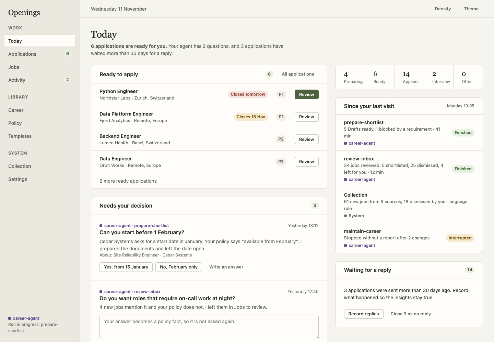
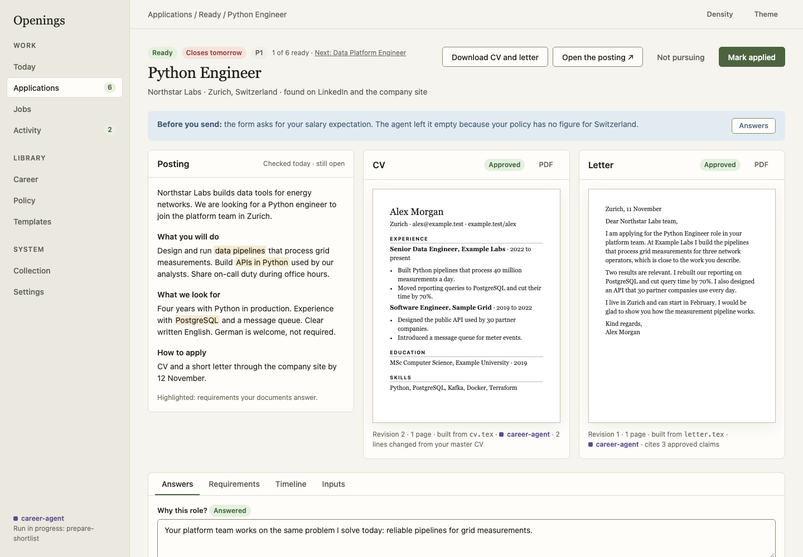

# Dashboard design

Status: **proposed**, waiting for the maintainer's approval (owner checkpoint 2,
issue #150). It designs the dashboard for the product accepted in the
[redesign proposal](proposal-redesign.md); issue #135 implements it.

The design has three parts: the information architecture, a design system, and
static [prototypes](prototypes/index.html) of every main screen. Open
`docs/developer/prototypes/index.html` in a browser: the prototypes are plain HTML
with synthetic data, work offline, and have working tabs, themes and density.

## Principles

1. **Start from the owner's three questions.** What do I apply to, what did the
   agent do, what needs my decision. The first screen answers all three.
2. **The agent is visible.** Every change shows who made it. Runs and questions are
   places, not notes.
3. **One screen per job to be done.** Reviewing an application shows the posting,
   the CV and the letter together, with the actions that end the task.
4. **Structured data has a structured editor.** No JSON text boxes.
5. **Calm and dense.** Warm neutral surfaces, one accent, colour only for meaning,
   text always beside colour. Lists first, cards only for grouping.

## Information architecture

Navigation has three groups. On narrow screens a bottom bar holds Today,
Applications, Jobs and Activity; the rest is under More.

| Group | Screen | Purpose | Replaces |
|---|---|---|---|
| Work | **Today** | Ready to apply, needs your decision, since your last visit, waiting for a reply | Overview |
| Work | **Applications** | The pipeline with Ready as a stage; list and board; **Insights** tab | Applications, Overview funnel |
| Work | **Application review** | Posting, CV and letter side by side; download, mark applied or close; answers, requirements, timeline, inputs | The application drawer and its tabs |
| Work | **Jobs** | To review, Shortlist, Dismissed, All; signals; duplicates inside the job | Inbox, Shortlist, Possible duplicates |
| Work | **Activity** | Questions, runs with their reports, the timeline of all changes | New |
| Library | **Career** | Profile and the Career record with typed claim fields | Career |
| Library | **Policy** | Decision rules, eligibility, writing rules, facts | Profile metadata JSON, parts of Career |
| Library | **Templates** | Sources, typed rules, assets, preview | Templates |
| System | **Collection** | Sources, yield, runs and tasks, providers | Collection, tasks in Settings |
| System | **Settings** | Agent access and tokens, skills, backup, workspace | Settings |
| | **Onboarding** | First run: connect an agent, watch the record being built | New |

What changes for someone who knows 0.15:

- **Overview disappears.** Its funnel becomes the pipeline strip on Today and the
  Insights tab.
- **Inbox and Shortlist merge into Jobs.** In an agent-operated workspace the
  review queue belongs to the agent, and the page says so.
- **The application drawer becomes a page:** one review screen plus four
  secondary tabs (answers, requirements, timeline, inputs).
- **Ready is a stage** you can see and count, not a filter.
- **Possible duplicates** is no longer a separate list of hundreds of groups. A
  likely duplicate is a signal on the job, with the candidate beside it.
- **Tasks move** from Settings to Collection, next to the runs that created them.
- **Policy is new**, and Profile metadata is no longer edited as JSON.

## Screens

| Screen | Prototype | What to look at |
|---|---|---|
| Today | [today.html](prototypes/today.html) | The summary sentence; one primary action; questions answered in place |
| Application review | [review.html](prototypes/review.html) | Three panes; "before you send" banner; who wrote each revision; one pane at a time on a phone with a fixed action bar |
| Applications | [applications.html](prototypes/applications.html) | Stage chips; recording an employer response; Insights with a small-sample state |
| Jobs | [jobs.html](prototypes/jobs.html) | Signals as tags; a rule's dismissals with Restore; duplicate decision inside the job |
| Activity | [activity.html](prototypes/activity.html) | A run report; an interrupted run; questions tied to their subject |
| Career | [career.html](prototypes/career.html) | Typed claim fields; key/value editor for remaining metadata |
| Policy | [policy.html](prototypes/policy.html) | Statement lists; a rule that acts on a signal; staleness per section |
| Templates | [templates.html](prototypes/templates.html) | Typed limits and rule statements |
| Collection | [collection.html](prototypes/collection.html) | Yield per source |
| Settings | [settings.html](prototypes/settings.html) | Token kinds; a readable skill with local notes |
| Onboarding | [onboarding.html](prototypes/onboarding.html) | The agent's progress as a checklist |

Screenshots at 1440×1000 and 390×844 are in [prototypes/screens](prototypes/screens).
Regenerate them with `node docs/developer/prototypes/screenshots.mjs`; the script
also fails on a script error or horizontal overflow at five widths.

## Design system

The tokens and components are in [prototypes/prototype.css](prototypes/prototype.css).
#135 moves them into the dashboard unchanged.

### Colour

Semantic tokens, with a light and a dark value each. Text pairs reach WCAG AA
(4.5:1) on every surface they are used on; the lowest ratios are listed.

| Token | Use | Light | Dark | Lowest contrast (light / dark) |
|---|---|---|---|---|
| `--bg`, `--surface`, `--card` | Shell, page, raised content | `#ebe8e0`, `#f6f4ee`, `#fffdf9` | `#1a1c17`, `#21231d`, `#292b24` | |
| `--ink` | Content | `#23241e` | `#ecece0` | 12.8 / 12.0 |
| `--ink-2` | Secondary text | `#5c5e54` | `#b9bcab` | 5.4 / 7.4 |
| `--ink-3` | Captions on surface or card | `#696b60` | `#9da18f` | 4.9 / 5.4 |
| `--accent` | Primary action, selection | `#4d6340` | `#b9cfa3` | 5.4 / 6.5 |
| `--ready` | Ready, approved, finished | `#3a6335` | `#a9d19b` | 5.7 / 7.1 |
| `--attention` | Deadline near, interrupted, empty | `#7a5200` | `#e6c27a` | 5.7 / 7.0 |
| `--danger` | Blocking, overdue, destructive | `#94483b` | `#e0a79a` | 5.2 / 6.0 |
| `--info` | Advice before an action | `#3d5a73` | `#a9c4dc` | 5.9 / 6.8 |
| `--agent` | Anything the agent did | `#5b4b8a` | `#c3b6ea` | 6.1 / 6.7 |
| `--control` | Border of buttons and inputs (needs 3:1) | `#85877a` | `#858972` | 3.1 / 3.0 |

0.15 fails this target in the light theme: secondary text is 4.0:1 on the page and
caption text 2.5:1. Caption text (`--ink-3`) is not used on soft backgrounds;
secondary text is used there.

Rules: one accent; colour never carries meaning alone (a tag always has text);
the agent colour is used only for attribution.

### Type, space and density

- **Type:** system sans for interface text, Georgia for page titles and large
  numbers, system monospace for source. Six sizes: 12, 13, 14 (body), 16, 20, 28 px.
  No font is downloaded: the dashboard works offline.
- **Space:** multiples of 4 px (4, 8, 12, 16, 24, 32, 48). Radius 8 px for cards,
  5 px for controls.
- **Density:** comfortable by default (44 px rows) and compact (36 px), chosen by
  the owner and remembered. Touch targets stay at least 44 px on narrow screens.
- **Layout:** one breakpoint at 860 px. Below it the sidebar becomes the bottom
  bar, columns stack, and side-by-side panes become a switch.

### Components

Button (primary, default, quiet, danger; two sizes), tag, count, card, list row,
table, tabs, segmented switch, field, switch, banner, actor chip, question,
statement list (policy items, rules, requirements), key/value editor, pipeline
strip, stat and rate bar, paper preview, split view with a detail panel, stepper,
fixed action bar, dialog, toast, empty and error states.

Each component is built once in #135 with its states (default, hover, focus,
disabled, loading, error) and its keyboard behaviour, and no page file exceeds
about 400 lines.

### Words

Short, concrete and direct: "6 applications are ready for you", not "Readiness
overview". Buttons name the result ("Mark applied", "Close 3 as no reply"). The
agent's text is shown as the agent's, with its name. Stages keep their names;
"Draft" is called Preparing, as today.

## Budgets

**Accessibility: WCAG 2.2 AA.**

- Automated checks (axe) on every screen, in both themes and at both widths, with
  no serious or critical finding. Run in CI with the browser tests.
- Keyboard: every action reachable and operable; focus visible; dialogs and the
  mobile navigation contain focus. The review flow has a keyboard-only test.
- A unit test asserts the contrast of every token pair in the table above.

**Performance**, measured in CI on a synthetic workspace of 5,000 jobs and 500
applications:

| Budget | Target | 0.15.2 |
|---|---|---|
| Applications list, 200 rows, time to interactive after navigation | under 300 ms | not measured |
| JavaScript for the first screen, compressed | at most 110 kB | 126 kB (one bundle, 440 kB raw) |
| Any later screen's own JavaScript, compressed | at most 40 kB | part of the one bundle |
| Stylesheet, compressed | at most 15 kB | 12.4 kB |
| Long lists | virtualised above 100 rows | paginated |

The issue quoted 385 kB for the current bundle; it is 440 kB today. The budget is
set on compressed size per screen, with screens loaded on demand.

## Implementation stages for #135

Each stage ships on its own; old and new screens coexist until stage 7. Every
stage has browser tests on Chromium and WebKit at both widths, regenerated
documentation screenshots and a regenerated parity matrix.

| Stage | Content | Needs |
|---|---|---|
| 1. Foundation | Tokens and components, the new navigation around the existing pages, screens loaded on demand, accessibility checks and budgets in CI | |
| 2. Today and Activity | Home screen; questions, runs and timeline | #149, #160 |
| 3. Applications | Pipeline with Ready; the review-and-apply page; employer responses and Insights when available | #160; #151 for Insights |
| 4. Jobs | Triage tabs, bulk actions, duplicate decision inside the job; signals when available | #145, #166 for signals |
| 5. Library | Career with typed claim fields and the key/value editor; Policy; Templates with typed rules | #163 |
| 6. System | Collection with yield and tasks; Settings with token kinds and readable skills | #161, #166, #168 |
| 7. Onboarding and removal | First-run flow; the old pages and stylesheet are deleted; the parity matrix has no gap | #136 follows |

A stage whose backend issue is not ready ships with what exists and gains the rest
when that issue lands; the table says which parts those are.

### Implemented

**Stage 1, Foundation.**

- `frontend/src/design` holds the tokens (`tokens.css`, the single source, with
  the values of the table above), the element defaults, the shell styles and the
  core components: button, tag, count, card, list row, tabs, segmented switch,
  field, switch, banner, actor chip, empty state, action bar, dialog and toast.
  The remaining components of the list above are added by the stage that first
  uses them.
- `frontend/src/shell` holds the navigation (three groups; bottom bar and More
  sheet up to 860 px), the top bar with theme and density, the agent's status
  line, the routes and the screens loaded on demand.
- The pages written before the design system keep their own stylesheet,
  `frontend/src/legacy.css`. Its rules apply only inside `.legacy` and its
  colours come from the tokens. A rebuilt page leaves that wrapper; stage 7
  deletes the file.
- Until their stage, Today is still Overview, and Jobs opens the existing Inbox
  and Shortlist pages. `#today` and `#jobs` are aliases; every earlier route
  works.
- Checks: `npm run budget` (first screen, each later screen, stylesheet),
  axe on every screen in both themes at both widths, the contrast of every pair
  of the colour table, and a keyboard-only test of the shell. The performance
  check of the Applications list belongs to stage 3; the browser test server
  already takes `OPENINGS_E2E_JOBS` and `OPENINGS_E2E_APPLICATIONS` for it.

**Stage 5, Library.**

- **Policy** (`pages/Policy.tsx`, `pages/policy/`) is new: the four sections as
  statement lists with add, inline edit, reorder by buttons, remove after
  asking, confirm, move to a section, the switch of a rule on a signal, the
  version of each section and the sections panel. A version conflict reads the
  section again and keeps the unsaved text in the open form. The banner
  "changed since N Drafts" of the prototype waits for staleness by section
  (#144), and a rule shows that signals arrive later (#166) instead of counts.
- **Career** (`pages/Career.tsx`, `pages/career/`) and **Templates**
  (`pages/Templates.tsx`, `pages/templates/`) are rebuilt and the old pages and
  their rules in `legacy.css` are deleted. Career has the Profile with typed
  fields, the record grouped by kind beside the entry editor, claims with their
  typed selection fields as controls, and **All claims** for search across
  entries. Templates has the list by kind and the tabs Source, Rules, Assets
  and Preview; Preview shows a PDF uploaded as an asset, because the workspace
  does not compile TeX. Free-form metadata and the free-form rest of template
  rules are edited as rows. `#career?section=…` and
  `#templates?template=…&section=…` open the matching part.
- Components added to `frontend/src/design`: statement list
  (`Statement.tsx`), key/value editor with a read-only tree for nested values
  (`KeyValue.tsx`, logic in `kv.ts`), split view with a pane switch on narrow
  screens (`Split.tsx`), and in `library.css` the table that stacks on narrow
  screens, the form grid, source text and record-editor pieces.
  `frontend/src/library` holds what the three screens share: the assets table
  with its file dialog, the confirmation dialog, the pager and a reader that
  always shows the latest record (`useFresh`).
- A rebuilt screen renders in `.screen` instead of `.legacy`
  (`shell/routes.ts`, `REBUILT`).

## Not decided here

- Charts beyond simple rate bars. Insights starts with tables and bars.
- Figures the prototypes had to invent: the number of sent applications below
  which a rate is withheld (5 in the prototype) and the restore limit as a share of
  free space. The backend issues decide them.
- Tables that become stacked blocks on narrow screens must keep their meaning for
  screen readers; #135 decides between ARIA roles and a list.
- A command palette and keyboard shortcuts beyond standard navigation.
- Notifications outside the dashboard (email, push).
