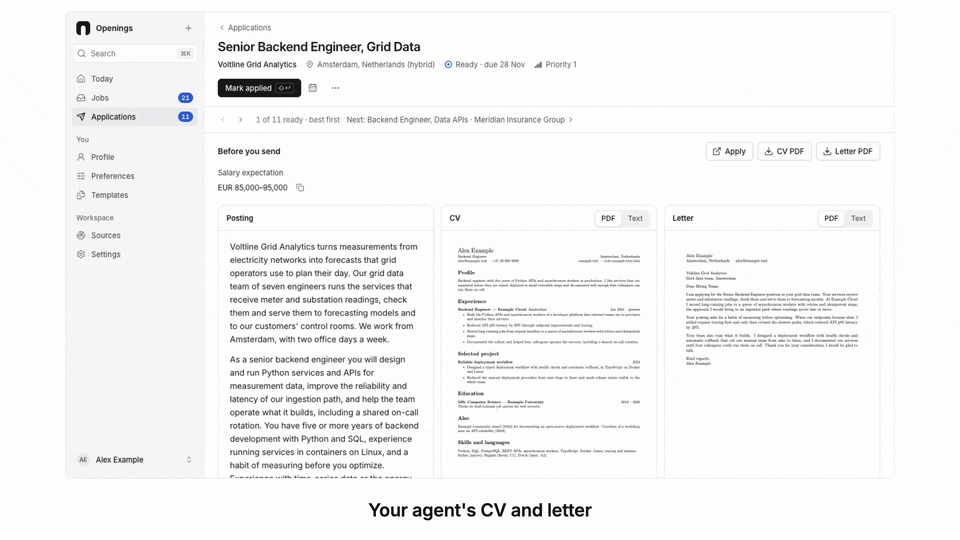

# Maintaining

Cut a release, keep the archives and set up the repository here, as the maintainer.

## Release

1. Check that the latest run of the weekly workflow (`weekly.yml`) on `main` passed.
2. Rename `## Unreleased` in [CHANGELOG.md](../../CHANGELOG.md) to the form the
   earlier sections use, `## X.Y.Z — date`.
3. Set every version at once and check the locks:

```bash
python3 scripts/bump_version.py X.Y.Z && uv lock --check
npm --prefix frontend install --package-lock-only --ignore-scripts
```

The section starts with its **headline**: one plain line of at most 100 characters,
before any list or bold heading, such as `Workday roles with several locations stay
listed`. The release is titled `Openings X.Y.Z: <headline>`, and the rest of the
section, with a fixed upgrade line, is its notes. The release workflow fails before
building anything if the section or its headline is missing.

Merge that change, then tag `vX.Y.Z` on `main`. The release workflow (`images.yml`)
then does these steps in order:

1. **Waits** for the CI run of the tagged commit and requires it to pass.
2. **Audits** the dependencies and builds both images.
3. **Smoke-tests** each pushed digest (`scripts/smoke_image.sh`, including the OCI
   labels).
4. **Publishes** one multi-arch index tagged `X.Y.Z` and `X.Y` on Docker Hub
   (`vincenzoimp/openings`) and on the GHCR mirror (`ghcr.io/vincenzoimp/openings`),
   with the same digest on both.
5. **Moves `latest`** for a final release, unless a newer final release exists, and
   smoke-tests `latest` as pulled. A prerelease (`X.Y.Z-rc.1`) moves neither `X.Y`
   nor `latest`.
6. **Creates** the GitHub Release.

To point `latest` at an already published release without a local login, run the
`latest.yml` workflow with `gh workflow run latest.yml -f version=X.Y.Z`. The
workflow checks that both architectures are there and moves `latest` on Docker Hub,
and on GHCR when that version is mirrored. Then it compares the digests and checks
that `latest` reports the version on `/health`.

A release that changes the schema ships its migration. Once it is tagged, write
the fixture the next migration upgrades from:

```bash
uv run python scripts/release_fixture.py --tag vX.Y.Z
```

It writes `backend/tests/fixtures/workspace-<schema>.sql.gz` from that tag's own
synthetic seed.

### Cadence

- At most one release a week, unless a bug blocks a user. Batch the rest in the
  next release.
- No 0.28.x release changes the schema. The next schema change is 1.0.0, which
  tests chained upgrades from 0.28.

## Traffic archive

GitHub keeps traffic for 14 days only, so archive it daily. `scripts/traffic_archive.py`
appends one dated JSON line a day to a file outside the checkout, and a second run
on the same day writes nothing. The line holds views, clones, referrers, popular
paths, stars, forks, issues by author and the Docker Hub pull count with its daily
change.

The script addresses the repository by its numeric id. It reads the token from
`GITHUB_TOKEN`, `GH_TOKEN` or `gh auth token`, and never writes it. Run it daily
from cron, for example:

```bash
15 6 * * * cd /path/to/openings && python3 scripts/traffic_archive.py --output "$HOME/openings-traffic/traffic.jsonl"
```

Never commit its output.

## Demo reel

`npm --prefix frontend run reel` (and `-- --dark`) builds the dashboard, records
about 20 seconds of it on the demo workspace (`frontend/tests/reel.spec.ts`, its
own Playwright project, never run in CI) and encodes `docs/images/demo.gif` and
`demo-dark.gif` with ffmpeg, which must be on `PATH`. It fails when a GIF is over
5 MB. Everything on screen is the dashboard except the cursor, the key chips, the
captions and the end card. The reel keeps its own clock, so two runs differ only in
encoder noise. `frontend/reel/` (ignored by Git) receives the MP4 master and the
track the video is cut from: each scene's caption and focal regions, the cursor,
the clicks and the keys. Re-render both after a change to a screen it shows.

The `video` Playwright project (`frontend/tests/video.spec.ts`) records the same
kind of track and the bare frames, at three times the pixels, on the desktop
layout or the phone layout (390×844), from a running `openings demo` that an
agent works on at the same time: before the agent, live while it works, and
after. A capture script outside the repository starts the
demo and the agent session and sets its variables (see the spec's header); the
recorder both specs share is `frontend/tests/reel.ts`.

<picture>
  <source media="(prefers-color-scheme: dark)" srcset="../images/demo-dark.gif">
  
</picture>

## Dependencies

Dependabot proposes updates weekly, each version at least seven days old
(`cooldown`). Two updates are made by hand:

- **Playwright:** `@playwright/test` and the Playwright image in `ci.yml`,
  `weekly.yml` and `screenshots.yml` move together; CI checks that they match.
- **Python minor version:** the runtime image, CI and `requires-python` move
  together once every compiled dependency publishes wheels for it.

## Static analysis

`codeql.yml` analyzes the Python and TypeScript on pull requests, on `main` and
weekly, and its findings are code scanning alerts. `zizmor.yml` audits the
workflows and the Dependabot configuration on every change under `.github/`, and
fails on any finding. Neither is a required check. Pin every action by commit SHA,
with its version in a comment.

## Repository settings

A ruleset protects `main`:

- pull requests only, with no review required;
- the checks `backend`, `frontend`, `e2e` and `container (amd64)` passing on a
  branch up to date with `main`;
- no force-push, deletion or bypass.

A change that renames those jobs updates the ruleset
(`gh api repos/VincenzoImp/openings-job-search/rulesets`).

The project description is the same in `pyproject.toml`, the Dockerfile label,
the `images.yml` index annotation and `frontend/index.html`;
`scripts/check_package.py` fails when one differs. Keep the GitHub About text
equal to it.

The `ghcr.io/vincenzoimp/openings` package is public. The release jobs push to
Docker Hub with the `DOCKERHUB_USERNAME` and `DOCKERHUB_TOKEN` secrets, and to GHCR
with the workflow's own token (`packages: write` on the publishing jobs only).

The Docker Hub overview is edited by hand from `docs/dockerhub.md`. To sync it on
every final release instead, set the repository variable
`DOCKERHUB_DESCRIPTION_SYNC` to `true` and add a Read, Write, Delete token as
`DOCKERHUB_DESCRIPTION_TOKEN`.
