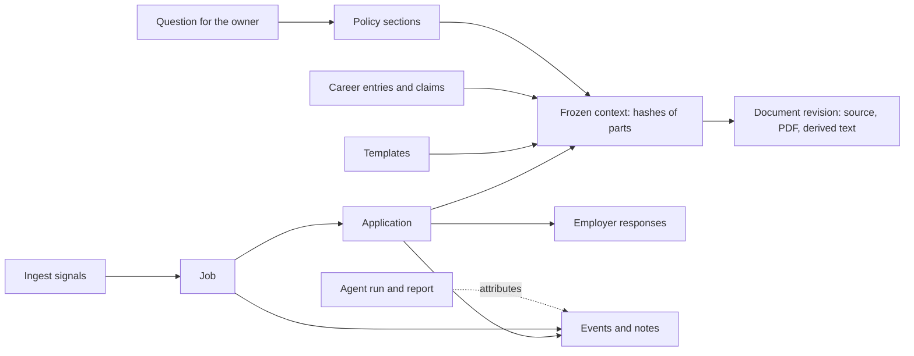

# Proposal: the redesigned Openings (0.x)

Status: **proposed**, waiting for the maintainer's approval (owner checkpoint 1,
issue #134). Baseline: 0.15.2. Nothing here is implemented yet.

Openings grew from a job archive into a workspace that an AI agent operates for its
owner. Most of 0.15 was shaped one feature at a time. This document steps back and
decides what the product should be if designed today around that way of working,
what to keep, what to drop and in which order to change it.

## Summary of the decisions

| # | Question | Recommendation |
|---|---|---|
| 1 | Pipeline | Keep the stored states. Add **Ready** as a real, visible step and organise the product around three owner questions: what do I apply to, what did the agent do, what needs my decision. |
| 2 | Owner policy | Replace free-form Profile `metadata` with a typed **policy**: short lists of decision rules, eligibility facts, writing rules and other confirmed facts. |
| 3 | Documents | The uploaded **source file is canonical**. Readable text is derived from it. Structured `content` stays only for form answers. |
| 4 | Contexts | Keep immutable full snapshots, stored **content-addressed** (#143). No versioned references. |
| 5 | Where things are recorded | One **timeline** per job and application: attributed events plus notes. The single application note becomes a pinned note. Requirements stay. |
| 6 | Agent runs | First-class **runs, reports and questions for the owner**, with every change attributed (#149). |
| 7 | Outcomes | Record **employer responses** with dates, add "no reply", and report response rates (#151). |
| 8 | Skills | Stay shipped and version-matched. Readable in the dashboard, with per-workspace **local notes** instead of forks. |
| 9 | PDF compilation | Stays with the agent. No compile service in this redesign. |
| 10 | Collection | Deterministic **signals at ingest** (language, likely duplicate, closed posting) and explicit, reversible **policy rules** that use them. Yield per source. |
| 11 | API shape | One naming scheme and one argument shape, declared once; old tool names kept as aliases for one release. |
| 12 | Configuration | **Scoped tokens**, a derived restore limit, automatic pruning. |

The data model changes are additive except for three, grouped in one release with
automatic migrations: documents (3), notes (5) and tool names (11).

## 1. Users and jobs to be done

**The owner** has little time and wants offers. The owner states facts and
preferences once, answers focused questions, reads what was prepared, submits each
application personally and records what happened. The owner needs to trust the
record: what was sent, on which facts it was based, and who changed what.

**The operating agent** runs the search under the
[operating mandate](../../skills/openings-workspace/references/operating-mandate.md):
it triages, prepares documents, maintains the Career record and tunes collection.
It works in long, interruptible runs, often as several parallel workers. It needs
compact reads, safe retries, a place to say what it did and a place to ask.

**A newcomer** installs the project and connects an agent. Within an hour the
workspace should hold a career record, templates and first searches, and the
dashboard should explain what happens next.

**Non-goals.** Openings does not submit applications or contact employers. It ships
no model, browser or TeX runtime. It stays a single-owner, self-hosted workspace in
one portable SQLite file. It is not an applicant-tracking system for employers.

## 2. Inventory with evidence

Evidence comes from three places: the generated [parity matrix](parity.md) (#148),
aggregate counts from a large real workspace on 0.15.2 (about 4,600 jobs, 540
applications, 2,200 document revisions, 550 MB), and the friction recorded during
real agent-operated runs. Counts are rounded; no record content was read.

### What real use looks like

- **The agent decides triage.** The Inbox was empty after each run: every collected
  job had been dismissed (95%) or shortlisted. Nearly every shortlisted job
  received a Draft. The owner never triaged; the owner applied.
- **The owner's queue does not exist as a place.** "Ready" is a filter on
  Applications. About 200 ready Drafts waited behind it.
- **Free-form JSON became the real data model.** All Career entries and all claims
  carry agent-written `metadata` (more than 45 distinct keys, such as selection
  roles and render rules). The Profile holds twelve metadata blocks, including the
  decision policy and work authorization. The CV template's `rules` hold fifteen
  blocks and reached version 173. The dashboard shows all of it as raw JSON.
- **Document `content` is not a contract.** Recent revisions use more than twenty
  agent-invented top-level keys. Content and the attached `.tex` drifted on dozens
  of revisions and needed a consistency check and a cleanup run. 30% of revisions
  have no context; 12% are of kind `other`.
- **Storage is mostly repetition.** Frozen contexts take 38% of the database
  (about 310 KB each, nearly identical). Two thirds of all file rows are context
  copies of the same few assets. Raw provider payloads take another 10%.
- **The timeline is mostly noise, and anonymous.** 58% of events are
  `posting_updated`. No event says who made the change.
- **Notes carry what has no home.** About 2,400 notes averaging 1,300 characters,
  plus a separate note field on two thirds of the applications: run reports,
  recorded gaps, questions for the owner.
- **Some features are unused.** Job `availability` is `unknown` on every job.
  Manual field overrides exist on five jobs. Form questions are used by 7% of
  applications. Provider settings were changed once or never.
- **Outcomes cannot be learned from.** Most submitted attempts have no recorded
  employer response, and "no reply" cannot be recorded.
- **Collection is noisy at the source.** The most frequent dismissal reason was an
  explicit language requirement the owner does not meet. Duplicate detection
  returned about 480 candidate groups, most of them different vacancies.
- **REST and MCP are aligned; the dashboard is not.** Of 91 operations, all have
  REST and MCP with the same inputs (one documented difference). Two have no
  dashboard path, three are reached only through another operation, thirteen edit
  structured data as raw JSON, and only 38 dashboard paths are exercised by a
  browser test.

### Keep, simplify, merge, remove, add

| Area | Decision | Evidence and reason |
|---|---|---|
| Shared services behind REST, MCP and dashboard | **Keep** | Parity between REST and MCP is complete and tested. |
| SQLite, optimistic versions, idempotency keys, one open application per job | **Keep** | No integrity incident in real runs; retries and parallel workers were safe. |
| Reversible dismissal, deliberate permanent deletion | **Keep** | 95% of jobs are dismissed; remembering them is what stops repeats. |
| Collection: saved searches, company boards, persisted provider gate | **Keep** | About 1,100 runs with six failed tasks. |
| Frozen contexts | **Keep, store differently** | Reproducibility is a core promise; the cost is storage only (decision 4). |
| Inbox, Shortlist, Applications as separate pages | **Simplify** | The owner uses one of them. Reorganise by owner question (decision 1). |
| Profile `metadata`, entry and claim `metadata`, template `rules` | **Simplify into typed fields** | Agents built a schema inside JSON because the product had none (decision 2). |
| Document `content` and attached source | **Merge** | Two copies of one text drift (decision 3). |
| Application note, job notes, application notes | **Merge** | Three places for free text (decision 5). |
| Staleness report | **Simplify** | Marked every Draft stale after unrelated Profile edits (#144). |
| Possible duplicates | **Simplify** | Precision is too low to act on (#145). |
| Tool and route naming, argument shapes | **Simplify** | `job_get`, `jobs_search`, `sources_get`, `career_get_profile`: four patterns (decision 11). |
| Job `availability` as a manual field | **Remove as manual; derive** | Never set. Becomes a collection signal (decision 10). |
| Per-field job overrides | **Keep, hide** | Five jobs. Needed for corrections, not worth a visible feature. |
| `posting_updated` events | **Remove from the timeline** | Keep the last refresh time on the posting; stop writing one event per refresh. |
| Raw provider payloads | **Trim** | Keep the fields identity and display use; 10% of the database. |
| Consistency check and its override | **Remove after decision 3** | Nothing is left to drift. |
| Agent runs, reports, questions for the owner | **Add** | Today they live in chat and notes (#149). |
| Attribution of every change | **Add** | Events have no actor. |
| Employer responses, "no reply", insights | **Add** | The product's purpose is offers (#151). |
| Ingest signals and policy rules | **Add** | Removes predictable noise before triage (decision 10). |
| Review-and-apply screen, home screen, onboarding | **Add** | The owner's daily work has no screen (#150). |
| Structured editors for every structured value | **Add** | Thirteen operations edit JSON text. |
| Scoped tokens | **Add** | An agent token can change the owner password and create tokens. |

## 3. Decisions

Each decision lists the options considered, the trade-off and the recommendation.

### 1. Pipeline

*Question: are Inbox → Shortlist → Draft → Applied the right stages when an agent
drafts everything it shortlists? What does the owner decide, and where?*

- **A. Keep as is.** No migration. The owner's real queue stays a filter.
- **B. New stage model.** Replace triage and status with one linear state
  (New, Dismissed, Preparing, Ready, Applied, …). Clean on paper; it breaks every
  client, loses the useful separation between interest in a job and one attempt at
  it, and makes "dismiss an applied job" ambiguous again.
- **C. Keep the stored states, change what the product shows.** Triage and
  application status stay as they are. **Ready** becomes a stored, explicit step
  inside Preparing, and the dashboard is organised by owner question.

**Recommendation: C.**

- The owner decides three things: whether to apply to a ready Draft, what really
  happened afterwards, and the answer to a question. The home screen shows exactly
  these: **Ready to apply**, **Needs your decision**, **Since your last visit**.
- **Ready is stored.** Today readiness is computed and nothing records that someone
  judged the Draft complete. A new `ready_at` on the application is set by an
  explicit "mark ready" (allowed only when the computed checks pass) and cleared
  when a current revision changes. The filter, the queue and the agent's handoff
  then mean the same thing.
- Triage remains for manual use and for the agent. In an agent-operated workspace
  the Inbox is the agent's queue, and the dashboard says so instead of presenting
  an empty page as the first screen.
- Status values and the one-open-application rule do not change.

### 2. Owner policy

*Question: should the decision policy, eligibility facts and writing rules become
typed, editable records?*

- **A. Keep free-form `metadata`.** Flexible. The owner cannot review or edit it
  without reading JSON, and any edit marks every Draft stale.
- **B. A fixed schema for everything.** Editable and checkable. Too rigid: real
  policies differ, and each new kind of fact would need a release.
- **C. A small typed policy made of statement lists.** Four sections, each a list
  of items with the same shape.

**Recommendation: C.** A `policy` record with four sections:

| Section | Holds | Example item |
|---|---|---|
| `decision` | Rules for shortlisting and dismissing | "Dismiss roles that require fluent German" |
| `eligibility` | Facts employers ask about | "Work authorization: EU citizen" |
| `writing` | Rules for documents, with scope `cv`, `letter` or `all` | "Never volunteer weaknesses" |
| `facts` | Other owner-confirmed facts | "Notice period: one month" |

Every item has an id, a short label, a statement, an optional value, a note and
the date the owner confirmed it. Items are added, edited, reordered and removed
one at a time, in the dashboard and through REST and MCP. Each section has its
own version, so staleness (#144) compares only the sections documents use, and a
context freezes them.

- Profile keeps its typed fields (name, contact, headline, summary, links).
  `preferences` and `roles` text moves into `decision` items during migration.
- Entry and claim `metadata` get the same treatment where the product acts on the
  value: a claim gains typed `default_in_cv`, `role` and `group`; the rest stays
  metadata. Template `rules` become a list of rule statements beside the typed
  limits.
- Free-form `metadata` remains everywhere as an extension field, shown in a
  key/value editor, never as a text box. Skills stop depending on it.
- Migration is conservative: existing metadata blocks are copied into `facts`
  items as structured values and left in place; the agent then sorts them into
  sections with the owner. Nothing is discarded automatically.

### 3. Documents: one source of truth

*Question: should the source file be canonical and content derived, or the reverse?*

- **A. Content canonical, files generated.** The server would need TeX. This
  contradicts the rule that generation and compilation belong to an external agent.
- **B. Both, checked for consistency (today).** Two copies; the check finds drift
  after it happened; agents fill `content` with whatever they like.
- **C. Source canonical.** A revision is its files. Text is derived.

**Recommendation: C.**

- A CV or letter revision consists of its uploaded source (`.tex` or other text
  source) and PDF, the evidence it cites (claim and entry ids) and an optional
  agent note. The server derives readable text from the source with the existing
  parser, for search, review and comparison between revisions.
- The upload states which source the PDF was built from (the source hash), so the
  pair cannot be mixed up silently.
- Form answers keep structured content: there the structure is the document.
- `documents_consistency`, "approve with differences" and the consistency override
  are removed. `content` on existing revisions is preserved read-only as
  `legacy_content`, so nothing is lost.
- Trade-off: clients that only wrote `content` and never uploaded a source must
  upload one. Real use already uploads both.

### 4. Contexts

*Question: keep full frozen copies, share them (#143), or replace them with
versioned references?*

- **A. Keep full copies.** 38% of the database, growing with every Draft.
- **B. Versioned references.** Contexts would point to record versions. That needs
  a history table for every record type and makes deletion of old versions
  dangerous. A larger change with more ways to break reproducibility.
- **C. Content-addressed parts (#143).** Each distinct frozen record is stored
  once by hash; a context lists hashes. Reads return the same bytes.

**Recommendation: C**, as #143 describes, with two additions: context asset rows
reference blobs by hash instead of adding one file row per context, and summary
columns make context lists fast. #143's target is a reduction of at least 70%;
on the real workspace that is about 150 MB, with byte-identical reads verified for
every context before and after.

### 5. Where things are recorded

*Question: notes, application note, requirements, events. Which stay, which merge?*

**Recommendation: one timeline per job and per application, with two kinds of
entries.**

- **Events** are written by the system, always with an actor and, when there is
  one, a run. Refresh noise is no longer an event.
- **Notes** are written by people and agents. The single `note` field on an
  application becomes a pinned note; job notes and application notes share one
  list with a visible scope.
- **Requirements** stay as typed records on the application: they change readiness.
- **Questions for the owner** stop being notes (decision 6).
- Trade-off: `application.note` disappears from the application payload. It stays
  readable as the pinned note, and the old field is accepted on writes for one
  release.

### 6. Agent runs, reports and questions for the owner

*Question: should these be first-class records (#149)?*

**Recommendation: yes, in three parts.**

- **Actors.** Every event and versioned write records who made it: the dashboard
  session or a named API token. Tokens get a kind (`owner` or `agent`).
- **Runs.** An agent opens a run with the workflow name and scope and closes it
  with a structured report that follows the skills' run-report reference: changes,
  not done, checks, limits. While a token has an open run, its writes are attached
  to that run without extra arguments on every tool. One open run per token:
  parallel workers share the run or use their own tokens. A run that was never
  closed is shown as interrupted, with the changes it made.
- **Questions.** A question has a subject (job, application, Career entry, policy
  item or none), the question, why it matters, optional answer choices, and a
  state: open, answered or withdrawn. The owner answers in the dashboard. The
  agent lists answers given since its last run. An answer that is a lasting fact
  is then recorded as a policy item by the agent, so the same question is never
  asked twice.

Options not taken: keeping reports in notes (cannot be listed, filtered or linked
to changes); a run id argument on every tool (noisy, and easy to forget).

### 7. Outcomes and learning

*Question: how should employer responses be represented (#151)?*

**Recommendation.**

- An application records **responses**: kind (`rejection`, `interview`, `offer`,
  `other`), date and note. Moving a stage in the dashboard records the matching
  response with its date, which stays correctable.
- A fourth closing outcome, **`no_response`**, with the date it was concluded. The
  agent proposes it for attempts older than a period set in the policy; the owner
  or the agent, under that rule, closes them.
- An **insights** operation returns response and interview rates by role family,
  seniority, location, source and time to response, with counts, and withholds a
  rate when the sample is too small.
- Only employer responses count. Drafts closed without applying and agent
  dismissals are excluded by construction.

### 8. Skills

*Question: how are skills versioned, overridden per instance and improved from use?*

- **Versioning:** unchanged. Skills ship with the server and match its version.
- **Per-instance changes:** no forks. A workspace can add **local notes** to a
  skill (short text, versioned, appended when the skill is served). Personal
  criteria continue to live in the policy.
- **Improvement from use:** a run report has a "method" section for what the
  workflow lacked. The maintainer turns recurring items into changes to the
  shipped skills.
- **Dashboard:** skills and their reference files are readable (a parity gap today).

Option not taken: editable copies of skills per workspace. They would drift from
the server version that defines the tools they call.

### 9. PDF compilation

**Recommendation: it stays on the agent's machine.** An optional compile service
would add a TeX runtime, a large image and a new attack surface for a task the
agent already does. The redesign instead makes the result easier to trust: the
upload names the source the PDF was built from (decision 3), and the review screen
shows the PDF beside the derived text. Revisit only if real newcomers fail at this
step.

### 10. Collection

*Question: what is noise, what is missing?*

**Recommendation: signals and rules.**

- **Signals at ingest**, all deterministic and without a model: the posting's
  language, language requirements stated in the text, a likely duplicate of an
  existing job with a confidence score (#145), and a posting that the source no
  longer lists (replacing manual `availability`).
- **Policy rules** may act on signals: for example "dismiss postings that require a
  language outside my list". A rule is an explicit `decision` item, off until the
  owner enables it. Jobs it dismisses are attributed to the rule, listed in the run
  view and restorable like any dismissal.
- **Yield per source:** collected, shortlisted, applied and responses per source
  and per search, as an operation and a dashboard view, so tuning sources stops
  being a hand-written script.
- Likely duplicates are **flagged**, never merged automatically.
- Housekeeping: finished tasks and runs beyond a retention period are pruned, and
  raw payloads are trimmed.

Option not taken: scoring jobs with a model inside the server. The agent does
that, with the owner's policy, outside the core.

### 11. API shape

REST and MCP already expose the same operations with the same inputs. The problems
are consistency and size.

**Recommendation.**

- **One name per operation, declared once** (#141): `<resource>_<verb>` with plural
  resources (`jobs_get`, `jobs_list`, `applications_update`, `profile_get`). REST
  paths keep their current form. Old tool names remain as aliases for one release
  and are listed in the changelog.
- **One argument shape:** flat arguments for identifiers and `expected_version`,
  one `value` object for the body. Today both shapes exist.
- **Lists** return summaries by default with the same `limit`, `offset` and
  `total` everywhere; full records are separate reads. Mutations return compact
  results.
- **Every delete takes `expected_version`**, and every create accepts an
  idempotency key. Notes, documents and files are the exceptions today.
- **Errors** keep the current structured form on both interfaces.

### 12. Configuration and deployment

**Recommendation.**

- **Scoped tokens:** an `agent` token cannot change the owner password, manage
  tokens or restore a backup. Existing tokens keep full access until the owner
  changes them.
- **Fewer required settings:** the restore limit is derived from free disk space
  instead of a fixed number that real workspaces outgrow. Settings shows the
  effective configuration, including the public URL the MCP endpoint accepts.
- **Automatic pruning** of old events, tasks and runs with one retention setting.
- Docker with one container and one volume remains the supported deployment.

## 4. Target architecture and API

The architecture does not change: shared services over one SQLite file, REST and
MCP as thin interfaces, the dashboard on REST, a bounded worker for collection.

**New or changed records**

| Record | Change |
|---|---|
| `policy_items` | New. Sections, items, per-section version. |
| `runs`, `questions` | New. |
| `events` | Adds actor and run. |
| `api_tokens` | Adds kind. |
| `applications` | Adds `ready_at`; `note` moves to a pinned note. |
| `responses` | New. Outcome gains `no_response`. |
| `snapshot_parts` | New. Contexts reference parts by hash. |
| `documents` | Derived text; `content` kept for answers; `legacy_content` for old revisions. |
| `claims` | Typed selection fields. |
| `jobs` | Signals; `availability` derived. |

**New operations** (each on REST, MCP and the dashboard): policy items; runs
(open, close, list, read); questions (ask, answer, list, withdraw); responses;
insights; source yield; mark ready; skill local notes.

**Contracts that stay compatible**

- REST paths, methods and fields of existing operations, except the changes listed
  under "breaking" below.
- The database upgrades itself in one transaction per release; a backup from 0.15
  restores into any later 0.x release.
- Frozen contexts and approved revisions keep their bytes and signatures.
- The rules in `AGENTS.md`: shared services, version checks, immutability,
  reversible dismissal, the provider gate, a core without model, browser or TeX
  runtimes.

**Breaking changes, grouped in one release**

- MCP tool names (aliases for one release before removal).
- Document `content` for CVs and letters; removal of the consistency operation.
- `application.note` as a field.
- Profile `preferences` and `roles` text, moved into policy items.

This stays on 0.x. It is not a 1.0 commitment.

## 5. Migration plan

Each stage is a release that can ship on its own. Dashboard stages (#135) run in
parallel from stage 1; old and new screens coexist until the last one.

| Stage | Release | Content | Schema |
|---|---|---|---|
| 0 | 0.16 | Platform (#137–#140, #142, #146), parity matrix (#148). No behaviour change. | 7 |
| 1 | 0.17 | Attribution, runs, questions (#149). Scoped tokens. Ready as a stored step. | 8, additive |
| 2 | 0.18 | Content-addressed contexts (#143). Pruning and payload trimming. | 9, storage only |
| 3 | 0.19 | Typed policy and claim fields. Staleness by section (#144). Employer responses and insights (#151). | 10, additive |
| 4 | 0.20 | Ingest signals, policy rules, duplicate precision (#145), source yield. | 11, additive |
| 5 | 0.21 | The breaking group: source-canonical documents, notes timeline, tool names. Upgrade guide. | 12 |
| 6 | 0.22 | Removal of aliases and compatibility fields; parity enforced in CI (#136). | 12 |

Rules for every stage:

- Incremental change. No part is rewritten except the dashboard, which #135
  already rebuilds page by page.
- The migration is tested on a copy of a large real workspace and timed before
  release; counts, signatures and integrity are compared before and after.
- Skills, docs, screenshots and the operator-workspace template change in the
  same release as the behaviour they describe.
- The backend quality pass (#141) follows stage 1, so the single registration
  pattern exists before the renames of stage 5.

## 6. Roadmap changes

**New issues**

- Typed owner policy and claim selection fields (decision 2).
- Ready as a stored step (decision 1).
- Source-canonical documents (decision 3).
- One timeline: notes and events (decision 5).
- Ingest signals, policy rules and source yield (decision 10).
- API naming and argument shape, with aliases (decision 11).
- Scoped tokens, derived limits and pruning (decision 12).
- Skills: local notes and dashboard reading (decision 8).

**Changed issues**

- #143: add blob references for context assets and summary columns.
- #144: compare policy sections; depends on the typed policy.
- #145: the confidence score also feeds the ingest signal; no automatic merge.
- #149: confirmed as described, with one open run per token and token kinds.
- #151: confirmed; adds the `responses` record and `no_response`.
- #150: the design starts from the three owner questions and includes editors
  for policy items, questions and runs.
- #135: stages follow the release table above.
- #141: includes the single declaration that the renames need.

**Not planned**

- A compile service, a model inside the server, multi-user accounts.
