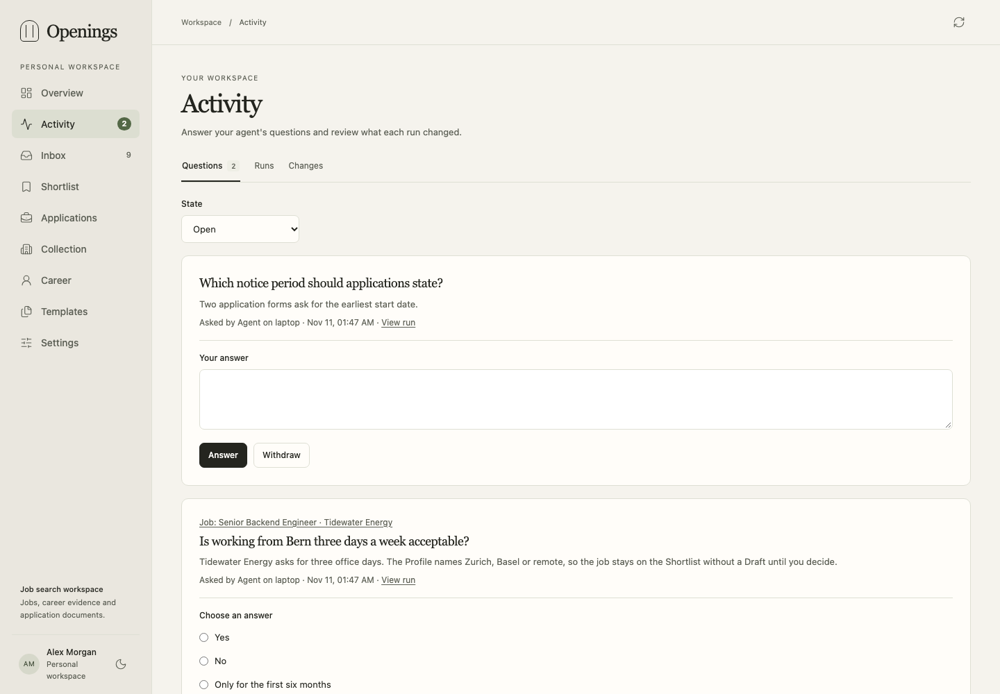
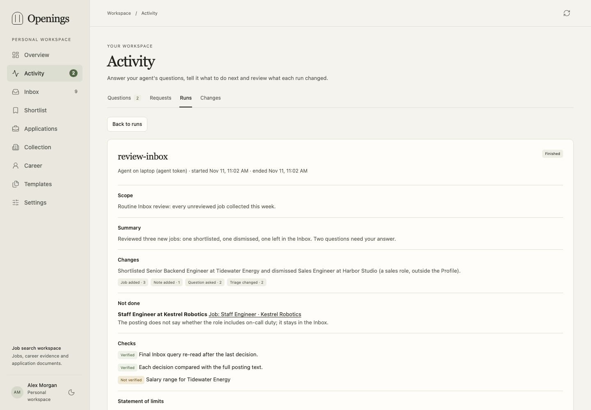
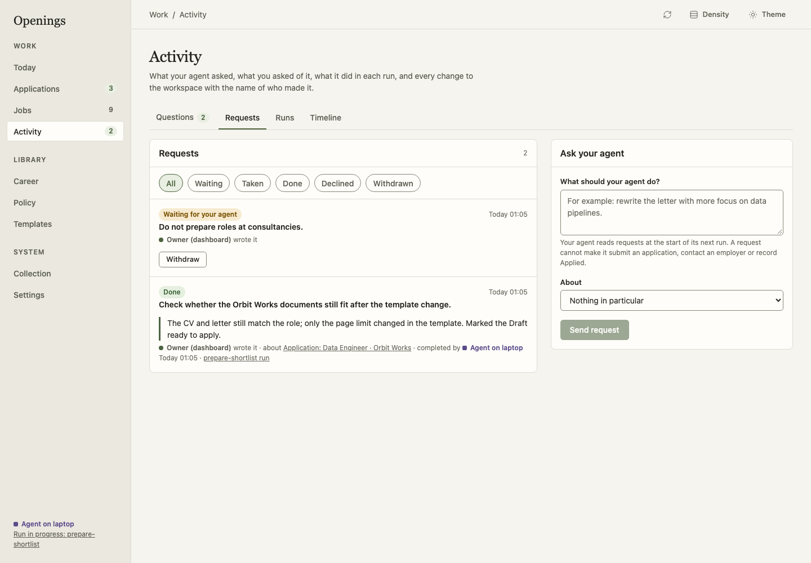

# Agent-operated job search

Openings is built to be run by your own AI agent. You install the workspace and
connect an agent; the agent then runs the search and keeps improving it. Your
part stays small: tell it facts and preferences, answer its focused questions,
apply to the Drafts it prepares, and mark each one Applied or close it.

## What the agent does

With the [workflow skills](../../skills/) and the
[operating mandate](../../skills/openings-workspace/references/operating-mandate.md),
an agent can, without waiting for each request:

| Area | Skill |
|---|---|
| Install, connect and onboard: career record, Profile, policy, templates, searches | [setup-openings](../../skills/setup-openings/SKILL.md) |
| Review the Inbox and shortlist credible jobs under your policy | [review-inbox](../../skills/review-inbox/SKILL.md) |
| Prepare a CV and letter Draft for every shortlisted job, with PDF checks | [prepare-shortlist](../../skills/prepare-shortlist/SKILL.md) |
| Keep searches and monitored companies effective; reduce noise | [manage-sources](../../skills/manage-sources/SKILL.md) |
| Improve your Career record, claims, CV MASTER and letter template | [maintain-career](../../skills/maintain-career/SKILL.md) |
| Prioritize ready Drafts, find stale or expired ones, record what you report | [track-applications](../../skills/track-applications/SKILL.md) |
| Prepare you for interviews from the documents the employer received | [prepare-interview](../../skills/prepare-interview/SKILL.md) |
| Write factual, evidence-based wording | [career-claims](../../skills/career-claims/SKILL.md) |
| Connection, versions, transfers, shared references | [openings-workspace](../../skills/openings-workspace/SKILL.md) |

The agent never submits an application, contacts an employer or records Applied
on its own, and never invents career facts. Your preferences live in the
[Policy](policy.md) and the Career record; Drafts you close are not read as
preferences. The agent proposes policy items, for example from an answer you
gave, and you confirm them under **Library → Policy**; it does not rely on an
item you have not confirmed.

## Set it up

An agent with shell access can do most of this for you with
[setup-openings](../../skills/setup-openings/SKILL.md); you choose the owner
password and create the API token yourself.

1. [Install Openings](getting-started.md) and create an **Agent** token in
   Settings. An agent token runs the whole search but cannot change your
   password, manage tokens, restore a backup or answer its own questions
   (see [token kinds](agents.md#token-kinds)).
2. Give your agent the skills. A connected agent gets them from the server
   itself: `skills_list` and `skill_get` tools, and one MCP prompt per skill,
   always matching the running version. Clients that support
   [Agent Skills](https://agentskills.io/specification) can also load the
   repository's `skills/` directory.
3. Connect the agent to MCP at `<origin>/mcp` with `Authorization: Bearer <token>`.
   **Settings → Agent access** shows ready-to-copy configuration for Claude Code,
   Codex and JSON-based clients (see [Agents and MCP](agents.md)). Set `OPENINGS_URL` and `OPENINGS_TOKEN` in
   the agent's environment for REST and file transfers; set `OPENINGS_CA_FILE`
   when the server uses a private certificate authority.
4. Give the agent an operator workspace: copy
   [`examples/operator-workspace`](../../examples/operator-workspace/README.md),
   point it at your server with `sync.py --url`, and start your client with its
   `launch.py`. It states the operating mandate, generates MCP configuration for
   Claude Code, Codex, Cursor, VS Code, Gemini CLI and opencode, and keeps
   personal data out of Git. The agent's machine needs `pdflatex` to compile PDFs.
5. Start by asking the agent to set up your workspace, or to try it first with
   the synthetic example career. Then tell it about your career. It records facts in the Career
   record and proposes your rules and preferences as policy items for you to
   confirm, asks what is missing, and then runs the workflows above.

## See what the agent did

Every change in Openings records who made it: you in the dashboard, a named API
token, or the system (collection). An agent works in **runs**. It opens a run
with the workflow name and scope, its changes are attached to that run, and it
closes the run with a report: summary, changes, what was not done and why,
checks, a statement of limits and what the workflow lacked. A run that was never
closed is shown as interrupted, with the changes it made.

When the agent needs a fact or a decision, it asks a **question** tied to the
job, application or Career entry concerned. Open **Activity** in the dashboard:

- **Questions** lists the open questions with an answer form; the navigation
  shows how many are open. The agent reads your answers at the start of its
  next run. You can change an answer or withdraw a question.
- **Requests** is where you tell the agent what to do next (see below).
- **Runs** lists the runs; a run shows its report, the requests it handled and
  every record it changed, with links.
- **Changes** lists every change with who made it.

## Ask your agent

You do not need a chat session to give the agent an instruction. Write a
**request** under **Activity → Requests**, or choose **Ask your agent** on a job
or an application to write one about that record: "prepare this one too",
"rewrite the letter with more focus on data pipelines", "stop preparing
consultancy roles".

Openings runs no agent itself, so a request waits until the agent's next run.
Every workflow starts by reading the open requests. The agent takes the ones it
can handle, does the work and writes a short result on the request, or declines
it with the reason. You see the state of each request (waiting, taken, done,
declined, withdrawn), who handled it and a link to the run. You can withdraw a
request until the agent has finished it.

A request directs the agent inside its mandate. It cannot make the agent submit
an application, contact an employer or record Applied: the agent declines that
part and says so. Only you, in the dashboard or with an owner token, write and
withdraw requests; an agent token cannot write requests for itself.

Give each agent, and each parallel worker that should report separately, its
own agent token: a token has one open run at a time, and its name and kind are
what you see next to each change.

## Working with the agent

Ask for anything in plain language: "what should I apply to today?", "add these
companies", "I got an interview at X", "make the CV stronger for data roles".
Between requests, a scheduled or recurring agent session can review new jobs and
prepare Drafts. Each run ends with a short report of what changed, what is left
and which facts the agent needs from you.

Changes stay reversible: records keep versions, contexts and document revisions
are immutable, and the agent backs up before broad changes. You can narrow the
mandate at any time in the operator workspace instructions.
