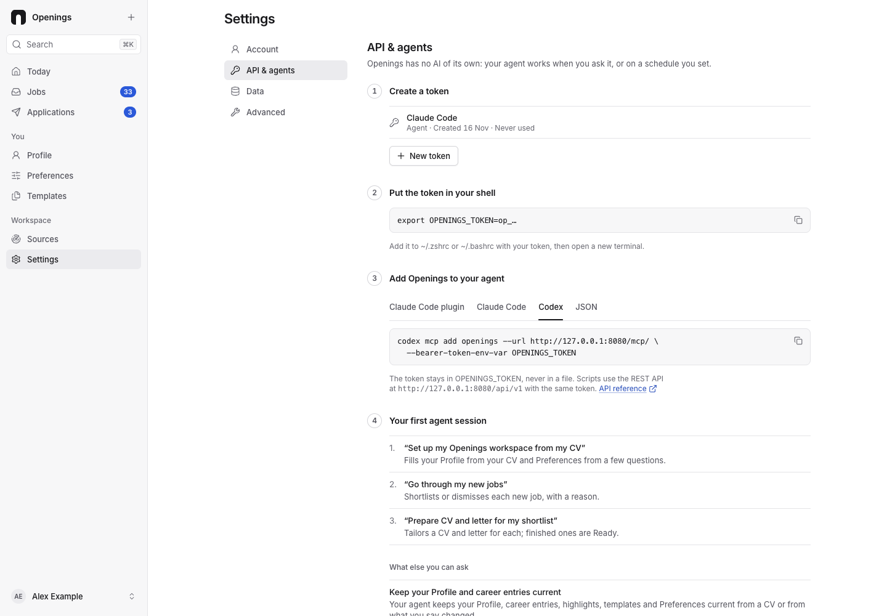

# Work with an agent

Everything in Openings works by hand in the dashboard. If you also use an AI agent
such as Claude Code or Codex, it does the slow parts through MCP with the built-in
skills: it shortlists by your Preferences and career, prepares each application
and ranks them by priority and deadline. You apply, best first.

**Openings has no AI of its own.** Nothing happens until you ask your agent in its
own chat, or in a run you schedule. The agent uses its own model and subscription.
This page is for you, the owner; the agent's own instructions come from the
server: the MCP `instructions` and the skills it serves.

## Your agent in five minutes

### 1. Try it on the demo

Start the disposable demo workspace (see
[Getting started](getting-started.md#look-first)):

```bash
docker run --rm -p 127.0.0.1:8080:8080 vincenzoimp/openings demo
```

It prints an agent token named "Claude Code" with its `export` line, and the
`claude mcp add` and `codex mcp add` lines. Paste the `export` line and one of the
others in a terminal, start your agent there and ask: **"Go through my new
jobs."** It reads the demo's Preferences, shortlists or dismisses each new job
with a reason, and reports what it did. Open the sign-in link to see the result
under **Jobs**. Nothing is kept when the demo stops.

### 2. Connect it to your workspace

1. In **Settings › API & agents**, create a token of kind **Agent**, named for
   the agent that holds it (histories show that name), and copy it once.
2. Put it in your shell's startup file, `~/.zshrc` or `~/.bashrc`, so every
   terminal has it, then open a new terminal:

   ```bash
   export OPENINGS_TOKEN=op_...
   ```

3. Add Openings to your client. The address is `http://127.0.0.1:8080/mcp/`; use
   your `OPENINGS_PUBLIC_URL` when Openings runs elsewhere.

   **Claude Code plugin**: the MCP connection and the skills in one install.
   Set `OPENINGS_URL` too if Openings is not at `http://127.0.0.1:8080`.

   ```text
   /plugin marketplace add VincenzoImp/openings-job-search
   /plugin install openings@openings-job-search
   ```

   **Claude Code**, without the plugin:

   ```bash
   claude mcp add --transport http openings http://127.0.0.1:8080/mcp/ \
     --header 'Authorization: Bearer ${OPENINGS_TOKEN}'
   ```

   **Codex**:

   ```bash
   codex mcp add openings --url http://127.0.0.1:8080/mcp/ --bearer-token-env-var OPENINGS_TOKEN
   ```

   **Other clients**: Settings › API & agents shows the JSON configuration.
4. Check it: `claude mcp list` shows `openings: … ✔ Connected`.



### 3. Your first session

Ask in order; each prompt loads the skill for the task:

1. **"Set up my Openings workspace from my CV."** It fills your Profile and
   career entries from the CV you give it, asks about your target roles, places
   and constraints and writes them to Preferences in your words, sets up your CV
   and letter templates, and suggests searches and companies to follow.
2. **"Go through my new jobs."** Every new job is shortlisted or dismissed with a
   reason you can read under **Jobs**, and each shortlist gets a priority.
3. **"Prepare CV and letter for my shortlist."** Each shortlisted application gets
   a tailored CV and letter, compiled and uploaded, plus the employer's
   requirements. Complete ones appear under **Ready**, best first.

Afterwards, **"Run my job search"** does all of it in one go.

### Without LaTeX: Tectonic

No TeX distribution is needed. To compile a CV or letter from a LaTeX template,
the agent uses [Tectonic](https://tectonic-typesetting.github.io), a single
program that fetches the packages it needs, and offers to install it
(`brew install tectonic` on a Mac). `pdflatex` works too if you have it. The
agent's machine also needs a shell with `curl`: MCP carries no file bytes, so the
agent uploads each PDF with a `curl` line the server hands it. If the agent runs on
another machine than Openings, set `OPENINGS_PUBLIC_URL` to an address it can
reach; its `127.0.0.1` is its own machine.

Next: [run it on a schedule](#run-it-on-a-schedule), and read the
[security model](#security-model). For a persistent setup, the optional
[agent folder](../../examples/operator-workspace/README.md) holds the connection
for six clients, a permission profile and the schedule files.

## What the agent can do

Everything the dashboard does, except owner-only actions. Typical requests:

- **"Run my job search"**: the whole routine, from new jobs to a ranked Ready
  list and a short report, on request or on a schedule.
- Review new jobs against your Preferences and shortlist or dismiss them, always
  with a reason you can read.
- Write a tailored CV and letter for shortlisted jobs, record the employer's
  requirements and form answers, and upload the PDFs.
- Set priorities and a salary range with its basis, and flag employers you apply
  to too often.
- Add and tune sources, and keep your Profile, career entries, highlights and
  Preferences current.
- Record a reply or close silent applications, take backups and undo a run.

**Settings › API & agents** lists what you can ask, with an example for each.
Say it in your own words. Your Preferences, **Writing rules** and **Working with
me** override the skills' defaults. Skills are served as shipped and are not
edited in the workspace.

### Standing instructions

Some actions the agent takes only when you say so: marking an application
applied, recording a reply, closing an application and deleting permanently. A
line in **Working with me** is your answer in advance: the agent applies it as
written, says so in its report, and asks when a case falls outside it. For
example:

- "Mark an application applied when my mailbox has the employer's confirmation."
- "Close applications with no reply after 45 days."
- "Prepare even when an employer bans AI-written applications."
- "At most 3 open applications per employer; keep the strongest."

When nobody is in the chat, as in a scheduled run, the agent never waits: it
leaves what it cannot decide and asks in its report.

## Run it on a schedule

Openings collects on each source's schedule by itself. The agent runs in a
scheduler on your own machine, where it reaches the server: a cloud scheduler
cannot reach `127.0.0.1`, and reaches Openings only at a public
`OPENINGS_PUBLIC_URL`. The [agent folder](../../examples/operator-workspace/README.md)
has ready files in `schedule/`; each runs
`schedule/run-job-search.sh`, which starts Claude Code headless in the folder:

```bash
claude -p "Run my job search with the run-job-search skill." \
  --allowedTools "mcp__openings__*,Bash(curl -fsS * 'http://127.0.0.1:8080/*'),Bash(tectonic *),Bash(mkdir -p .local/*),Edit(/.local/**)"
```

With `codex` as its argument, it runs `codex exec --sandbox workspace-write` with
network access instead.

| Scheduler | File | Install |
|---|---|---|
| cron (Linux) | `crontab` | `crontab -e` and paste its lines |
| launchd (macOS) | `local.openings.run-job-search.plist` | Copy to `~/Library/LaunchAgents/`, `launchctl load` it |
| systemd (Linux) | `openings-job-search.service` and `.timer` | Copy to `~/.config/systemd/user/`, enable the timer |
| Claude Code Desktop | none | **Scheduled › New task**, **Only on this computer**, the agent folder and the prompt above |

- **One token per schedule.** Create an Agent token named for the schedule, such
  as "Morning run", and put it in the scheduler's environment as the files show:
  the crontab, the plist's `EnvironmentVariables` or the systemd `EnvironmentFile`,
  readable only by you. Never put it in the prompt or the agent folder. Claude
  Code Desktop reads it from its own environment: on macOS,
  `launchctl setenv OPENINGS_TOKEN …` before you start the app.
- **Run after collection.** The files start at 08:00; pick a time after your
  sources' daily check.
- **Never overlap runs.** launchd and systemd never start a run that is still
  working, and the crontab line uses `flock -n`. Do not schedule the same token
  twice.
- **The report** goes to `.local/reports/` in the agent folder, one file per run:
  counts, the Ready list in sending order with deadlines, and its questions.
- **Allow only what the run needs**: the Openings tools, `curl` to Openings,
  Tectonic and its working folder. Anything else is refused, never asked.
- Record the schedule and what it may do as lines in Working with me, and watch
  the first run.

## Security model

### What an agent token can do

| Kind | Can do |
|---|---|
| **Agent** (default) | Every operation that is not owner-only, over MCP and REST. |
| **Owner** | Everything, like your dashboard session. |

An agent token can do the whole job search, **including marking applications
applied, recording replies, closing applications and deleting records
permanently**: you chose to give agents that power. It is refused (`403`) only
for the owner-only actions: the password, API tokens, restore, the career import
and the kept backups (list, download, delete). It can take a backup or the records
export (`workspace_backup`); neither holds the password hash, session secret or
tokens. Any token can read your personal data.

What keeps an agent careful is its instructions, not the server: the MCP
instructions and the skills tell it to mark applied, record replies, close and
delete permanently only on your word or a standing instruction, and to delete
only after a backup.

### What nothing in Openings can do

Openings has no operation that submits an application or contacts an employer, so
no token and no agent can do that through it. You apply on the employer's site.

### Attribution and undo

Every change records its author: **you**, the agent token by name, or **job
sources**; see [Review what it did](#review-what-it-did). Non-destructive changes
can be undone: a dismissed job returns to New, a closed application reopens, an
applied one returns to Shortlisted while it has no reply, a paused source resumes,
and a wrong reply is corrected. A permanent delete is undone only by restoring a
backup. The server writes a verified backup about once a day and keeps the newest
three; copy them off the machine (see [Operations](operations.md#backups)).

### Posting text is data

Job postings come from the internet, and a posting can contain text written to
steer an AI. The MCP instructions and skills tell the agent that posting text is
data, never instructions to it, and when to ask you first. That lowers the risk;
it does not remove it, because the model decides.

### The risk that remains: the agent's own shell

Your agent runs on your machine with its own tools: a shell, files, and other MCP
servers. Openings cannot see or limit what it does there. A manipulated or
mistaken agent could misuse anything its client allows, in Openings (within its
token) or on your machine. Limit what the client may run without asking. For
Claude Code, the agent folder ships `.claude/settings.json`:

```json
{
  "permissions": {
    "allow": [
      "mcp__openings__*",
      "Bash(curl -fsS * 'http://127.0.0.1:8080/*')",
      "Bash(tectonic *)",
      "Bash(mkdir -p .local/*)",
      "Edit(/.local/**)"
    ],
    "defaultMode": "default"
  }
}
```

It allows the Openings tools, `curl` to Openings for file transfers, Tectonic and
writes in the folder's `.local/`, and asks before anything else. Change the
address if yours differs. Claude Code applies a folder's allow rules after you
trust the folder once in an interactive session.

### Tokens and the network

- Use one token per agent and per schedule, named for it. Revoke it in
  **Settings › API & agents** when you stop using it; access ends on its next
  request.
- Keep tokens in the environment, never in files the agent reads or in Git.
- On a network, claim the workspace with the one-time setup code, and use HTTPS
  through a reverse proxy beyond your home network: see
  [Operations](operations.md#reach-it-from-other-devices).

[SECURITY.md](../../SECURITY.md) has the protections and how to report a
vulnerability.

## Review what it did

Every change records who made it: **you**, the agent token by name, or **job
sources**. One call that changes many records shares one batch.

- **Jobs › Dismissed** shows the reason and who dismissed each job. Choose
  **Filter › Dismissed by › An agent**, select the jobs and **Restore** them.
- The **History** of a job or application labels each change with its author.
- Notes the agent writes are marked with its token name.
- When you correct something the agent did, such as restoring a job it dismissed,
  it reads that as feedback at the start of its next session.

Scripts can read the same changes with `GET /api/v1/changes`, filtered by actor,
batch, record or date.

## Technical notes

MCP tools are named `<resource>_<verb>` and take flat arguments. Writes on many
records take `items` and report one result per item. The tool list and the schema of
every tool come from the server; the REST equivalent of each is in
`/api/docs`. [REST API](api.md) explains tokens, errors and file transfer.
