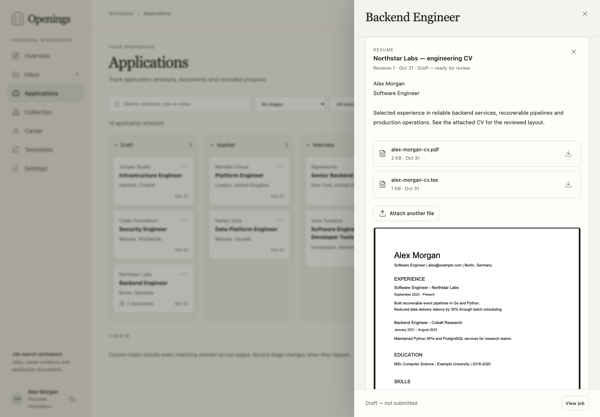

# Application documents and tracking

An application holds its notes, form questions, answers, prepared contexts,
document revisions and progress. A job can have one open application at a time
and retain earlier closed attempts.

## Prepare the library

In **Career**, store your profile, stable [career entries](career.md) and approved
claims. In **Templates**, add one or more resume or cover-letter templates, their
assets and optional writing guidance. Set a default for each document type.
General instructions apply across templates; template guidance adds specific rules.
The synthetic templates in `examples/` provide starting points.

A template can define a one-page engineering CV, a longer research CV or another
layout. Your external agent fills it using the selected facts and instructions.

## Start an application

Open a job and choose **Start application**, then add its questions or notes.
This creates a **Draft** and adds the job to **Shortlist**. Shortlisting alone
simply keeps an interesting offer; it creates no application. Collection and
scoring also leave application creation to you or your agent.

The job shows its application stage and opens the existing attempt when one is
already underway. After closing an attempt, you can deliberately start another.
Keep the application in **Draft** while preparing files. Prepare a context with
the selected templates and relevant career entries or claims.

The context freezes the posting, profile, approved claims, instructions, questions,
templates and exact asset bytes. Later edits affect newly prepared contexts;
existing documents retain the material used to write them.

## Write, compile and upload

Connect an [external agent through MCP](agents.md), or work manually. Ask it to
read the prepared context, write the CV, cover letter and answers, compile LaTeX
on its computer, and upload PDF and source files to the appropriate document
revision. It uses its own model access and tools.

For manual work, create the document in the application and upload its files.
Keep each PDF with the source revision that produced it. Form answers have both
an archived document revision and live application answers; update the live answers
when you want to reuse them in the application form.

## Review and submit

Open the uploaded PDF and check wording, dates, layout and page count. Approve the
reviewed revision when ready. For changed content, create a new revision and upload
its new files. Approved revisions keep their content and attachments fixed.

Submit through the employer's portal, then record **Applied**. Preparing documents
or uploading a PDF leaves the application in its current stage.

## Follow progress

Use the list or Kanban view to move between **Draft**, **Applied**, **Interview**,
**Offer** and **Closed**. Closing an attempt records **Accepted**, **Not selected**
or **Not pursued**; choose an outcome explicitly. Events retain the recorded
journey, including an interview before a later rejection. The overview funnel
follows those recorded stages. The submission date can be corrected or cleared.

## Keep, dismiss or delete

| Action | Result |
|---|---|
| Shortlist | Keep an interesting job without starting an application. |
| Remove from Shortlist | Return the job to review; application history stays intact. |
| Close application | Record its outcome and retain documents and history. |
| Dismiss job | Hide it from active review and remember it during later collection. |
| Delete application | Remove that attempt and its documents/files; keep the job. |
| Forget job | Permanently remove the job, identities and owned application history/files. Future collection can find it again. |

Closing or deleting an application leaves its job in Shortlist. Dismissing a job
preserves its applications; record a closing outcome when you stop pursuing one.
Restore a dismissed job before preparing new application documents.

Scripts and agents can perform the same workflow using the [REST API](api.md)
or [MCP tools](agents.md).
