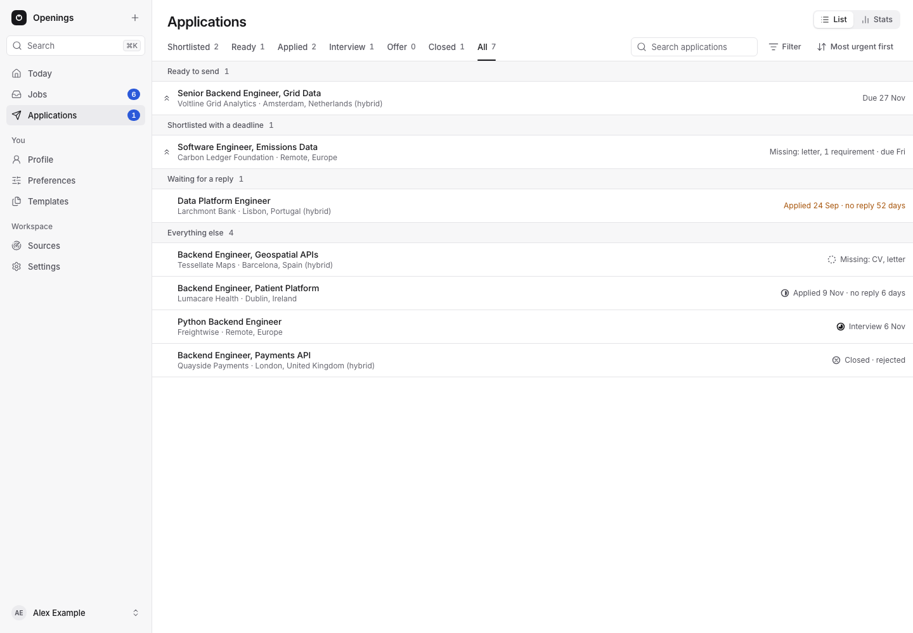
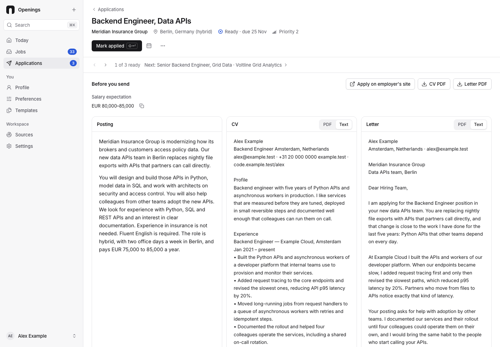

# Applications

Prepare, send and track each application here, from the first document to the
last reply. An application is your attempt to get one job. It holds the
documents, the employer's requirements, form answers, notes and replies.

## Stages

Shortlisting a job starts its application in **Shortlisted**. From there it moves
to **Applied**, **Interview**, **Offer** and **Closed**. A job has at most one
open application, and can keep earlier closed ones.

**Applications** has one tab per stage with its count, plus **Ready**: the
Shortlisted applications that are ready to send. The list offers:

- **Search**, as in Jobs, over the role, company, location, posting and pinned
  note; a stage name such as "interview" finds that stage.
- **Filter**, by priority, deadline, job site or outcome.
- **Sort**, by **Most urgent first** (the default), deadline, last change or the
  day it was sent.

Most urgent first puts **Ready to send, best first** at the top, ranked by
priority, then deadline. Shortlisted ones with a deadline follow, then sent ones
past the no-reply period, then the rest.

Each row shows the role and company, the stage, one phrase about it ("Missing:
letter", "Ready · due Fri", "Applied 12 Oct · no reply 32 days") and the
priority. Ready rows also show their rank and "Priority n". Pointing at a row
shows **Apply** (Ready) or **Record reply** (sent), and `…` with **Change
stage…**, **Close…** or **Reopen**, and **Delete permanently…**.

Closing needs an outcome: **Accepted**, **Rejected**, **Not pursued** or **No
reply**. A closed application stays in the list with its history and files. You
can start a new attempt for the job, but never two open ones at once.

Pick rows with `x` or ⌘-click to act on them together. The bar offers only what
fits every picked row: **Close as no reply**, **Close…** with an outcome,
**Reopen** and **Set priority…**. Each application succeeds or fails on its own,
and a failure is named without stopping the others.

## Ready

Openings computes Ready from the records. A Shortlisted application is Ready when
every document it requires has a complete current revision and no blocking
requirement is open. The required documents are a CV and a letter, unless you
untick one in **Required documents…**.

Where something is missing, the application says what, such as "Missing:
letter". A new blocking requirement, or a new revision still without its PDF,
takes the application out of Ready until it is settled. Ready does not judge the
content, and preparing documents never sends anything. Today and the Ready tab
list Ready applications best first: priority, then deadline.

## Review and apply

An application opens on its own page from Today, a row of the list or a link. Its
head shows the role, company, stage, deadline and priority, **Open posting** and
`…` (**Change stage…**, **Deadline and priority…**, **Required documents…**,
**Close…**, **Delete permanently…**). The rest follows the stage:

- **Shortlisted:** **What's missing** (CV, letter, requirements done), a slot per
  required document for its PDF, the requirements and the form's answers. The
  main action settles the first missing item. Once nothing is missing, the page
  becomes the Ready page.
- **Ready:** the posting, CV and letter side by side, each document with a
  PDF/Text switch; on a phone, the tabs **Check**, **Posting**, **CV** and
  **Letter**. **Before you send** lists the salary expectation your agent
  recorded, open requirements (tick them there), the form's answers with copy
  buttons, **Apply** and **Download CV + Letter**.
- **Applied, Interview, Offer:** where it stands first ("Applied 12 Oct · no
  reply for 32 days") and **Record reply**. Then the notes, the history, the
  documents that were sent, and the folded posting, requirements and answers.
- **Closed:** how it ended ("Rejected on 2 Nov after interview"), the notes, the
  history and the sent documents. `…` › **Reopen** opens it again.

**Apply** opens the employer's site in a new tab, where you send the application.
The Ready page shows its place in the queue ("1 of 3 ready · best first"), and
`[` and `]` move between Ready applications.

**Mark applied** (`⇧↵`) records that you sent it, today unless you pick another
day beside the button. The next Ready application opens at once, and the toast
offers **Undo**, which returns the application to Shortlisted while no reply is
recorded. After the last one the page says **All sent** and links back to Today.
**Not pursuing** (in `…`) closes the application and keeps everything.

## Documents

A CV or letter revision is a **PDF**, and optionally the **LaTeX source** it was
built from. You need no LaTeX: a PDF alone is complete. Drop the PDF on its slot,
or choose **Upload PDF**, with the `.tex` source alongside if you have it.

A revision is incomplete until its PDF is stored. Then it is complete, and its
files never change. A filled slot's `…` offers **Replace…** (a new revision),
**Download**, **Earlier versions**, **Show changes from previous version** and
**Remove…**.

- **Readable text** comes from the source when there is one, otherwise from the
  PDF, without running TeX. The Text switch shows it, and **Show changes**
  compares it line by line. A PDF with no readable text is still complete.
- **A PDF uploaded with a source** must have been built from that source, or
  Openings refuses it.
- **Each revision** can record the career entries and highlights it uses.
- **Form answers and other documents** are text, not PDFs.

Your agent uploads revisions the same way. Each file is limited to 20 MiB.

## Requirements and form answers

**Requirements** record the employer's conditions: authorship rules (such as no
AI-written applications), attachments, references, format, language, eligibility
and dates. Add one on the page, and mark it **Blocking** when the application
must not go out until it is settled. Tick it once it is. Requirements belong to
the application, so refreshing the job keeps them.

**Form answers** keep the answer to each question of the employer's form, with a
copy button, so you can paste them into the form.

## Plan

Give an application a **priority**, from 1 (highest) to 5, and the employer's
**deadline** with **Deadline and priority…**. From the list, you can set a
priority for several at once. Rows show both, and a past deadline on a
Shortlisted application is marked overdue.

## Replies

When the employer answers, choose **Record reply** on the row or the page. Say
what happened, the date it arrived (today by default, never in the future) and an
optional note. One action records the reply and moves the stage:

| Reply | Stage |
|---|---|
| Interview invitation | Interview |
| Offer | Offer |
| Rejection | Closed, Rejected |
| Other (for example a request for references) | unchanged |

Only applications you marked applied can have replies. The dashboard cannot edit
a recorded reply yet. Your agent or the REST API corrects or removes one
(`applications_update`), and that never moves the stage. A sent application's
`…` also has **Close as no reply**, **Withdraw** and, at Offer, **Accept offer**,
each with **Undo**.

**No reply** is a way to close. Set its period with **Count an application as no
reply after [30] days** in [Preferences](profile-preferences-templates.md#settings).
Today's **Waiting for a reply** lists Applied applications without a reply for
longer, with **Close as no reply** for one or for all. Nothing closes by itself,
and your agent closes them only when you ask.

## Notes and history

The application's note is its standing guidance. You read it first on the page
and change it with **Edit**, and your agent reads it first too. The history lists
replies, stage changes and notes, newest first, each with its author: "by you",
"by <token name>" for an agent, or "by job sources". **Show all changes** adds
every recorded change, including the job's.

Before an interview, ask your agent to prepare you. Your agent saves a brief on
the application as a note: what the role needs, stories from your record, likely
questions, weak spots, logistics and questions to ask. After the interview, your
agent saves your debrief as a note too.

## Stats

**Applications › Stats** (beside **List**) covers the applications you sent in
the last 90 days, 12 months or all time: the share that got a reply or an
interview, the median days to a reply and the funnel. Once two sources each have
five sent applications, it adds replies by source.

## Delete

| Action | Result |
|---|---|
| Close | Records the outcome; keeps documents and history. |
| Delete application | Removes that attempt and its documents and files; keeps the job. Deleting the last one returns the job to New. |
| Forget job | Removes the job and everything it owns. See [Jobs and sources](jobs-and-sources.md). |
