# Applications

An application holds its notes, form questions, answers, prepared contexts,
document revisions, progress and the employer's answers. A job can have one open
application at a time and retain earlier closed attempts.

## Prepare the library

In **Career**, store your profile, stable [career entries](career.md) and approved
claims. In **Policy**, state your [rules and facts](policy.md) once. In
**Templates**, add one or more CV or letter templates with their source, assets
and rules: typed limits (pages, bullets per entry, bullet length), a list of
rule statements and guidance. Set a default for each kind of document.
**General instructions** apply across templates; template guidance adds specific rules.

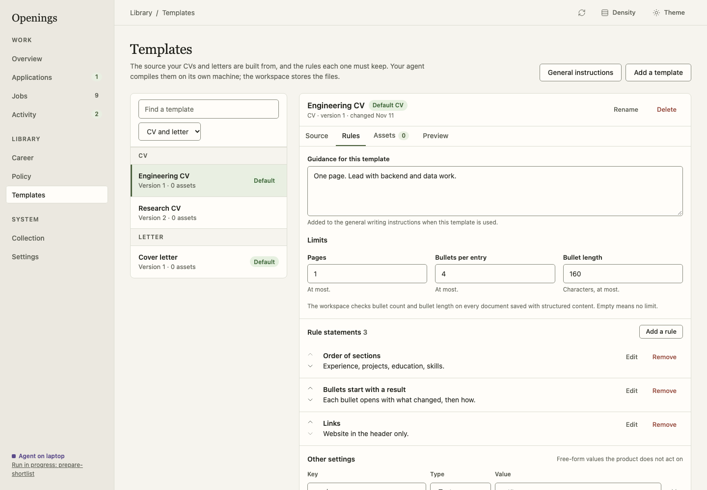

The synthetic templates in `examples/` provide starting points.

A template can define a one-page engineering CV, a longer research CV or another
layout. Your external agent fills it using the selected facts and instructions.

## Start an application

Review new jobs in **Jobs**, which opens on the **New** tab (the tabs are
**New**, **Shortlisted**, **Dismissed** and **All**). Select a job to read it
beside the list, then choose **Shortlist** or **Dismiss…** to reject it
reversibly with an optional reason.

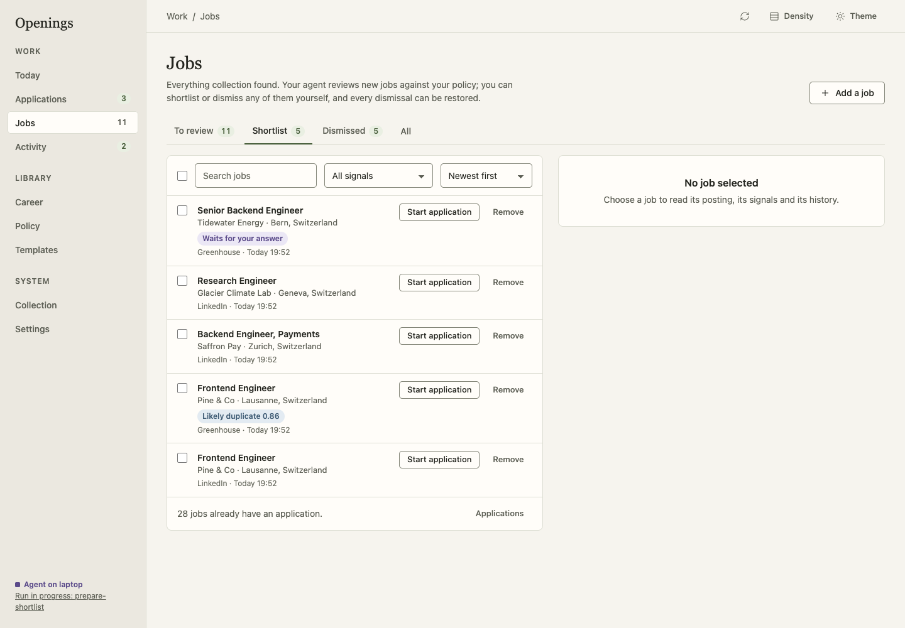

**Shortlist** is the one way to say "I want this job": it starts the job's
application in stage **Shortlisted** (`shortlisted` in REST/MCP), needing a CV
and a letter. Collecting jobs does not start preparation. Undoing a shortlist
(back to New, or dismissing the job) removes that application while nothing has
been added to it; once it has documents, notes, replies, requirements or
answers, close it instead. Closing an application never changes the job's tab,
and deleting a job's last application returns the job to New. The job shows its
application stage and opens the existing attempt. After closing an attempt, you
can deliberately start another.

## The pipeline

**Applications** has two tabs, **Pipeline** and **Insights**. The pipeline counts
every stage with a chip: **Shortlisted**, **Ready** (the Shortlisted applications
that are Ready, see below), **Applied**, **Interview**, **Offer** and
**Closed**. Search by role or company, filter by outcome, and sort by deadline,
priority, the time it was sent or the last change.

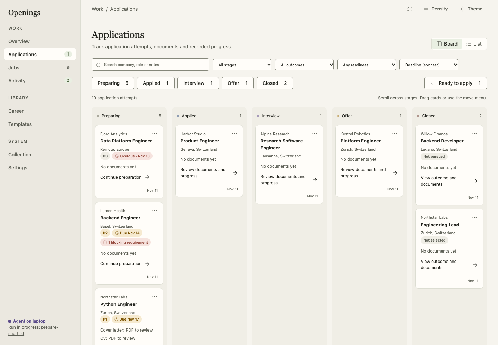

Each row shows the role and company, the stage, the plan (priority, deadline and
a blocking requirement for an application being prepared; the day it was sent
otherwise), the state of the CV and letter ("Missing: letter" names what Ready
still lacks), what the employer answered (or how long the wait is, highlighted
once it is longer than the no-reply period) and the next action: **Review** a
Ready application, **Decide** on a blocking requirement, **Answer** your agent's
question, or **Record reply** for one that was sent. **Board** shows the open stages side by side; **Show closed**
adds the closed ones and **N more** opens the rest of a stage in the list.

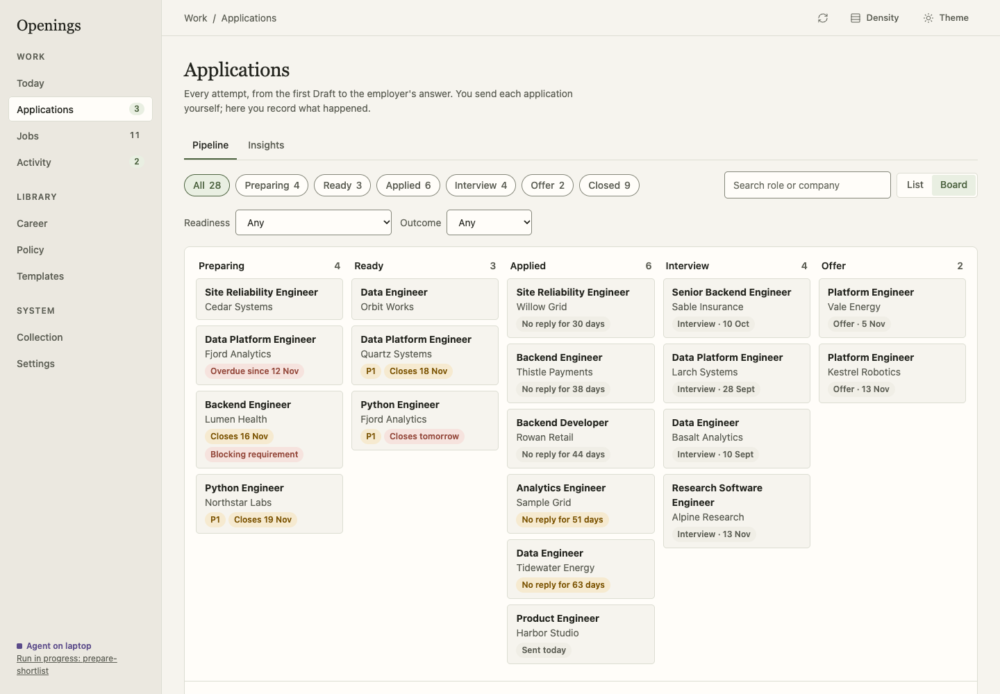

Select rows (or every row shown) to act on them together: **Close as no reply**,
**Close…** with an outcome, **Reopen…** to a stage or **Delete…**. Each
application is changed on its own; one that cannot be, such as an application
never sent closed as no reply or a second open attempt for one job, is named
without stopping the others.

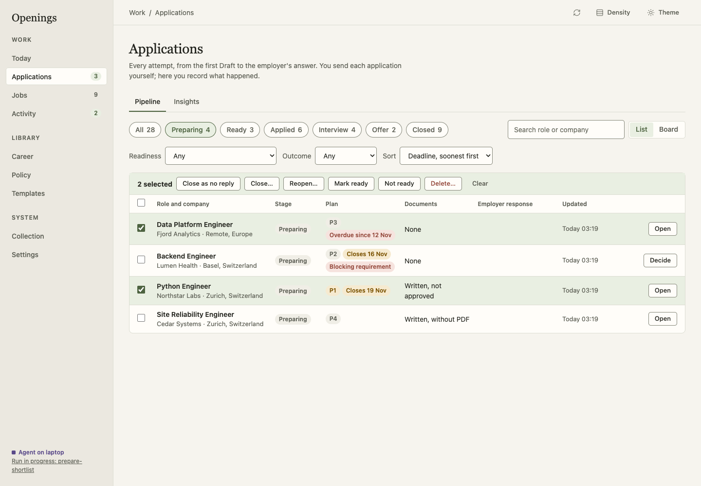

## Review and apply

An application opens on its own page, from Today's **Review**, a row of the
list or any link to it. The posting, the current CV and the current letter stand
side by side with their PDFs; on a phone a switch shows one at a time and the
main actions stay in a bar at the bottom. A switch above the CV or the letter
shows, instead of its PDF, its readable text. An empty slot offers **Upload
PDF**, with the `.tex` source alongside if you have one.

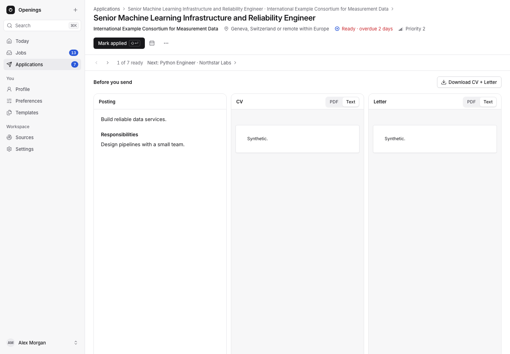

Above them, the page says where the application stands: its stage, deadline and
priority, and for a Ready one its place among the Ready applications in Today's
order (closest deadline first) with a link to the next one. **Before you send** names
the requirements that are not resolved and the required form questions without
an answer. The actions end the task:

- **Download CV and letter** saves both PDFs; **Open the posting** opens the
  employer's page.
- **Mark applied** records that you sent it: the application moves to Applied
  with the time, which you can correct under **Details**. Only you mark an
  application applied; your agent never does.
  Once it is marked, the next Ready application opens, in Today's order, and
  the confirmation offers **Undo** for six seconds: it returns the application
  to Shortlisted, without a sent day. Going back is possible while no reply is
  recorded. After the last Ready application the page says
  **All sent** and links back to Today.
- **Not pursuing** closes it as Not pursued; its documents and history stay.

Below, six tabs hold the rest:

| Tab | What it holds |
|---|---|
| **Answers** | One control per form question, with the live answers; **Copy all**; add, edit and remove questions. |
| **Requirements** | The employer's conditions, each blocking or not and resolved or not, with your note. |
| **Timeline** | The employer's replies, then one list of the notes and changes of the application and of its job, the pinned notes first, with filters. |
| **Inputs** | The frozen copies of your record the documents were written from, their files, and what changed since. |
| **Documents** | Every document revision: open, revise, add files to an incomplete one, delete. |
| **Details** | Stage and outcome, priority, deadline, the time sent, the required documents and whether it is Ready, the pinned note, requests for your agent, the job and deletion. |

Old links to an application (`#applications?application=…&detail=…`) open this
page on the matching tab.

## Write, compile and upload

Under **Inputs**, **Prepare a frozen copy** freezes the posting, profile, policy,
approved claims, instructions, questions, templates and exact asset bytes for
your agent, and downloads it. The chooser supports search and selecting or
clearing matching entries, claims and templates. Claims follow their owning
entries: excluding an entry also excludes its claims. Omitted entry/claim
selections use all eligible material; an explicitly empty selection includes
none. An empty template selection uses your defaults. Later edits affect newly
prepared copies; existing documents keep the material used to write them.

Connect an [external agent through MCP](agents.md), or work manually. Ask it to
read the prepared context, write the CV, letter and answers, compile LaTeX
on its computer, and upload the PDF with the source it was built from as a
document revision. It uses its own model access and tools.

A CV or letter revision is a PDF and, optionally, the `.tex` source it was built
from, with an optional note and the claims and Career entries it uses. You need
no LaTeX: a PDF alone is a complete revision. Openings reads the text from the
source when there is one, without running TeX, and otherwise extracts it from
the PDF; that text is what you search and compare between revisions, and the
PDF is the document you send. When a PDF has no readable text, the revision is
still complete. A PDF uploaded with a source names it, and a PDF built from
another source is refused. Form answers keep their fields.

For manual work, choose **Add a document** under **Documents**, or **Upload
PDF** in the CV or letter slot of the review page: for a CV or a letter, its
title, the frozen copy it was written from, its PDF and optionally its `.tex`
source; for form answers or another document, its text. Form answers have both
an archived document revision and live application answers; update the live
answers under **Answers** when you want to reuse them in the application form.

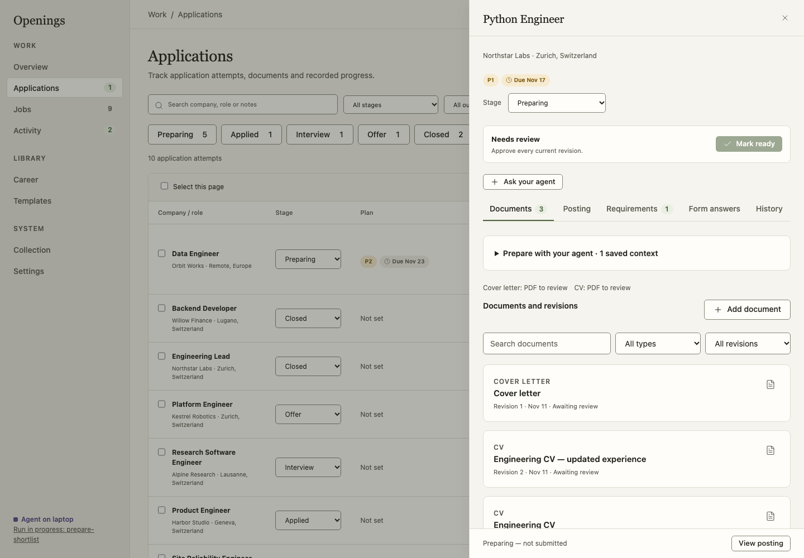

Open the PDF and check wording, dates, layout and page count. A CV or letter
revision is incomplete until its PDF is stored, then complete and fixed: its
files never change. **Compare with revision 1** (for the revision before the
open one) lists the lines removed and added since then, with the unchanged lines
around them. For a changed CV or letter, choose **New PDF** (or **New
revision**) and upload the new PDF and, if you have it, its source. A CV or
letter saved before 0.22 also shows the content stored with it then, read-only.
Click a file name to preview a supported PDF, image or text file with its size
and hash.

The list shows the state of the CV and letter from the current revisions, and
"Missing: letter" (for example) when a required document has no complete
revision. **Inputs changed** marks an
application whose current revisions use a frozen copy made before a later change
to something the documents use, and the line below names the first change, for
example "Profile summary and 2 more". The tab **Inputs** lists every change with
what happened to it: "Profile summary — changed", "Policy “Work authorization” —
changed · Facts employers ask about". A writing rule for the CV only marks the CV
("CV only").

Only what documents use counts: the Profile's name, headline, contact details,
links and summary; the confirmed items of the policy sections for eligibility,
writing and other facts; the text of general guidance; the source, guidance and
rules of the selected templates; the text, dates and skills of the selected
Career entries and the wording of their claims. Editing Profile metadata,
a Decision item (target roles, preferences, a rule for shortlisting jobs), an agent's
unconfirmed proposal, a template's name, the order of entries or claims, a
claim's selection fields or any free-form metadata leaves every application current,
and so does changing spacing or changing a part back. A frozen copy made before the policy
existed (0.19) holds none of it; **Inputs** says that policy changes are not
compared for it. Frozen copies never change; to refresh, prepare a new one and
save new revisions.

Editing a form question keeps compatible live answers. If a changed type, option
or limit makes an answer invalid, the editor shows why and requires an explicit
choice before clearing it. Frozen copies and document revisions stay unchanged.

## Ready

**Ready** is computed, never marked: a Shortlisted application is Ready when
every document it requires has a current complete revision (its PDF stored)
and no blocking requirement is unresolved. Under **Details**, **Required
documents** sets which documents count (CV and letter by default; untick one
when the employer asks only for the other). Details says whether the
application is Ready, and otherwise what is missing.

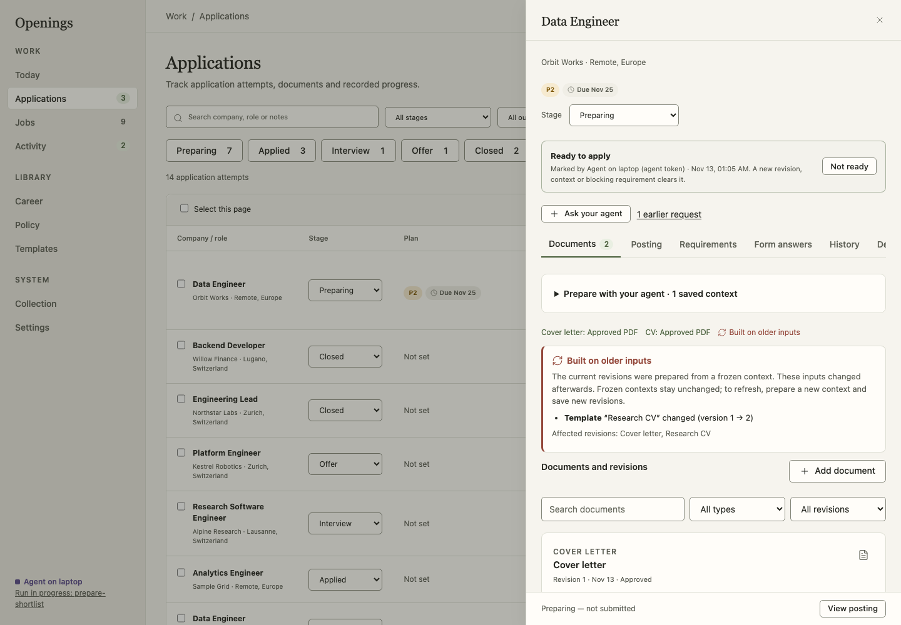

Because Ready is computed, it always follows the records: a new revision that
is not complete yet, or a blocking requirement added or reopened, makes the
application not Ready until that is settled. Writing documents or uploading a
PDF never submits anything.

## Record what the employer did

You send each application through the employer's portal yourself; then choose
**Mark applied** on the review page. When the employer answers, choose **Record
reply** on its row, or on its page: say what happened, the date and an optional
note. One reply records the answer and moves the stage with it:

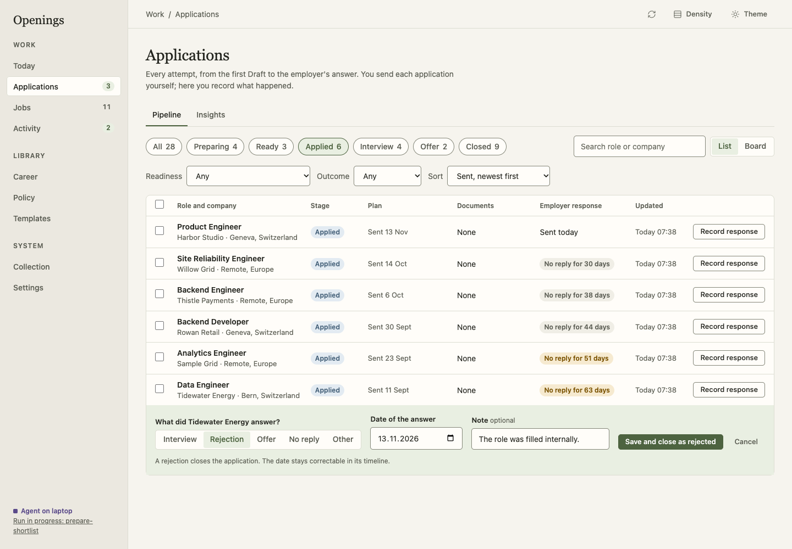

| Reply | What it records |
|---|---|
| **Interview** | An interview reply, and the application moves to Interview (a second interview keeps it there). |
| **Rejection** | A rejection reply, and the application closes as Rejected. |
| **Offer** | An offer reply, and the application moves to Offer. |
| **Other** | Another answer, such as a request for references; the stage does not change. |

The date is the day the answer arrived; it defaults to today and cannot be in
the future. The **Timeline** lists the replies with who recorded them; **Correct
the reply** changes a day, kind or note and **Remove the reply** deletes one
recorded by mistake, neither changing the stage. The upgrade to 0.20 added one
reply to each application already in Interview or Offer and each rejected one
that was sent, dated by the stage change that moved it there; a reply marked
**Estimated date** took the day of the application's last change instead, so
correct it if you know better.

**No reply** is a fourth way to close, with Accepted, Rejected and Not pursued.
The no-reply period is the number of days in your Policy's Decision item
labelled "No reply" (for example "45 days"), or 30 days without one. Today's
**Waiting for a reply** lists the Applied applications without a reply sent
longer ago, with **Close as no reply** on each and for all of them; **Record
replies** opens them in the list. Nothing closes by itself. Your agent may close
them too, but only under a "No reply" rule you confirmed in the Policy;
otherwise it asks you.

## Insights

The **Insights** tab shows how employers answered the applications you sent.

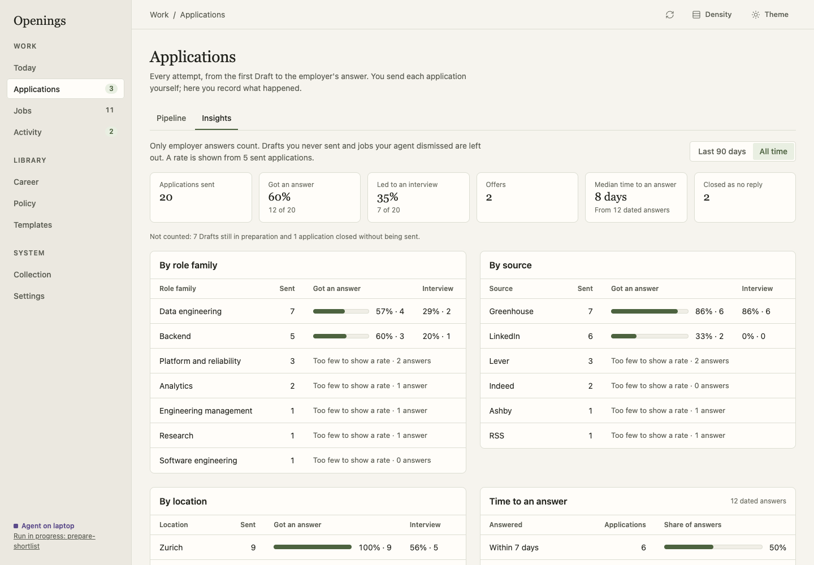

- **Only employer answers count.** The sample is the sent applications: those
  with a sent date, in Applied, Interview or Offer, or with a reply.
  Shortlisted applications you never sent and applications closed without
  being sent are counted apart, and jobs your agent dismissed never had an
  application.
- **Got an answer** is the share with any reply; **Led to an interview** the
  share with an interview or an offer reply; **Offers** the number with an
  offer. **Median time to an answer** is the day of the first reply minus the
  day it was sent; applications without a sent date are counted but not timed.
- **Small samples are not read.** A rate is shown from 5 sent applications in
  its group, and the median and the time table from 5 dated answers; below that
  the group shows its counts and "Too few to show a rate". REST and MCP take a
  different `min_sample` (1 to 100).
- Groups: **role family** and **seniority** read from the job title, **source**
  (the collection source that found the job, else the board it came from, else
  added by hand), **location** (the first part, "Zurich" of "Zurich,
  Switzerland") and **month sent**. **Last 90 days** narrows it to applications
  sent in that time.
- **Progress** at the end shows, for a period of sending, how far the sent
  applications went: reached each stage, waiting there, rejected, no reply or not
  pursued.

Role family and seniority come from fixed keywords in English, German, French
and Italian, never from a model: for example *Data Engineer*, *Dateningenieur*,
*Ingénieur de données* and *Ingegnere dei dati* are Data engineering; *Senior*,
*erfahrener*, *confirmé* and *esperto* are Senior; *Werkstudent*, *stagiaire* and
*stagista* are Intern or trainee. The first family that matches wins, the more
specific first (*Analytics Engineer* is Analytics, *Python Engineer* Backend);
a title without a known word is Unknown, and most titles state no seniority. The
families are Engineering management, Data science and ML, Analytics, Data
engineering, Platform and reliability, Security, Mobile, Full stack, Frontend,
Backend, Quality and testing, Research, Product, Design and Software
engineering.

## Plan and track requirements

Each application can have a **priority** (P1 highest to P5 lowest) and the
employer's **deadline**, set under **Details**. Rows show them; a past deadline
on an application still Shortlisted is marked overdue.

Ready uses only the current revision of each document; a complete earlier
revision does not count when a newer one is incomplete. It does not check the
content or submit anything. REST and MCP list the Shortlisted applications
missing a document with `needs=documents`, and return `missing` for each
(`cv`, `letter` or `requirement:<id>`).

**Requirements** records employer conditions: authorship rules (such as no
AI-written applications), attachments, references, format, language, eligibility
and dates. Mark a requirement **Blocking** when documents must not be prepared or
submitted until it is settled, and **Resolved** with a note once you decide.
They are stored on the application, not in job details, so source refreshes of
the job continue.

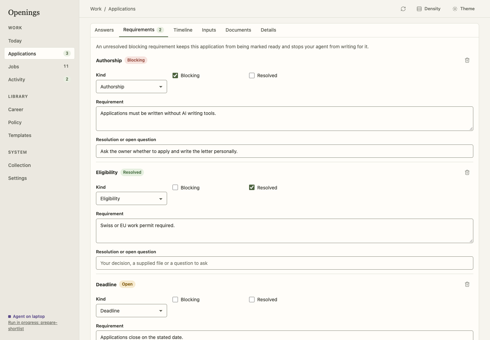

The posting is beside the documents on the review page; **Job details** opens
the job with its notes, files and maintenance actions.

## Keep, dismiss or delete

| Action | Result |
|---|---|
| Shortlist | Start the job's application in stage Shortlisted. |
| Back to New | Reconsider a shortlisted job; its application is removed while it is still empty. |
| Close application | Record its outcome and retain documents and history. |
| Dismiss job | Hide it from active review and remember it during later collection. |
| Delete application | Remove that attempt and its documents/files; keep the job. |
| Forget job | Permanently remove the job, identities and owned application history/files. Future collection can find it again. |

Closing an application keeps it in Applications, including its history and
files. The **Timeline** lists the notes and recorded changes of the application
and of its job in one list, newest first, each with who made it: you in the
dashboard, a named API token (with the workflow of its run) or the system.
Entries from before version 0.17 show "unknown (before 0.17)". The job's own
entries carry a **Job** tag. Filter by kind (notes, changes, employer
replies), by who, by scope (this application or the job) and by period. Add a
note on the application at the top; each note can be pinned, edited or deleted.
The job's page shows the same timeline for the job and every application to it.

**Pinned notes.** A job and an application each have at most one pinned note,
listed first in its timeline; pinning another note unpins the previous one, and
unpinning keeps the note. The application's pinned note is its standing
guidance: edit it under **Details**, where it replaced the application note of
earlier versions. Your agent reads it first, and each new frozen copy of your
record includes it; copies made earlier keep the text they froze.

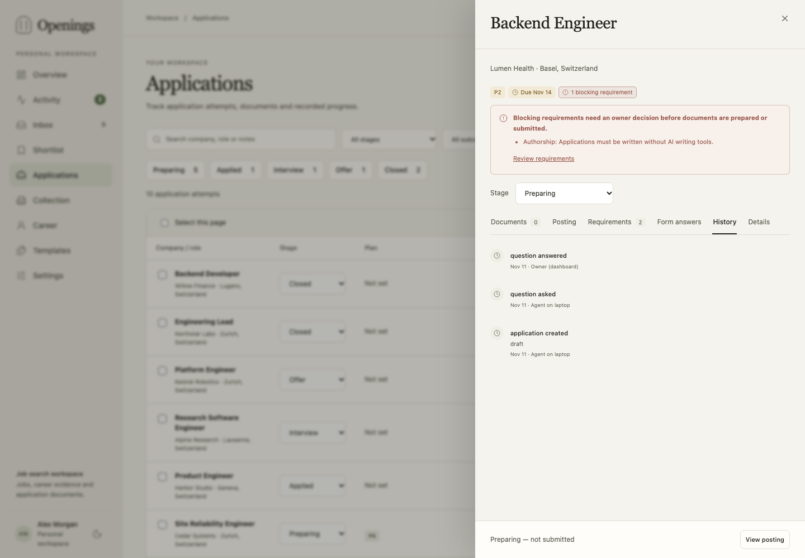

Closing never changes the job's tab. To cancel preparation without losing
documents, close it as **Not pursued**. Deleting the final attempt is permanent
and returns the job to New.

A job collected after another that probably describes the same vacancy (the
same posting from several job boards and the employer's site) carries the
signal **Likely duplicate** with a confidence; the **Likely duplicate** filter
of each tab lists them. The job shows **Is this the same vacancy?** with the
earlier job and the reasons: the same apply link or requisition ID, identical or
nearly identical text, the same company, role and location, and anything that
speaks against it, such as a different location, requisition, level or a
posting published months apart. Company names are compared without legal,
corporate and country suffixes.

**Same vacancy: merge** opens the merge dialog; **Different** records that the
two jobs are separate vacancies, and the signal does not return. Nothing is
merged automatically. **Details**, **Possible copies and merging** lists every
other record that may be this vacancy, at any confidence, and merges with any
job you choose.

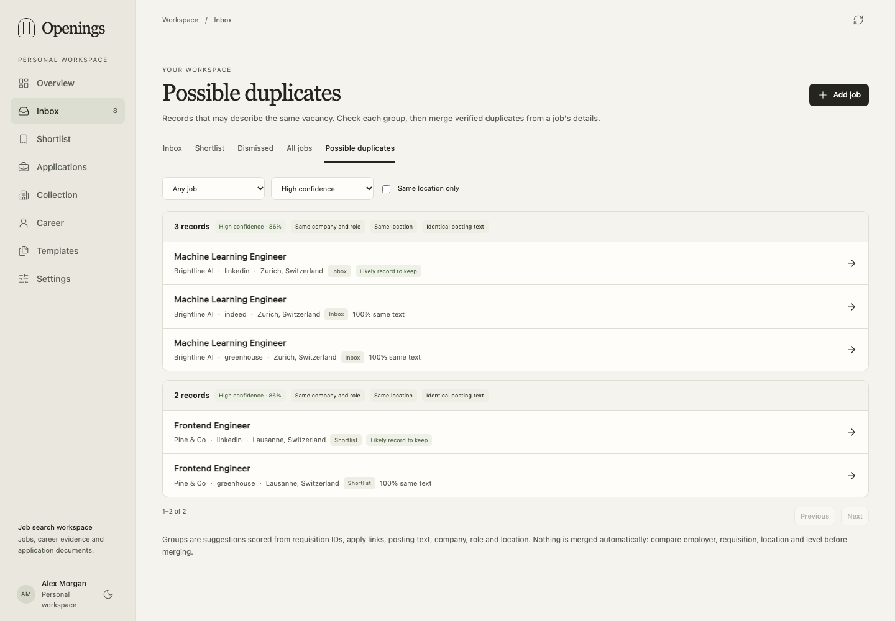

Dismissing a job preserves its closed applications; an open one with work in
it must be closed first. Restore a dismissed job before preparing new documents:
find it under **Dismissed** and choose **Restore**. A later attempt is always
explicit and respects the one-open-application rule.

Scripts and agents can perform the same workflow using the [REST API](api.md)
or [MCP tools](agents.md).
