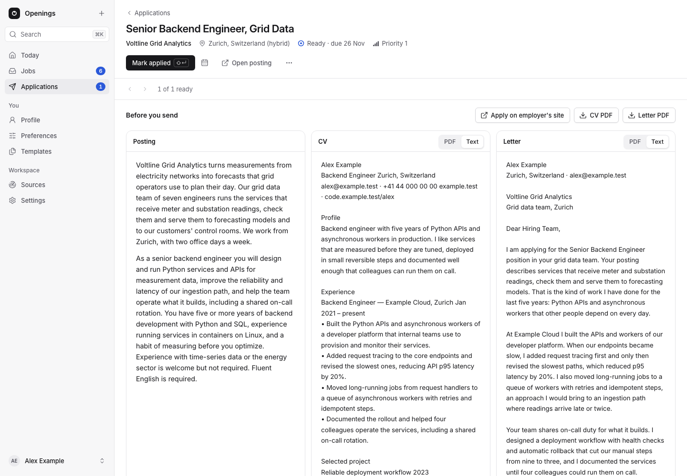

# Applications

An application is your attempt to get one job. It holds the documents, the
employer's requirements, form answers, notes and replies. A job has at most one
open application and can keep earlier closed ones.

## Stages

Shortlisting a job starts its application in **Shortlisted**. From there:
**Applied**, **Interview**, **Offer** and **Closed**. **Applications** has one chip
per stage, with its count, and **Ready**, the Shortlisted applications that are
ready to send. Search by role or company and **Filter** by priority, deadline,
source or outcome. The default order, **Needs action**, puts Ready ones first (by
deadline), then Shortlisted ones with a deadline, then sent ones waiting longer
than the no-reply period, then the rest; you can also sort by deadline, last
change or the day it was sent.

Each row shows the role and company, the stage and one phrase about it ("Missing:
letter", "Ready · due Fri", "Applied 12 Oct · no reply 32 days"), and the
priority as a small glyph. Pointing at a row shows **Apply** (Ready) or **Record
reply** (sent), and `…` with **Change stage…**, **Close…** or **Reopen**, and
**Delete permanently…**.

Closing needs an outcome: **Accepted**, **Rejected**, **Not pursued** or **No
reply**. A closed application stays in the list with its history and files. You
can start a new attempt for the job, but never two open ones at once.

Pick rows with `x` or ⌘-click to act on them together. The bar offers only what
fits every picked row: **Close as no reply**, **Close…** with an outcome,
**Reopen** and **Set priority…**. Each application succeeds or fails on its own,
and a failure is named without stopping the others.

## Ready

Ready is computed. A Shortlisted application is Ready when every document it
requires has a complete current revision and no blocking requirement is open. The
required documents are a CV and a letter unless you untick one in **Required
documents…**.
Where something is missing, the application says what, for example "Missing:
letter" or an open blocking requirement. Today lists Ready applications by closest
deadline, then priority.

Ready follows the records. Add a blocking requirement, or a new revision still
without its PDF, and the application is not Ready until that is settled. Ready
does not judge the content, and preparing documents never sends anything.

## Review and apply

An application opens on its own page from Today, a row of the list or a link. Its
head shows the role, company, stage, deadline and priority, **Open posting** and
`…` (**Change stage…**, **Deadline and priority…**, **Required documents…**,
**Close…**, **Delete permanently…**). The rest follows the stage.

- **Shortlisted:** **What's missing** (CV, letter, requirements done), a slot per
  required document to upload its PDF, the requirements and the form's answers.
  The main action settles the first missing item; once nothing is, the page is
  the Ready page.
- **Ready:** the posting, CV and letter side by side, each document with a
  PDF/Text switch; on a phone, tabs **Check**, **Posting**, **CV**, **Letter**.
  **Before you send** lists open requirements (tick them there), the form's
  answers with copy buttons, **Apply on employer's site** and **Download CV +
  Letter**. The page shows its place in Today's order ("2 of 5 ready · Next: …");
  `[` and `]` move between them.
- **Applied, Interview, Offer:** where it stands first ("Applied 12 Oct · no
  reply for 32 days") and **Record reply**, then the notes, the history, the
  documents that were sent, and the posting, requirements and answers folded.
- **Closed:** how it ended ("Rejected on 2 Nov after interview"), the notes, the
  history and the sent documents; `…` **Reopen**s it.

**Mark applied** (`⇧↵`) records that you sent it, today unless you pick another
day beside the button. Only you do this. The next Ready application opens at once
and **Undo** is offered; it returns the application to Shortlisted while no reply
is recorded. After the last one the page says **All sent** and links back to
Today. **Not pursuing** (in `…`) closes it and keeps everything.

## Documents

A CV or letter revision is a **PDF**, and optionally the **LaTeX source** it was
built from. You need no LaTeX: a PDF alone is complete. Drop the PDF on its slot of
the application page, or choose **Upload PDF**, with the `.tex` source alongside if
you have it. A revision is incomplete until its PDF is stored, then complete and
fixed: its files never change. A filled slot's `…` offers **Replace…** (a new
revision), **Download**, **Earlier versions**, **Show changes from previous
version** and **Remove…**.

- **Readable text** comes from the source when there is one, otherwise from the
  PDF, without running TeX. It is what the Text switch shows and what **Show
  changes** compares (lines removed and added). A PDF with no readable text is
  still complete.
- A PDF uploaded with a source must have been built from that source, or it is
  refused.
- Each revision can record the career entries and highlights it uses.
- Form answers and other documents are text, not PDFs.

Your agent can write and upload revisions the same way; see
[Work with an agent](agents.md). Files are limited to 20 MiB each.

## Requirements and form answers

**Requirements** record the employer's conditions: authorship rules (such as no
AI-written applications), attachments, references, format, language, eligibility
and dates. Add one on the page and mark it **Blocking** when the application must
not go out until it is settled; tick it once it is. They belong to the
application, so refreshing the job does not remove them.

**Form answers** keep the answer to each question of the employer's form, with a
copy button, so you can paste them into the form.

## Plan

Give an application a **priority** (1 highest to 5) and the employer's
**deadline** with **Deadline and priority…**, or a priority for several at once
from the list. Rows show them, and a past deadline on an application still
Shortlisted is marked overdue.

## Replies

When the employer answers, choose **Record reply** on the row or the page, say what
happened, the date it arrived (today by default, never in the future) and an
optional note. One action records the reply and moves the stage:

| Reply | Stage |
|---|---|
| Interview invitation | Interview |
| Offer | Offer |
| Rejection | Closed, Rejected |
| Other (for example a request for references) | unchanged |

The dashboard cannot edit a recorded reply yet: your agent or the REST API
corrects or removes one (`applications_update`), and that never moves the stage. Only applications you marked applied can have replies. A sent
application's `…` also has **Close as no reply**, **Withdraw** and, at Offer,
**Accept offer**, each with **Undo**.

**No reply** is a way to close. The period is **Count an application as no reply
after [30] days** in [Preferences](profile-preferences-templates.md#settings).
Today's **Waiting for a reply** lists Applied applications without a reply for
longer, with **Close as no reply** one by one or for all. Nothing closes by itself,
and an agent closes them only when you ask.

## Notes and history

The application's note is its standing guidance: read first on the page, changed
with **Edit**, and read first by your agent. The history lists replies, stage
changes and notes, newest first, each with who made it: "by you", "by <token
name>" for an agent, or "by job sources". **Show all changes** adds every recorded
change, including the job's.

## Stats

**Applications › Stats** (beside **List**) counts the applications you sent in the last 90 days, 12
months or all time: the share that got a reply or led to an interview, the median
days to a reply, the funnel, and replies by source once two sources each have five
sent applications.

## Delete

| Action | Result |
|---|---|
| Close | Records the outcome; keeps documents and history. |
| Delete application | Removes that attempt and its documents and files; keeps the job. Deleting the last one returns the job to New. |
| Forget job | Removes the job and everything it owns. See [Jobs and sources](jobs-and-sources.md). |
