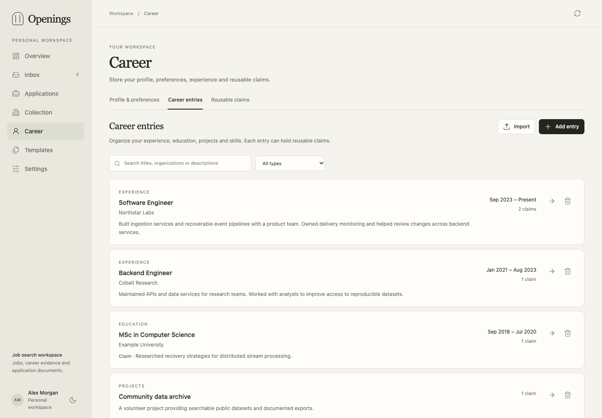

# Career entries and claims

Career stores your profile, reusable entries and claims. A template and its writing
instructions determine how those records appear in an application document.

An **entry** holds stable facts: type, title, optional organization, dates, skill
tags and an optional detailed description. A **claim** belongs to one entry and
holds reusable wording. An entry can have no claims, one claim or several.

| Type | Entry title | Organization | Example claim |
|---|---|---|---|
| Experience | Backend Engineer | Example Co | Reduced ingestion latency by 30%. |
| Education | MSc in Computer Science | Example University | Researched reliable stream processing. |
| Publication | Measuring Public Data Pipelines | Example Conference | Evaluated 40 public datasets. |
| Skill | Languages | — | Python, Go, SQL |

Use **Career → Career entries** to add or edit an entry and manage its claims.
The global **Reusable claims** view supports searching and filtering across entries.
Cards show titles, organizations, career dates and a two-line description or claim
preview. Titles and organizations identify entries in selectors. Descriptions can
stay empty; use them for context and evidence, and claims for reusable wording.



## Dates and ordering

Choose no date, a single date or a period. Each supplied date has a year and an
optional month. A period has a start and either an end or **Present**. Unknown
dates stay empty. Entry dates never fall back to the record's modification date.

The **Order** field controls entry order and claim order within an entry. New
records append by default. Templates and agents can select and arrange relevant
material without changing the stored facts.

## Skills

Skill tags associate capabilities with their supporting entries. Enter them with
commas; whitespace and case-insensitive duplicates are removed while preserving
the first spelling and order. Tags do not infer proficiency or experience length.

You can also create Skill entries such as **Languages**, **Infrastructure** or
**Communication**. A claim can contain a list, a single skill or an explanatory
sentence. Choose the convention that suits your templates and instructions.

## API and agents

REST and MCP expose the same fields and validation. Entry fields `organization`,
`dates`, `skills` and `position` are structured fields, separate from free-form
`metadata`. Do not repeat them inside metadata.

```json
{
  "kind": "experience",
  "title": "Backend Engineer",
  "organization": "Example Co",
  "dates": {"kind": "period", "start": "2023-09", "end": null, "current": true},
  "skills": ["Python", "SQL"],
  "narrative": ""
}
```

A single date uses `{"kind":"single","start":"2025"}`. Send `dates: null`
to clear dates in a versioned update. Omit unchanged fields. Claims also expose
`position`; approved claims are eligible for application preparation contexts.

Prepared application contexts freeze the selected entries, claims, dates and
ordering. Later edits affect future contexts. Review generated wording and files
before recording a submission.
