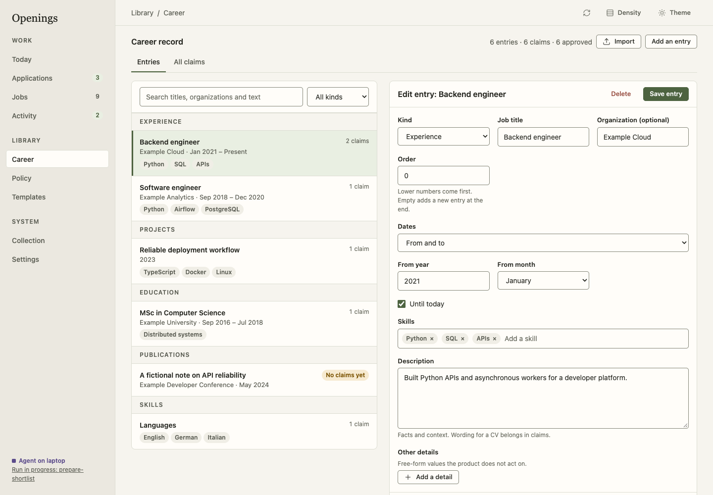

# Career entries and claims

Career stores your profile, reusable entries and claims. A template and your
writing rules determine how those records appear in an application document. Your
rules and preferences are not part of Career: they live in
[Preferences](preferences.md).

An **entry** holds stable facts: type, title, optional organization, dates, skill
tags and an optional detailed description. A **claim** belongs to one entry and
holds reusable wording. An entry can have no claims, one claim or several.

| Type | Entry title | Organization | Example claim |
|---|---|---|---|
| Experience | Backend Engineer | Example Co | Reduced ingestion latency by 30%. |
| Education | MSc in Computer Science | Example University | Researched reliable stream processing. |
| Publication | Measuring Public Data Pipelines | Example Conference | Evaluated 40 public datasets. |
| Skill | Languages | — | Python, Go, SQL |

**Library → Career** shows the **Profile** first: name, headline, location,
contact, summary and links. Below it, **Career record** lists your entries by
kind. Choose an entry to edit it beside the list: its fields, its claims and
its files. **Add an entry** starts a new one and **Import** adds entries from
text or JSON after a preview. **All claims** searches and filters the claims of
every entry. Descriptions can stay empty; use them for context and evidence,
and claims for reusable wording.



## Claims

A claim is a draft until you approve it; only approved claims reach an
application. Each claim row shows its text, **Approved** or **Not approved**,
**Approve** for a draft, a ★ to **Always include in my CV** (the claim is in the
CV unless the job gives a reason to leave it out) and a **…** menu with **Edit**
and **Delete**. The ★ is the API field `always_include`. Anything else an agent
wants to keep about a claim, such as how strongly to prefer it, goes in the
claim's `metadata` in the API; the dashboard does not show or edit metadata.

## Dates and ordering

Choose no date, a single date or a period. Each supplied date has a year and an
optional month. A period has a start and either an end or **Present**. Unknown
dates stay empty. Entry dates never fall back to the record's modification date.

The **Order** field controls entry order; claims keep the order they were added
in (the API's `position` changes it). New
records append by default. Templates and agents can select and arrange relevant
material without changing the stored facts.

## Skills

Skill tags associate capabilities with their supporting entries. Enter them with
commas; whitespace and case-insensitive duplicates are removed while preserving
the first spelling and order. Tags do not infer proficiency or experience length.

You can also create Skill entries such as **Languages**, **Infrastructure** or
**Communication**. A claim can contain a list, a single skill or an explanatory
sentence. Choose the convention that suits your templates and writing rules.

## API and agents

REST and MCP expose the same fields and validation. Entry fields `organization`,
`dates`, `skills` and `position` are structured fields, separate from free-form
`metadata`. Do not repeat them inside metadata. A claim's `always_include` is
typed in the same way; other selection hints of an agent stay in metadata.

```json
{
  "kind": "experience",
  "title": "Backend Engineer",
  "organization": "Example Co",
  "dates": {"kind": "period", "start": "2023-09", "end": null, "current": true},
  "skills": ["Python", "SQL"],
  "narrative": ""
}
```

A single date uses `{"kind":"single","start":"2025"}`. Send `dates: null`
to clear dates in a versioned update. Omit unchanged fields. Claims also expose
`position`; approved claims can be cited by document revisions.

A document revision records the claims and Career entries it cites. Later edits
affect new revisions; existing revisions never change. Review generated wording
and files before recording a submission.

Target roles and what you rule out are statements in [Preferences](preferences.md).

Import previews keep the pasted text while you review it. Leaving an unfinished
import asks before discarding it. If a versioned editor reports a conflict, review
the latest values and copy your draft before choosing **Reload editor and discard
draft**. Reapply only the changes you intend to keep.
