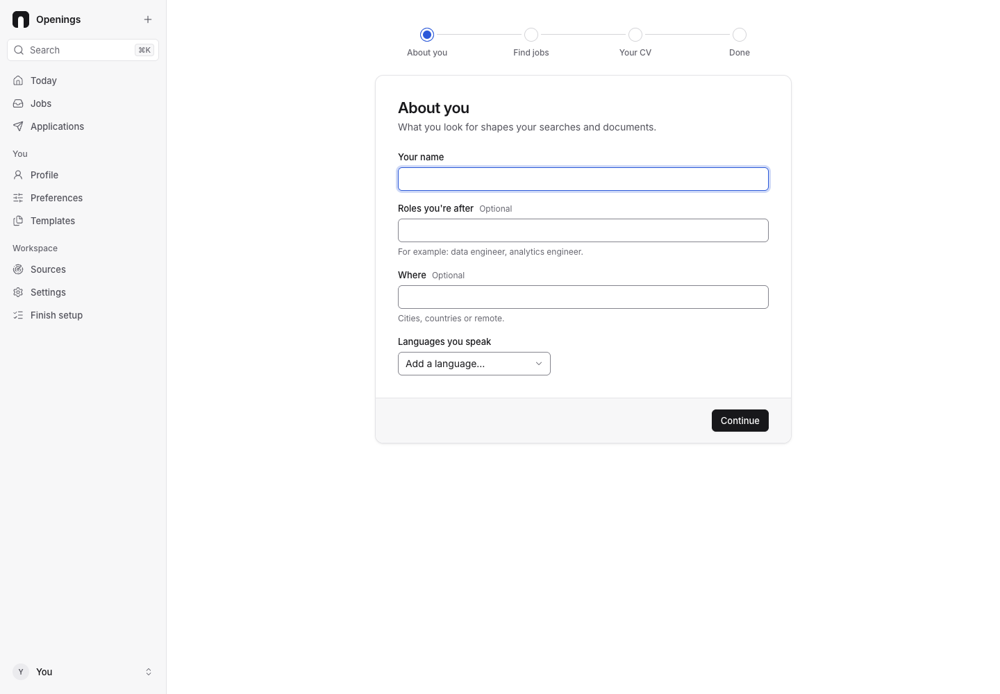
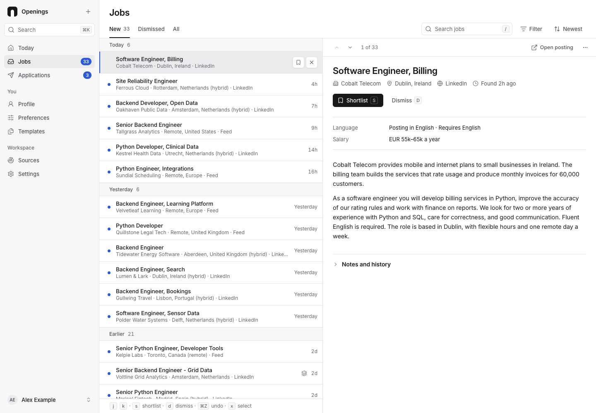
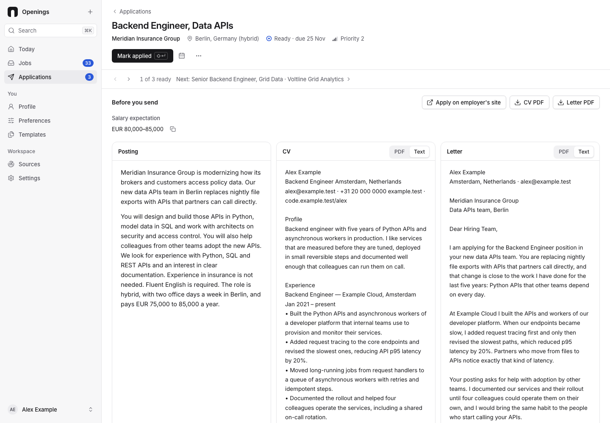

# Getting started

This page takes you from nothing to your first application, by hand, without an
agent. [How it works](how-it-works.md) explains the words used here. You need
Docker; the host needs no Python, Node or TeX.

<!-- quick-start: the README and docs/dockerhub.md repeat these commands (test_docs.py) -->

## Look first

A disposable workspace of fictional data that contacts no job site and is
deleted when it stops (Ctrl+C):

```bash
docker run --rm -p 127.0.0.1:8080:8080 vincenzoimp/openings demo
```

It prints a sign-in link that works once, an agent token with its `export` line,
and the lines that connect Claude Code and Codex. From a clone,
`uv run openings demo` does the same.

## Use it

One command keeps your workspace in the `openings` volume:

```bash
docker run -d --name openings -p 127.0.0.1:8080:8080 -v openings:/data --read-only --tmpfs /tmp --restart unless-stopped vincenzoimp/openings:latest
```

Or with Docker Compose v2, in a folder of its own. The Compose file adds CPU and
memory limits and log rotation, and pins the minor release (such as `0.28`), so
updates bring its fixes:

```bash
curl -fsSLO https://raw.githubusercontent.com/VincenzoImp/openings-job-search/main/docker-compose.yml && docker compose up -d
```

Settings go in a `.env` file beside it (see [Configuration](configuration.md)).
Check that it runs with `curl --fail http://127.0.0.1:8080/health`.

## The setup code

Until an owner password exists, each start prints a one-time **setup code** in
the log. The setup page asks for it, so nobody else on your network can claim the
workspace first:

```bash
docker logs openings            # with docker run
docker compose logs openings    # with Docker Compose
```

The demo needs no code, and with `OPENINGS_PASSWORD` set before the first start
none is printed: that password is the owner's.

## Port 8080 taken?

Map another host port, and tell Openings the address that agents and upload
links use:

```bash
docker run -d --name openings -p 127.0.0.1:18080:8080 -v openings:/data \
  -e OPENINGS_PUBLIC_URL=http://127.0.0.1:18080 \
  --read-only --tmpfs /tmp --restart unless-stopped vincenzoimp/openings:latest
```

With Compose, the address follows the port:

```bash
OPENINGS_PORT=18080 docker compose up -d
```

## On a server or NAS

Publish the port on the network and set the address other devices use, here
`http://nas.local:8080`:

```bash
docker run -d --name openings -p 8080:8080 -v openings:/data \
  -e OPENINGS_PUBLIC_URL=http://nas.local:8080 \
  --read-only --tmpfs /tmp --restart unless-stopped vincenzoimp/openings:latest
```

With Compose, put these lines in `.env`, then run `docker compose up -d`:

```dotenv
OPENINGS_BIND=0.0.0.0
OPENINGS_PUBLIC_URL=http://nas.local:8080
```

Opened from an address the public URL does not cover, the dashboard names the
value to set. Claim the workspace with the setup code right away, and put HTTPS
in front before you reach it from outside your home network:
[Operations](operations.md#reach-it-from-other-devices) has a Caddy and a
Traefik example.

<!-- /quick-start -->

## Set up your workspace

Open **http://127.0.0.1:8080**, enter the setup code and choose an owner password
of at least 10 characters (or set `OPENINGS_PASSWORD` before the first start). A new
installation then opens the **setup guide**, four short steps about you:

1. **About you.** Your name, the roles you are after and where (saved as
   statements under Preferences, *What I'm looking for*), and the languages you
   speak. Only the name is required.
2. **Find jobs.** A company's careers page, read directly from its job board,
   with **Title must include** prefilled from your roles; or a search of
   LinkedIn (with a country, also Indeed and Glassdoor) prefilled from step 1;
   or one job added by its link. **Test** shows what each finds before you
   save it, and a saved source is checked at once.
3. **Your CV.** Paste your CV text and add the career entries read from it, or
   start from the example CV template.
4. **Done.** How every day works, and connecting an AI agent, which is
   optional: Openings has no AI of its own.

Find jobs and Your CV can be skipped; opened again, the guide resumes at the
first step not done. Until the workspace has a name and what
you look for, a job or a source, and a career entry or template, Today shows a
three-item **setup checklist** and the sidebar a **Finish setup** link. Both
are read from the workspace, so every browser shows the same state.



## Find your way

The navigation has three groups: **Today**, **Jobs** and **Applications** for the
daily work; **You** (Profile, Preferences, Templates) for what Openings knows
about you; **Workspace** (Sources, Settings) for the rest.

**Today** shows what is ready to send, what needs attention, applications waiting
for a reply and new jobs. When nothing needs you, it says so.

## Add your first job

1. Choose **Add job** (the **+** button, or `n`). Paste the job's URL, or enter
   the title, company and the whole posting. If a job with that address exists,
   it is shown instead of a copy. When a page cannot be read, paste the text
   yourself.
2. In **Jobs**, the **New** tab lists jobs waiting for a decision. Select one to
   read it beside the list. Choose **Shortlist** (`s`) to pursue it, or
   **Dismiss** (`d`) to set it aside; the next job is shown at once, every
   decision can be undone (`z`), and a dismissal's toast offers
   **Add reason**. Dismissed jobs stay under **Dismissed** and can be
   restored (`r`).



Shortlisting starts the job's application. Undoing it removes that application
while nothing has been added to it.

## Add a source

Jobs can also arrive by themselves. Under **Sources**, choose **Add source**: a
**Search** (a query and a place on LinkedIn, Indeed or Glassdoor), a **Company
careers page** or an **RSS feed**. **Test** shows the first results and saves
nothing. **Save** adds the source and checks it at once, then on the schedule.
[Jobs and sources](jobs-and-sources.md) explains every setting.

## Prepare your first application

You can do this without an agent or LaTeX. Have your CV and letter ready as PDFs.

1. Open **Applications** and select the application you just started. Its page
   says what is missing and has a slot for the CV and one for the letter.
2. Drop each PDF on its slot, or choose **Upload PDF**. If you built it from
   LaTeX, add the `.tex` source too.
3. If the employer sets conditions, such as a required reference, add them under
   **Requirements** and mark the ones that must be settled first as **Blocking**.
4. When both documents are stored and nothing blocks the application, the page
   becomes the **Ready** page and Today lists it under **Ready to apply**.
5. Choose **Download CV + Letter**, then **Apply on employer's site**.
6. Back in Openings, choose **Mark applied**. **Undo** is offered, and the next
   Ready application opens.



When the employer answers, choose **Record reply**, say what happened and give the
date. After the no-reply period (30 days unless you change it in
[Preferences](profile-preferences-templates.md#settings)) Today lists the
silent ones, and you can close them as **No reply**. Nothing closes by itself.

[Applications](applications.md) has the details.

## Fill in your record

Under **You**, add your **Profile** and career entries, state what you want in
**Preferences**, and add a CV and letter **Template** if an agent will write your
documents. None of this is needed to apply by hand.
[Profile, Preferences and Templates](profile-preferences-templates.md) explains
each. Synthetic examples are in the [`examples/`](../../examples/README.md) folder.

## Optional: an agent

If you want an agent to triage jobs and write documents,
[Your agent in five minutes](agents.md#your-agent-in-five-minutes) connects one,
starting on the demo. Back up before you upgrade: see
[Operations](operations.md#update).
