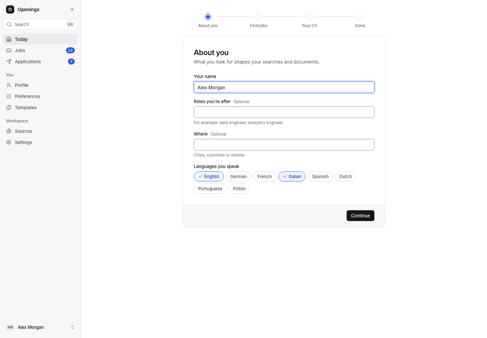
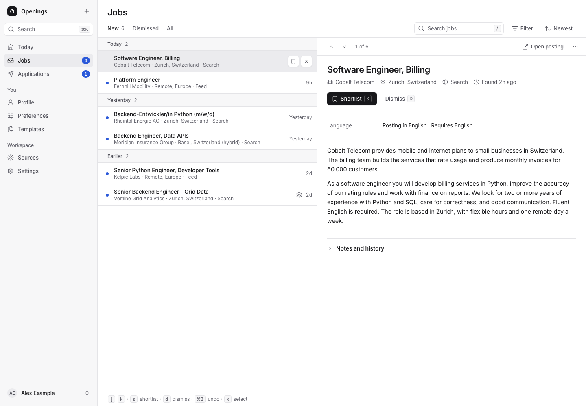

# Setup and first use

Install Docker with Compose v2, then start the published images:

```bash
git clone https://github.com/VincenzoImp/openings.git
cd openings
cp .env.example .env
docker compose pull
docker compose up -d --no-build
```

Images support Linux amd64 and arm64. Docker Compose pins the release; the host
needs no Python, Node or TeX installation. [Contributing](../../CONTRIBUTING.md)
covers local builds.

## Set up your workspace

Open `http://127.0.0.1:8080` and choose an owner password of at least 10
characters (or set `OPENINGS_PASSWORD` in `.env` before the first start). A new
workspace opens on the **setup guide** instead of Today. It has three steps, and
every state in it is read from the workspace, so it shows what is done whoever
did it:

1. **Connect your agent.** Create an agent token, copy it once, and add the
   configuration for Claude Code, Codex or another MCP client (the same as
   Settings, **Agent access**). Then tell your agent "Set up my Openings
   workspace." The step says whether the agent has called yet, and updates by
   itself.
2. **Your record.** What the agent builds with you: the Profile, Preferences,
   the first searches, Career entries, claims and templates, each done, in
   progress or not started, with the agent's open questions. You can fill in the
   first three yourself under their row: your name, headline, place and email;
   the facts employers ask about (such as a work authorization) and how many
   days without an answer make an application unanswered (the no-reply period
   in Preferences, 30 days until you set it); and a first saved search.
3. **First applications.** How every day works once the record is complete.

**Skip for now** goes to Today. Until you finish or skip the guide, Today offers
to continue it; Settings, **Workspace**, **Open the setup guide** opens it at any
time. The browser remembers whether you skipped it; nothing about the guide is
stored in the workspace.



## Finding your way

The navigation has three groups. **Work** holds Today, Applications, Jobs (the
tabs New, Shortlisted, Dismissed and All, each with the selected job beside
the list; after you shortlist or dismiss a job in New, the next job of the list
is shown) and Activity. **Library** holds Career, Preferences and Templates. **System** holds
Collection and Settings. The numbers beside Applications and Activity count the
applications ready to apply and the agent's open questions; the line at the bottom
names the agent while one of its runs is open.

**Today** is the first screen. A sentence counts what waits for you, and the
cards below answer three questions:

- **Ready to apply:** the Shortlisted applications whose required documents are
  complete and that no requirement blocks, closest deadline first, then
  priority. **Review** opens the application's review page, where
  you check the CV and letter beside the posting and mark it applied.
- **Needs your decision:** the agent's open questions, answered in place, and
  applications blocked by a requirement. **Not now** only folds the answer box
  away; the question stays open.
- **What happened:** the pipeline (Shortlisted, Ready, Applied, Interview, Offer,
  each a link to its list), the agent's runs and collection **since your last
  visit**, and the applications **waiting for a reply** longer than the no-reply period
  set in Preferences (30 days unless you change it), with
  **Record replies** to open them and **Close as no reply**, one by one or all
  together. Nothing closes by itself.

"Since your last visit" starts where your previous visit ended: a visit lasts
while Today keeps being opened and ends after 30 minutes without it, so reloading
or looking at a run and coming back changes nothing. The browser remembers the
visit; on the first visit, or when the browser keeps no site data, Today shows
the last 7 days and says so. How your applications fare is under
**Applications**, **Stats**.

On a phone the bottom bar shows the four Work destinations and **More**, which
opens Library and System. The top bar switches between the light and dark theme;
the choice is remembered in the browser, and the theme follows the system until
you choose one.

## Your first job

1. Sign in at `http://127.0.0.1:8080` (see above for the first start).
2. In **Jobs** (it opens on **New**), choose **Add a job**. Paste a URL
   or enter the title, company and full posting. The address is looked up first:
   a job already in your workspace is shown instead of a copy. If URL extraction
   cannot obtain the text, paste it yourself.
3. Select the job to read its posting and signals beside the list, then choose
   **Shortlist** or **Dismiss…**. Shortlisting starts the job's application in
   stage Shortlisted, needing a CV and a letter; undoing it removes that
   application while nothing has been added to it. **Dismiss…** keeps its identity and history and asks for an
   optional reason.
4. In **Collection**, add a saved search or company board, preview it, then enable
   its schedule. New sources start paused.
5. Add [career entries and claims](career.md), templates and writing rules.
   Follow [Application documents](applications.md) to prepare and review files.



Career data, search settings and files live in SQLite. Configure them in the
dashboard, REST or MCP. `.env` controls installation settings such as the host
address and image selection. Search settings need no YAML file.

## Deployment modes and resources

The single `openings` container has a Compose budget of **0.5 CPU / 512 MiB**.
This is an enforced container limit, not a measured host requirement. Allow
resources for the operating system, Docker and other services.

## LAN access

Edit `.env` with the address clients can reach:

```dotenv
OPENINGS_BIND=0.0.0.0
OPENINGS_PORT=8080
OPENINGS_PUBLIC_URL=http://openings.example:8080
```

Replace `openings.example` with your hostname or LAN address. Run
`docker compose up -d --no-build` after edits. The public URL controls MCP host
checks and relative file-transfer links; it must match the client origin. Set the
owner password before opening access to other devices. Use HTTPS through a
trusted reverse proxy across untrusted networks.

Behind a reverse proxy, list the proxy's address as seen by the container in
`.env`, so sign-in limits and secure cookies use each browser's real address:

```dotenv
OPENINGS_TRUSTED_PROXIES=172.18.0.2
```

Use comma-separated IP addresses or CIDR ranges. When it is empty (the default),
`X-Forwarded-For` and `X-Forwarded-Proto` are ignored and all proxied clients
share the proxy's sign-in limit. Trust only proxies that overwrite these headers.

The core listens on port 8080 inside its container. `OPENINGS_PORT` changes the
host port; update `OPENINGS_PUBLIC_URL` to match.

## Storage and checks

The `workspace` volume holds `/data/openings.sqlite`, live journals and all uploaded
file bytes. The core runs as UID/GID 10001. A bind-mounted `/data` directory must be
writable by that identity; the default named volume handles this automatically.

```bash
docker compose ps
docker compose logs --tail=100 openings
curl --fail http://127.0.0.1:8080/health
```

Health checks the core and SQLite. [Operations](operations.md) covers
backups, restore and service lifecycle. Before upgrading, read the release notes:
pre-1.0 releases can change APIs and database format. A release upgrades the
workspace to its format automatically on start; back up before upgrading.
Workspaces older than 0.23 must be opened once with 0.23 first; release history
is in [CHANGELOG.md](../../CHANGELOG.md).
