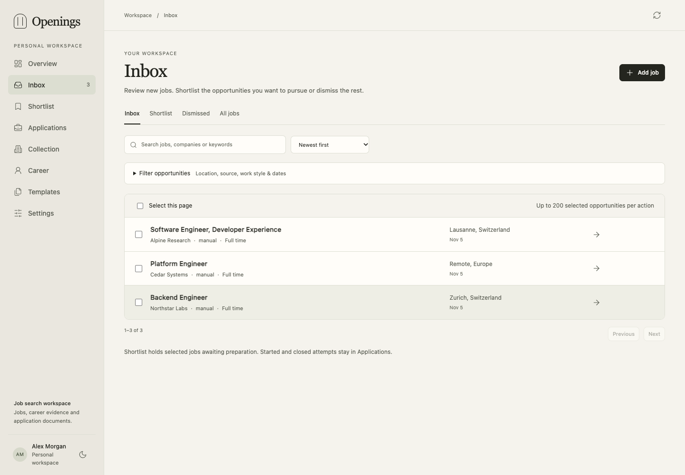

# Setup and first use

Install Docker with Compose v2, then start the published images:

```bash
git clone https://github.com/VincenzoImp/openings.git
cd openings
cp .env.example .env
docker compose pull
docker compose up -d --no-build
```

Images support Linux amd64 and arm64. Docker Compose pins the release; the host
needs no Python, Node or TeX installation. [Contributing](../../CONTRIBUTING.md)
covers local builds.

## Your first job

1. Open `http://127.0.0.1:8080` and choose an owner password of at least 10 characters.
   For unattended setup, set `OPENINGS_PASSWORD` in `.env` before the first start.
2. In **Inbox**, choose **Add job**. Paste a URL or enter the title, company and full
   posting. If URL extraction cannot obtain the text, paste it yourself.
3. Open the job to inspect its description, add it to **Shortlist** or choose
   **Start application**. Starting creates an application in Preparing and removes it from the pending Shortlist;
   an existing application opens instead. **Dismiss** keeps its identity and history.
4. In **Collection**, add a saved search or company board, preview it, then enable
   its schedule. New sources start paused.
5. Add [career entries and claims](career.md), templates and writing instructions.
   Follow [Application documents](applications.md) to prepare and review files.



Career data, search settings and files live in SQLite. Configure them in the
dashboard, REST or MCP. `.env` controls installation settings such as the host
address and image selection. Search settings need no YAML file.

## Deployment modes and resources

The single `openings` container has a Compose budget of **0.5 CPU / 512 MiB**.
This is an enforced container limit, not a measured host requirement. Allow
resources for the operating system, Docker and other services.

## LAN access

Edit `.env` with the address clients can reach:

```dotenv
OPENINGS_BIND=0.0.0.0
OPENINGS_PORT=8080
OPENINGS_PUBLIC_URL=http://openings.example:8080
```

Replace `openings.example` with your hostname or LAN address. Run
`docker compose up -d --no-build` after edits. The public URL controls MCP host
checks and relative file-transfer links; it must match the client origin. Set the
owner password before opening access to other devices. Use HTTPS through a
trusted reverse proxy across untrusted networks.

Behind a reverse proxy, list the proxy's address as seen by the container in
`.env`, so sign-in limits and secure cookies use each browser's real address:

```dotenv
OPENINGS_TRUSTED_PROXIES=172.18.0.2
```

Use comma-separated IP addresses or CIDR ranges. When it is empty (the default),
`X-Forwarded-For` and `X-Forwarded-Proto` are ignored and all proxied clients
share the proxy's sign-in limit. Trust only proxies that overwrite these headers.

The core listens on port 8080 inside its container. `OPENINGS_PORT` changes the
host port; update `OPENINGS_PUBLIC_URL` to match.

## Storage and checks

The `workspace` volume holds `/data/openings.sqlite`, live journals and all uploaded
file bytes. The core runs as UID/GID 10001. A bind-mounted `/data` directory must be
writable by that identity; the default named volume handles this automatically.

```bash
docker compose ps
docker compose logs --tail=100 openings
curl --fail http://127.0.0.1:8080/health
```

Health checks the core and SQLite. [Operations](operations.md) covers
backups, restore and service lifecycle. Before upgrading, read the release notes:
pre-1.0 releases can change APIs and database format, and the app accepts its
current workspace format. Schema 5 and 6 workspaces are upgraded to schema 7
automatically on start; back up before upgrading. Older formats still require
their matching release.
