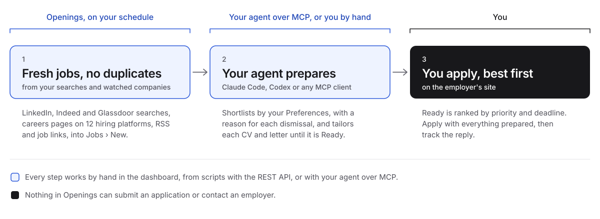

# How it works

Learn here what Openings holds, how a day goes and the words every page shares.
Openings is a self-hosted app with no AI of its own. Your own AI agent reads
what Openings holds to decide on jobs and write documents, and you apply.

## What Openings holds

You set these up once, in your own words:

- **Profile.** Your career entries and their highlights. You approve each
  highlight, and only approved ones reach an application. A ★ means "Always
  include in my CV".
- **Preferences.** Five sections of plain lines: *What I'm looking for*, *What I
  rule out*, *Facts about me*, *Writing rules* (for All documents, the CV or the
  Letter) and *Working with me*, which says what your agent may do on its own.
- **Templates.** Your own CV and letter layouts in TeX, with limits on pages,
  bullets per entry and bullet length, and one default per kind.
- **Sources.** LinkedIn, Indeed and Glassdoor searches, careers pages on 12
  hiring platforms, the Hacker News "Who is hiring?" thread and RSS feeds.
  Each source shows what it found, how many were ever shortlisted and how many
  you applied to.

Change a line in your Preferences, and your agent's next decisions change with it.

## Every new job, filtered, prepared and ranked

<picture>
  <source media="(prefers-color-scheme: dark)" srcset="../images/flow-dark.svg">
  
</picture>

1. **Openings collects.** Fresh jobs arrive from your sources on their schedule,
   or by hand. Repeats are left out and likely copies are flagged.
2. **Your agent decides.** Your agent reads each new job by your Preferences and
   career, then shortlists it with a priority or dismisses it with a reason.
3. **Your agent prepares.** For each shortlisted job, your agent writes a CV and
   letter from your templates and uploads the PDFs.
4. **You apply.** **Ready** lists the complete applications best first: priority,
   then deadline. You choose **Apply**, send it on the employer's site, then
   choose **Mark applied**.
5. **Openings follows through.** You **Record reply** when the employer answers,
   or close a silent application as **No reply**.

Each step also works by hand. You decide when an application counts as applied:
you mark it, or your agent does when you say so or a line in *Working with me*
says how.

## Concepts

1. **Job.** A posting you might apply to, with its text and where it came from.
2. **Triage.** Where a job stands in review: **New**, **Shortlisted** or **Dismissed**. A dismissed job is kept, and can be restored.
3. **Label.** A mark Openings computes without a model: the languages, a likely duplicate, or no longer listed. Labels filter; they never dismiss.
4. **Application.** Your attempt to get one job. A job has at most one open application, and shortlisting the job starts it.
5. **Stage.** **Shortlisted**, **Applied**, **Interview**, **Offer** or **Closed** (Accepted, Rejected, Not pursued or No reply).
6. **Ready.** A Shortlisted application with its required documents complete and no blocking requirement open. Openings computes it.
7. **Document.** A CV or letter as a PDF, with its LaTeX source if you have one, or form answers. A stored revision never changes.
8. **Requirement.** An employer's condition, such as "no AI-written applications". A blocking one keeps the application out of Ready.
9. **Reply.** What the employer did, with a date. Recording one also moves the stage.

## Who does what

| Surface | For | Contains |
|---|---|---|
| Dashboard | You, by hand | Everything you need to find, decide, prepare, send and track |
| REST API | Scripts and your own tools | All dashboard actions, plus the owner-only ones |
| MCP and skills | Your agent, in its own chat | Everything except the owner-only actions: the password, tokens, restore, the career import and kept backups |

The word on screen is the word in REST, MCP and these pages. The
[REST API](api.md#names) page lists the field names behind them.
