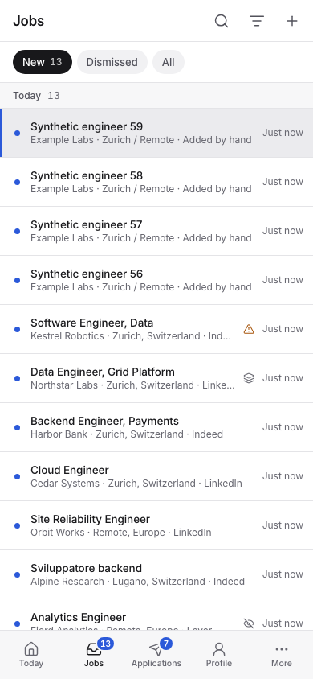

# Jobs and sources

## Review jobs

**Jobs** has three tabs: **New**, **Dismissed** and **All**. Shortlisted jobs live
in Applications; in **All** they show their stage. Select a job to read its
posting, signals, notes and history beside the list. After each decision the
next job is shown, and every decision can be undone from its toast or with `z`.

- **Shortlist** (`s`) starts the job's application (stage Shortlisted). Undoing
  it removes that application only while it is empty. Once it has documents,
  notes, replies, requirements or answers, close the application instead.
- **Dismiss** (`d`) sets the job aside at once; its toast offers **Add reason**
  (up to 500 characters). Dismissed jobs keep their identity and history, so
  later collection does not bring them back as new. **Dismissed** shows who
  dismissed each job and why; the Filter menu narrows it to **You**,
  **An agent** or **Job sources**. **Restore** (`r`) returns a job, or a
  selection, to New.
- **Forget permanently…** in the job's `…` menu removes the job, its identities
  and its applications, notes and files after asking. Collection can find it
  again. This cannot be undone.

Closing an application never changes the job's tab. Deleting a job's last
application returns the job to New.

The keyboard does it all: `j` and `k` (or the arrows) move, `s`, `d` and `r`
decide, `z` undoes, `o` opens the posting, `e` corrects the details, Enter moves
to the job, `/` searches and `?` lists every shortcut. Select several jobs (`x`,
shift+`j`/`k`, or shift-click for a range) to shortlist, dismiss, restore or
forget them at once; each job succeeds or fails on its own. On a phone a job
opens full screen with **Dismiss** and **Shortlist** at the bottom; swipe a row
right to shortlist it or left to dismiss it.

## Add or correct a job

**Add job** (or `n`) takes a URL, or a title, company and the full posting. A job
already in the workspace is shown instead of a copy. When a page cannot be read, the
job stays marked **Text incomplete** until you paste the posting with
**Correct details** in the job's `…` menu. Edits you make are kept when a source
refreshes the job.

## Signals and filters

Each job carries labels computed without a model:

| Signal | Meaning |
|---|---|
| Posting language | The language the posting is written in. |
| Requires | The languages it requires; one language of a group is enough. A language mentioned only as a plus is not required. |
| Possible duplicate | It probably repeats an earlier job. |
| No longer listed | A company board stopped listing it. Set only when a run read the whole board. |

Signals label and filter; they never dismiss a job. Filter by language, signal,
source or who dismissed. List your languages under
[Preferences](profile-preferences-templates.md#settings), then switch on **Hide
jobs requiring languages I don't speak**: a job is hidden when one of its required
language groups has none you speak, and the count of hidden jobs is shown.

## Duplicates

A job that probably repeats an earlier one, such as one posting on several boards,
shows **Possibly the same job as** the earlier job, with the reasons: the same
apply link or requisition ID, the same text, or the same company, role and place,
and anything against it, such as a different place or level. Choose **Merge into
one job** to keep one job with both sources and timelines, or **Keep both** to
record that they are different. The label does not come back. Nothing merges
automatically. **Merge with another job…** in the job's `…` menu merges any two
jobs.

## Sources

**Sources** (page title *Job sources*) lists each source with what it searches,
how its last check went ("Checked 2h ago · 4 new", or in red "Last check failed:
… · Details") and what its jobs became. A paused source is greyed. On hover,
**Check now** and `…` (Edit, Pause or Resume, Duplicate, Delete permanently…).
The top line sets how often every source is checked and has **Check all now**;
its `…` pauses every automatic check. **Recent checks**, collapsed at the
bottom, lists the last 20 checks with Stop and Retry.

**Add source** opens a form: the kind first (Search, Company careers page, RSS
feed), then its fields. **Test** shows the first ten results through the shared
request gate and saves nothing; **Save** adds the source, checked on the
schedule. A source added over REST or MCP starts paused unless it says
otherwise. A paused source can still be checked by hand.

| Source | What it collects |
|---|---|
| Saved search | One query and place on LinkedIn, Indeed and Glassdoor |
| Company board | A Greenhouse, Lever, Ashby, Recruitee, Personio, Workable, SmartRecruiters, BambooHR, Rippling, Workday, Oracle or join.com board, or an RSS/Atom feed |
| Manual job | The URL or text you add under Jobs |

Breezy boards can be previewed but not collected automatically; add their postings
by hand.

### Saved searches

| Setting | Default and range |
|---|---|
| Query | Required. One saved search per query and place. |
| Location | Empty. Use a place the portal knows. |
| Country | Empty. Indeed and Glassdoor need one, such as `switzerland` or `uk`; LinkedIn uses the location alone. |
| Portals | All three; choose the ones you want. |
| Result limit | 20 per portal per run, 1 to 50. Known jobs count. |
| Age window | 72 hours, 1 to 8760. |
| Remote only, job type | Off, any. |

A query and a result limit do not guarantee complete coverage: portals sort by
relevance, round age filters and sometimes return incomplete results.

### Company boards

Paste the careers page or feed URL; the form names the detected service, and
**Test** confirms it. The
result limit is 100 matching jobs per run (1 to 2000). Optional filters keep
matching **titles** and **locations** and skip **excluded role terms** such as
`sales`; any matching term in a group is enough, and unknown locations stay
visible for review. Lever boards have a region (`global` or `eu`). Company boards
can hold undated jobs, so the age window does not apply to them.

### Schedule

The top line of Sources sets one interval for every source (1 to 24 hours).
Over REST and MCP a source can have its own **interval** (default every 1440
minutes, 15 to 43200) or **daily times**: one to twelve local `HH:MM` times and a
time zone, such as `08:00, 16:00` in `Europe/Berlin`. The first interval run
waits one interval after enabling; use **Check now** to collect now. Missed slots
merge instead of queueing. Pausing every automatic check keeps the settings;
checks already queued continue until **Stop** under Recent checks.

Over REST and MCP a run can change the age window or result limit for that run
only, and several sources can be enabled, paused, run, changed or deleted
together. Deleting a source keeps the jobs it found.

### Runs and counts

**Recent checks** shows each check's time, source and what it found or why it
failed; REST `GET /collection/runs` has the cumulative counts: processed, new,
already known, invalid, waiting for text and text unavailable. A
**Partial** run reached a limit or could not fetch some descriptions.

Automatic candidates enter your jobs only when usable posting text exists. Those
still waiting stay in the run's progress and resume by themselves.

Each source row shows what it found, such as "31 found · 9 shortlisted ·
3 applied". A source that finds many jobs and few you keep is a candidate to
narrow or pause.

### Request limits

**Settings › Advanced** shows the shared gate of each job site your sources use:
its state and the minimum spacing between requests (5 seconds by default), saved
when you leave the field. Every request obeys it:
previews, URL imports, scheduled and manual runs, redirects and detail pages. An
HTTP 429 pauses the provider until its retry time; the pause survives restarts.
A login page is reported as blocked. A portal can still block requests or change
its pages; paste the posting when a page cannot be read.

Source fields and defaults are read from the running server: REST
`GET /api/v1/sources/schemas`, or `collection_get` over MCP.
