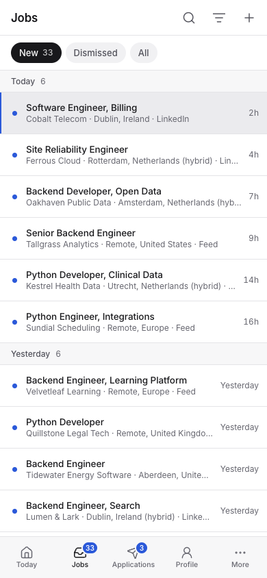
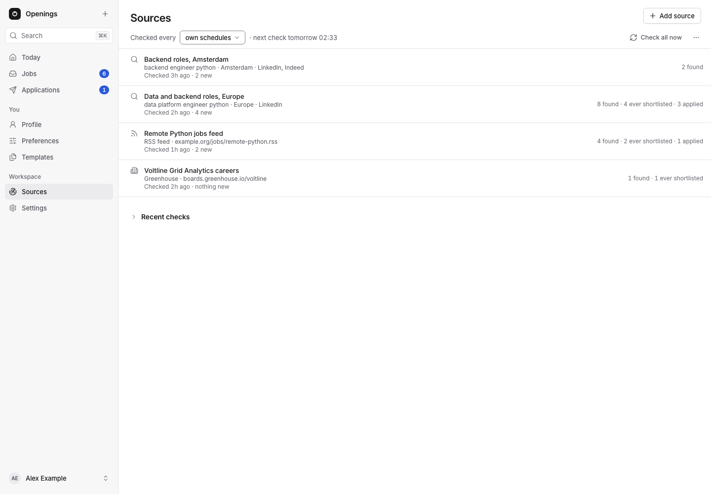

# Jobs and sources

## Review jobs

**Jobs** has three tabs: **New**, **Dismissed** and **All**. Shortlisted jobs live
in Applications; in **All** they show their stage. Select a job to read its
posting, labels, notes and history beside the list. After each decision the
next job is shown, and every decision can be undone from its toast or with `z`.

- **Shortlist** (`s`) starts the job's application (stage Shortlisted). Undoing
  it removes that application only while it is empty. Once it has documents,
  notes, replies, requirements or answers, close the application instead.
- **Dismiss** (`d`) sets the job aside at once; its toast offers **Add reason**
  (up to 500 characters). Dismissed jobs keep their identity and history, so
  later collection does not bring them back as new. **Dismissed** shows who
  dismissed each job and why; **Filter › Dismissed by** narrows it to **You**,
  **An agent**, **Job sources** or **Not recorded** (dismissed before 0.21,
  when Openings did not record who did it). **Restore** (`r`) returns a job, or a
  selection, to New.
- **Forget permanently…** in the job's `…` menu removes the job, its identities
  and its applications, notes and files after asking. Collection can find it
  again. This cannot be undone.

Closing an application never changes the job's tab. Deleting a job's last
application returns the job to New.

The keyboard does it all: `j` and `k` (or the arrows) move, `s`, `d` and `r`
decide, `z` undoes, `o` opens the posting, `e` corrects the details, Enter moves
to the job, `/` searches and `?` lists every shortcut. ⌘K (Ctrl+K) searches jobs and
applications from any screen, best match first: the title, then company, location
and state, then the posting text. Select several jobs (`x`,
shift+`j`/`k`, or shift-click for a range) to shortlist, dismiss, restore or
forget them at once; each job succeeds or fails on its own. On a phone a job
opens full screen with **Dismiss** and **Shortlist** at the bottom; swipe a row
right to shortlist it or left to dismiss it.

## Add or correct a job

**Add job** (or `n`) takes a URL, or a title, company and the full posting. A job
already in the workspace is shown instead of a copy. When a page cannot be read, the
job stays marked **Text incomplete** until you paste the posting with
**Correct details** in the job's `…` menu. Edits you make are kept when a source
refreshes the job.

## Labels and filters

Each job carries labels computed without a model:

| Label | Meaning |
|---|---|
| Posting language | The language the posting is written in, when it is English, German, French, Italian, Spanish, Portuguese, Dutch, Polish, Swedish, Danish, Norwegian or Finnish. |
| Requires | The languages it requires; one language of a group is enough. A language mentioned only as a plus is not required. |
| Possible duplicate | It probably repeats an earlier job. |
| No longer listed | A company careers page stopped listing it. Set only when a check read the whole page; a page that suddenly lists nothing must list nothing at the next check too. |

Labels describe and filter; they never dismiss a job. **Filter** by language,
label, source or who dismissed. List your languages under
[Preferences](profile-preferences-templates.md#settings), then switch on **Hide
jobs requiring languages I don't speak**: a job is hidden when one of its required
language groups has none you speak, and the count of hidden jobs is shown.

## Duplicates

A job that probably repeats an earlier one, such as one posting on several sites,
shows **Possibly the same job as** the earlier job, with the reasons: the same
apply link or requisition ID, the same text, or the same company, role and place,
and anything against it, such as a different place or level. Choose **Merge into
one job** to keep one job with both sources and timelines, or **Keep both** to
record that they are different. The label does not come back. Nothing merges
automatically. **Merge with another job…** in the job's `…` menu merges any two
jobs.

## Sources

**Sources** lists each source with what it searches,
how its last check went ("Checked 2h ago · 4 new", or in red "Last check failed:
… · Details") and what its jobs became. A paused source is greyed. On hover,
**Check now** and `…` (Edit, Pause or Resume, Duplicate, Delete permanently…).
The top line sets how often every source is checked and has **Check all now**;
its `…` pauses every automatic check. **Recent checks**, collapsed at the
bottom, lists the last 20 checks with Stop and Retry.

**Add source** opens a form: the kind first (**Search**, **Company careers page**,
**RSS feed** or **HN Who is hiring**), then its fields. **Test** shows the first
ten results and saves nothing; on a careers page it lists the titles first, then
fetches their text. When a site refuses or finds nothing, Test says why and until
when, and suggests a careers page; **Save** adds the source and checks it at
once, then on the schedule. A source added over REST or MCP starts paused unless it says
otherwise. A paused source can still be checked by hand.

| Source | What it collects |
|---|---|
| Search | One query and place on LinkedIn, Indeed and Glassdoor |
| Company careers page | The jobs of one company on Greenhouse, Lever, Ashby, Recruitee, Personio, Workable, SmartRecruiters, BambooHR, Rippling, Workday, Oracle or join.com |
| RSS feed | An RSS or Atom feed of jobs |
| HN Who is hiring | The latest monthly Hacker News "Ask HN: Who is hiring?" thread |

Jobs you add under Jobs have no source. Breezy pages can be previewed but not
collected automatically; add their postings by hand.

### Searches

| Setting | Default and range |
|---|---|
| Keywords | Required. One search per query and place. |
| Location | Empty. Use a place the portal knows. |
| Country | Empty. Indeed and Glassdoor need one, such as `germany` or `uk`; LinkedIn uses the location alone. |
| Job sites | All three; choose the ones you want. |
| Posted within | 72 hours, 1 to 8760. |
| Result limit (REST and MCP: `results_wanted`) | 20 per portal per check, 1 to 50. Known jobs count. |
| Remote only, job type (REST and MCP: `is_remote`, `job_type`) | Off, any. |

A query and a result limit do not guarantee complete coverage: portals sort by
relevance, round age filters and sometimes return incomplete results.

### Company careers pages and feeds

Paste the careers page or feed URL; the form names the detected service, and
**Test** confirms it. The result limit is 100 matching jobs per check (1 to 2000,
`max_results` over REST and MCP). **Title must include** keeps matching titles and
**Title must not include** skips terms such as `sales`; any matching term is
enough. Over REST and MCP, `filters.locations` also keeps matching places, and
unknown locations stay visible for review. A search's **Skip companies**
(`filters.exclude_companies`) leaves out aggregators and agencies that re-post
other companies' jobs, matching whole words of the company name. Lever pages have
a region (`global` or `eu`). A Workday board lists at most about 2,000 roles; to
follow one region of a large board, filter the board on its own site (for
example by location) and paste that URL: its facets (such as
`?locationHierarchy1=…`) are kept in `config.facets`, so only those roles are
read. Careers pages and feeds can hold undated jobs, so **Posted within** does not
apply to them.

**HN Who is hiring** (`hnhiring`) needs no address: each check reads the newest
thread through the HN Algolia API. Every top-level comment is one job; replies
are skipped. Title, company and place come from the comment's first line
("Company | Role | Place | …"), and the whole comment is the posting. The
result limit is 1000 (`max_results`). When a new month's thread appears, the
previous month's jobs are marked no longer listed.

### Schedule

The top line of Sources sets one interval for every source (1 to 24 hours).
Over REST and MCP a source can have its own **interval** (default every 1440
minutes, 15 to 43200) or **daily times**: one to twelve local `HH:MM` times and a
time zone, such as `08:00, 16:00` in `Europe/Berlin`. A source is checked as soon
as it is added or resumed, then on its schedule; **Check now** checks it again. Missed slots
merge instead of queueing. Pausing every automatic check keeps the settings;
checks already queued continue until **Stop** under Recent checks.

Over REST and MCP a check can change `hours_old`, `results_wanted` or `max_results`
for that check only (`overrides`), and several sources can be enabled, paused, run, changed or deleted
together. Deleting a source keeps the jobs it found.

### Checks and counts

**Recent checks** shows each check's time, source and what it found or why it
failed; REST `GET /collection/runs` has the cumulative counts: processed, new,
already known, invalid, waiting for text and text unavailable. A
**Partial** check reached a limit or could not fetch some descriptions.

Automatic candidates enter your jobs only when usable posting text exists. Those
still waiting stay in the check's progress and resume by themselves.

Each source row shows what it found, such as "31 found · 9 ever shortlisted ·
3 applied". The counts add up over time: a job stays counted as shortlisted
after its application is closed. A source that finds many jobs and few you keep is a candidate to
narrow or pause.

### Request limits

**Settings › Advanced** shows each job site your sources use, whether it is
paused, and the minimum time between two requests to it (5 seconds by default),
saved when you leave the field. Every request respects it: tests, job links,
scheduled and manual checks, redirects and detail pages. When a site answers
"too many requests" (HTTP 429), Openings pauses requests to it until the time the
site names; the pause survives restarts. REST and MCP can lift it early with
`clear_cooldown`.
A refusal reads, for example, "LinkedIn refused this request from your network;
Openings waits until 14:30 UTC and tries again. Careers pages are not affected."
Servers in a data centre or at a VPS provider are refused far more often than a home
connection; there, follow company careers pages first. See
[Troubleshooting](operations.md#a-job-site-refused-requests).
A login page is reported as blocked. A careers page that does not exist (HTTP 404,
or a redirect to the job site's home page) fails at once and names its board; check
its URL. A portal can still block requests or change its pages; paste the posting
when a page cannot be read.

Source fields and defaults are read from the running server: REST
`GET /api/v1/sources/schemas`, or `collection_get` over MCP.
