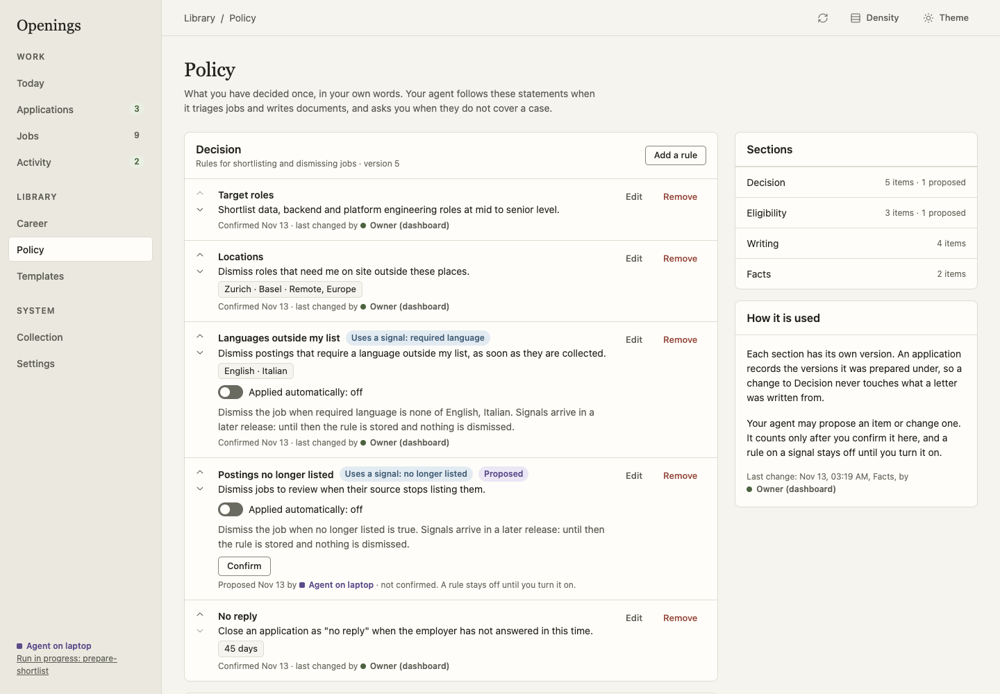

# Policy

The policy holds what you have decided once, in your own words. Your agent
follows it when it reviews jobs and writes documents, and asks you when it does
not cover a case. Open it under **Library → Policy**.



## Sections

| Section | Holds | Example |
|---|---|---|
| **Decision** | Rules for shortlisting and dismissing jobs | "Dismiss roles that need me on site outside Zurich and Basel." |
| **Eligibility** | Facts employers ask about | "EU citizen with a Swiss B permit", valid to 30 June 2028 |
| **Writing** | Rules for your documents, for the CV, the letter or all documents | "Never volunteer weaknesses or missing skills." |
| **Facts** | Anything else you have confirmed | "Notice period: one month to the end of a month." |

Every item has a short label, a statement, an optional value and an optional
note. A value is a text, a number, a date, yes or no, or a short list. Use
**Add a rule** or **Add a fact**, **Edit**, the arrows to change the order and
**Remove**, which asks first. **Move to…** puts an item into another section.

Each section has its own version. Saving an item makes a new version of its
section only, and an application records the section versions it was prepared
under. If the section changed in another session while you were editing, the
form says so, shows the latest list and keeps your text; save again to apply it.

## Confirmed items and proposals

An item counts when you have confirmed it.

- What you add or change in the dashboard, or with an owner token, is confirmed
  at once, with the date.
- What an agent token adds is a **proposal**. It is shown with its author and a
  **Confirm** button. An agent cannot confirm an item.
- When an agent changes the label, statement, value, scope or rule of a
  confirmed item, the item becomes a proposal again. A change to the note or
  the order keeps the confirmation.

Agents read proposals but do not rely on them, and a prepared application
marks each item it froze as confirmed or not.

## After the upgrade to 0.19

Earlier versions kept this information in the Profile: free-form `metadata`,
and the **Target roles** and **Preferences** fields. The upgrade copies it and
changes nothing in the Profile:

- every top-level key of the Profile metadata becomes one item in **Facts**,
  tagged **Unsorted**, with the original value. A nested value is shown as a
  collapsed structure;
- **Preferences** and **Target roles** become one item each in **Decision**.

The copied items are not confirmed. Sort them with **Confirm as a fact**,
**Move to…** and **Edit**: give each a label, write the statement, and choose a
kind of value to replace a copied structure. Your agent can do the sorting and
ask you to confirm (the `maintain-career` skill describes it).

0.23 removed the Profile's **Target roles** and **Preferences** fields. Before
removing them, the upgrade checks that an item of the policy holds each text
(in any section, ignoring differences of spacing); a text that none holds, for
example one edited after 0.19, becomes one more unconfirmed **Decision** item,
marked as copied when 0.23 removed the field.

## Rules on a signal

A Decision item may name a collection signal, for example "dismiss postings
that require a language outside my list". The rule has a switch, **Applied
automatically**, that is off until you turn it on; only you can turn it on, and
the item must also be confirmed.

Openings computes the signals of every job when it is collected, without a
model: the language the posting is written in, the languages it states as
required or welcome, a likely duplicate of an earlier job, and a company-board
posting that is no longer listed. An enabled, confirmed rule acts once on each
new job when its signal arrives, and only on a job nobody has reviewed yet:

- **dismiss** moves the job to **Dismissed**. The dismissal names the rule
  ("Dismissed by the rule “Languages I work in”"), and **Restore** brings the
  job back to review; the rule does not dismiss it again;
- **flag** keeps the job in **To review** and lists the rule among its signals.

A rule never acts on jobs already waiting for review, on jobs you added
yourself in the dashboard, on shortlisted jobs or on jobs with an application.
A likely duplicate is only ever flagged or dismissed, never merged.

Below each rule, **It matches N of the M jobs to review now** is a dry run of
the rule against the jobs waiting for review; nothing changes. **N jobs
dismissed by it** opens the Dismissed tab of Jobs filtered to that rule.

## REST and MCP

REST and MCP return the same items as the dashboard.

| Operation | REST | MCP |
|---|---|---|
| Read the policy or one section | `GET /policy`, `GET /policy/{section}` | `policy_get` |
| Add an item | `POST /policy/{section}/items` | `policy_add` |
| Edit an item | `PATCH /policy/items/{item_id}` | `policy_update` |
| Move it to another section | `POST /policy/items/{item_id}/move` | `policy_move` |
| Reorder a section | `POST /policy/{section}/reorder` | `policy_reorder` |
| Confirm a proposal (owner only) | `POST /policy/items/{item_id}/confirm` | `policy_confirm` |
| Remove an item | `DELETE /policy/items/{item_id}?expected_version=` | `policy_remove` |
| Try a rule without saving it | `POST /policy/rules/preview` | `policy_rule_preview` |

`expected_version` is always the version of the item's section; a stale one
returns `409 conflict` with `details.current_version`. A move also sends
`target_version`, the version of the section the item moves to.

```json
{
  "expected_version": 4,
  "label": "Letter length",
  "statement": "Three paragraphs, under 200 words.",
  "value": 200,
  "scope": "letter",
  "note": "Was 250 words; recruiters skim."
}
```

`value_type` is inferred from the value (`text`, `number`, `boolean`, `list`);
send `"value_type": "date"` with `YYYY`, `YYYY-MM` or `YYYY-MM-DD`. `scope`
belongs to Writing items and `rule` to Decision items:

```json
{
  "signal": "language_required",
  "condition": {"operator": "not_in", "value": ["English", "Italian"]},
  "action": "dismiss"
}
```

The signals are `language_required` and `posting_language` (`in`, `not_in`
with a list), `likely_duplicate` (`at_least` with a number from 0 to 1) and
`no_longer_listed` (`is` true); the actions are `dismiss` and `flag`.
`GET /policy` lists them and reports `signals_applied: true`. Setting
`enabled: true` needs owner authority.

A synthetic policy to try is in [`examples/policy.json`](../../examples/policy.json).
The record export and backups include the policy. Every write leaves a change
record with the item, the section, the changed field names and the version,
never the text.
