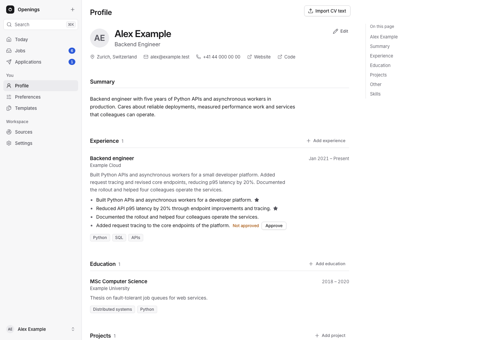
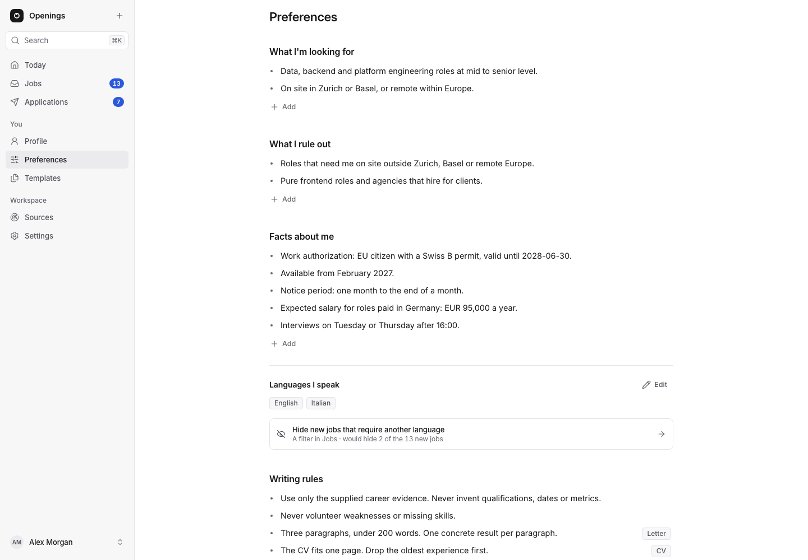
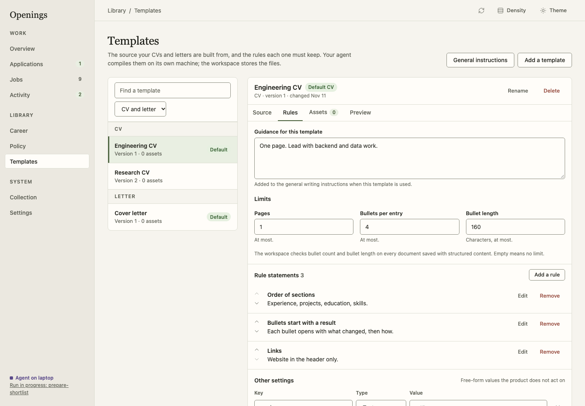

# Profile, Preferences and Templates

The **You** part of the navigation holds what Openings knows about you. You can
leave all of it empty and apply by hand. It matters when an agent writes your
documents: the agent reads it, and nothing in it acts on its own.

## Profile and career entries

**Profile** reads like a finished CV: a header (name, headline, location,
email, phone and links), a summary, then **Experience**, **Education**,
**Projects** and **Other**, and the **Skills** of every entry together. Empty
fields are not shown. On a wide screen **On this page** jumps to each part; on a
phone the same list is behind **Jump to**.

Each block is changed on purpose: point at it (or tap it) and choose **Edit**.
The block becomes its form, in place on a wide screen and as a full-screen sheet
on a phone; **Save** (⌘↵) stores it and **Cancel** (Esc) leaves it. One block is
open at a time, and leaving unsaved changes asks first. **Add experience** (and
the add button of each part) opens an empty entry, placed by its dates. **…** →
**Delete permanently…** removes an entry after a dialog that lists its
highlights and files. If a block was saved elsewhere meanwhile, Save says
**Changed elsewhere** and keeps your draft: **Keep editing** saves your changes
(fields you did not touch keep their new values), **Reload** shows the stored
record.

**Import CV text** reads pasted text or Markdown, or a dropped `.txt` or `.md`
file: headings name the parts, a sub-heading starts an entry, a line with dates
gives its dates and place, and bullets become its highlights. Nothing is stored
until you confirm the preview, and the header fills only empty fields. Your agent
can also read a PDF CV for you.

An **entry** holds stable facts: a kind (experience, project, course, education,
award, publication, fact, skill, language or other), a title, an optional
organization, dates, a location, skill tags and an optional description. A **highlight** is one
reusable sentence under an entry:

| Entry | Highlight |
|---|---|
| Experience: Backend Engineer, Example Co | Reduced ingestion latency by 30%. |
| Education: MSc in Computer Science | Researched reliable stream processing. |
| Skill: Languages | Python, Go, SQL |

A highlight is a draft until you **Approve** it (an agent's new highlights show
**Not approved**); only approved highlights reach an application. A ★ marks
**Always include in my CV**. In an entry's form you add, reword, approve, star,
remove and reorder highlights (drag the handle, or its **Move up**/**Move
down**); highlights you write there are approved. Dates are none, a single date
or a period (year and optional month; **Present** for an open end); unknown
dates stay empty. Skill tags are comma-separated, with duplicates removed.
Facts and narratives are context for an agent; highlights are wording it may
reuse, not the only wording it may use.

Every document revision records which entries and highlights it used. Editing an
entry later never changes a stored revision.

## Preferences

**Preferences** hold what you want, in your own words. Your agent reads them when
it reviews jobs, writes documents and works with you, and asks you when they do
not cover a case.

| Section | Holds | Example |
|---|---|---|
| **What I'm looking for** | Roles, places, companies and conditions worth a look | "Data and platform roles, on site in Zurich or Basel, or remote within Europe." |
| **What I rule out** | What makes a job not worth applying to | "Agencies that hire for clients." |
| **Facts about me** | What employers ask about: eligibility, availability, notice, salary | "EU citizen with a Swiss B permit, valid until 2028-06-30." |
| **Writing rules** | How CVs and letters are written | "Never volunteer weaknesses or missing skills." |
| **Working with me** | Instructions the agent follows | "Never contact an employer for me." |

Each statement is a line of plain text (up to 2,000 characters), and a section
holds up to 200. Point at a line for **Edit**, which edits it in place, and `...`,
with **Move to** another section and **Delete** (with Undo). **+ Add** writes a new
line; Enter saves it and opens the next. Drag a line's handle, or press Alt+↑/↓,
to reorder. A writing rule applies to **All** documents, the **CV** or the
**Letter**. An empty section shows two grey examples. If the section changed in
another session, the page says so and keeps your text.

Writing rules live only here: a template keeps its layout, guidance and limits.
Working with me is the one place for standing instructions to your agent. Synthetic
examples are in [`examples/preferences.json`](../../examples/preferences.json).

### Settings

Two values are typed, because Openings uses them itself:

- **Languages I speak:** the link **Hide new jobs that require another language**
  opens that Jobs filter and says how many new jobs it would hide. It only
  filters; it never dismisses a job.
- **Count an application as no reply after [30] days:** from 1 to 365. See
  [Applications](applications.md#replies).

## Templates

A **template** is a CV or letter layout your agent fills with your facts and
writing rules. Start from the example CV or letter (the synthetic `cv.tex` and
`letter.tex` in `examples/`), or upload a `.tex` file. Each has four tabs:

- **Preview:** a sample PDF you upload under Files.
- **Source:** the LaTeX, with line numbers; **Edit source** to change it.
- **Files:** what the source needs, such as fonts, images or a class file.
- **Limits:** **Pages**, **Bullets per entry** and **Bullet length**. Other rules,
  such as `engine`, and the template's guidance are set through the API.

Mark one template per kind as the **default**; the `...` menu renames,
duplicates, downloads the source or deletes it permanently. A one-page
engineering CV and a longer research CV can both exist.

Openings never compiles LaTeX. Your agent compiles on its own machine and uploads
the PDF. If you write your own documents, you need no template.

## REST and MCP

| Action | REST | MCP |
|---|---|---|
| Read Preferences, settings, profile and templates | `GET /workspace/context` | `workspace_context` |
| Replace one Preferences section | `PUT /preferences/{section}` | `preferences_update` |
| Change a setting | `PATCH /settings` | `settings_update` |
| Update the profile | `PATCH /career/profile` | `profile_update` |
| Read or save career entries | `GET`, `POST /career/batch` | `career_get`, `career_save` |
| Save highlights | `POST /career/highlights/batch` | `highlights_save` |
| Read or save templates | `GET /templates/{template_id}`, `POST /templates/save` | `templates_get`, `templates_save` |

The sections are `looking_for`, `ruled_out`, `facts`, `writing` and
`working_with_me`. A write replaces the whole section with `{"expected_version": N,
"items": [{"text": "..."}]}` (writing items also take `scope`: `all`, `cv` or
`letter`). A stale version returns `409 conflict` with `details.current_version`;
read again and merge. The import of career entries is owner-only: it is a
dashboard and REST action with a preview, not an MCP tool.
