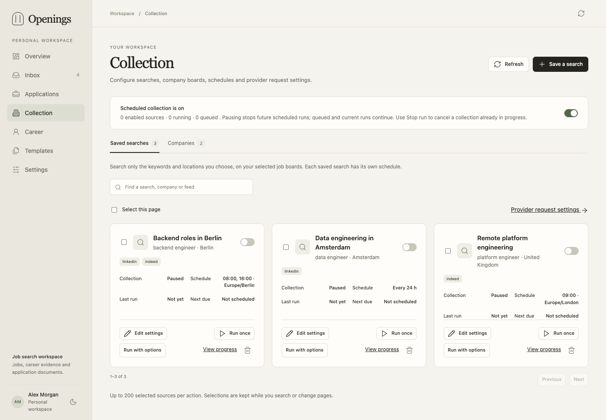
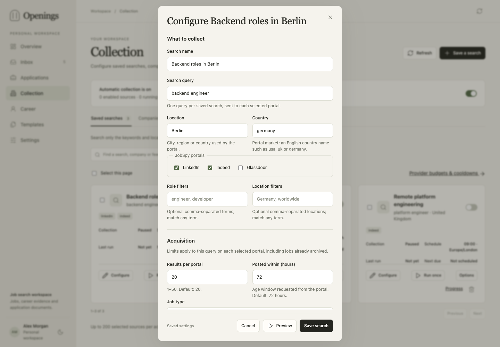

# Collection

**Collection** combines saved portal searches and selected company boards. Sources
store their settings in SQLite. New sources start paused; preview one, review its
results and enable the schedule when ready. You can run a paused source manually.



## Choose what to collect

| Source | What it searches | Example |
|---|---|---|
| Saved search | One query and location on selected JobSpy portals | `backend engineer`, `Berlin`, LinkedIn and Indeed |
| Company | One supported ATS board or RSS/Atom feed | A company's Greenhouse board, filtered to engineering roles |
| Manual job | The URL or posting you supply | Inbox → Add job |

Create another saved search for another query or location. Career preferences guide
optional fit scoring; the query controls what is requested from a portal.

### Saved searches

JobSpy searches **LinkedIn**, **Indeed** and **Glassdoor** through the attributed
1.4.1 subset. The form separates the query, acquisition settings and schedule.

| Setting | Meaning and default |
|---|---|
| Query | Required search text; one saved search per query/location combination. |
| Location | Portal search location; empty by default. Use a location the selected portal recognizes. |
| Country | JobSpy country selection; default `usa`. Available locations and capabilities vary by portal. |
| Portals | LinkedIn, Indeed and Glassdoor selected by default; select the ones you want. |
| Result limit | Up to **20 returned jobs per portal per run** by default; allowed range 1–50. Known jobs count toward it. |
| Age window | **72 hours** by default; allowed range 1–8760 hours. Applied through the portal's supported age filter. |
| Remote only | Off by default. Requests remote roles; eligibility still depends on each posting. |
| Job type | No restriction by default; choose a supported type when useful. |
| Fetch descriptions | On by default; full text may require additional provider requests. |

Preview saves no jobs and requests at most three results per portal. Its request
estimate describes that preview; a complete configured run can need more requests.
The preview also reports a separate estimate for the configured full run.
Result limits bound returned matches, including already archived jobs. Portals can
sort by relevance, round age filters or return incomplete results. A 24-hour window
and a limit of 50 do not establish complete coverage of that day.

### Company boards and feeds

Supported ATS adapters are Greenhouse, Lever, Ashby, Recruitee, Personio, Workable,
Breezy, SmartRecruiters, BambooHR, Rippling, Workday, Oracle and join.com. RSS/Atom
feeds are also supported. Paste the official board/feed URL, preview it and check
the detected service and configuration.

| Setting | Meaning and default |
|---|---|
| Board | Required board identifier or supported board URL; depends on the ATS. |
| Region | Adapter region, default `global`; used by services with regional endpoints. |
| Result limit | Up to **100 matching jobs per run** by default; range 1–2000. |
| Detail batch | Up to **10 detail fetches per batch** by default; range 0–25. Setting zero leaves listing-only text where the listing lacks a description. |
| Candidate limit | Up to **2000 board listings** inspected by default; range 20–10000. Limits scanning before local role/location filters. |
| Title filters | Optional terms for matching roles on the selected board. Empty means unrestricted. |
| Location filters | Optional locations; unknown or region-only remote eligibility needs review. Empty means unrestricted. |

Company boards can contain undated jobs; a saved-search age window does not apply
to them. RSS uses a feed URL and a result limit, without ATS detail controls.
Within each filter group, any matching term is sufficient; title and location
groups apply together. Unknown locations stay visible for review. Adapters report
listing/result caps and unsupported or blocked responses.

Complete cached descriptions can be reused; after 24 hours they become eligible
for refresh. Missing descriptions and bounded pages continue through the same run
where the adapter supports them. A source can retain a useful header while its
text is still pending. Inspect **Needs text** records before preparing documents.

## Set the schedule

Choose one schedule mode:

- **Interval:** every configured number of minutes; default 1440 (one day), range
  15–43200. The first scheduled run waits that interval after enabling; use
  Run once to collect immediately. Useful when exact wall-clock times do not matter.
- **Daily times:** one to twelve unique local `HH:MM` times plus an IANA timezone,
  such as `08:00, 16:00` in `Europe/Berlin`. The timezone keeps local times meaningful
  across daylight-saving changes. The daily schedule defaults to `07:00` in `UTC`.

The next execution is shown on the source. Daily slots are tracked independently
from actual start/finish times. Delayed work continues as one active invocation;
missed slots coalesce instead of creating a queue of duplicate runs.

**Pause automatic collection** preserves individual source settings and prevents
new scheduled runs. Queued or current runs continue; **Stop** cancels a selected
active run. Pausing one source controls its future automation. Manual runs remain
available under the same provider limits.

## Run once or change settings in bulk

**Run once** uses the saved settings. **Run with options** changes the lookback or
result/detail limits for that invocation only. The run freezes its source
configuration when queued; later source edits affect subsequent runs.

Select sources to enable, pause, run, configure or delete them together. Bulk
configuration changes only the chosen compatible fields and preserves untouched
settings. Configuration and filter keys merge; an empty filter list clears that
filter. A schedule replaces the whole schedule variant. Each source reports its
own outcome; failed items remain selected for
correction. Deleting a source retains its archived jobs. To use another source
service, create a new source; an existing source's service is fixed.

## Read progress

One collection run groups its source's provider tasks. Task batches can pause for
provider limits and resume from stored progress. The run keeps cumulative counts:

| Counter | Meaning |
|---|---|
| Found | One observation per provider identity in this run; retrying or filling its description does not count it again. |
| New | Unique new archive records. |
| Already archived | Observations resolved to existing archive records. The same job can appear through another provider or another source run. |
| Invalid | Observations rejected during ingestion. |
| Pending descriptions | Records still awaiting required detail work. |
| Unavailable descriptions | Detail work finished without obtaining usable full text. |

Provider status distinguishes active work, a scheduled wait with a resume time,
failed work and cancellation. Processing time measures active attempts; waiting
time and total elapsed time explain longer runs. Raw task diagnostics remain
available for investigation. A **Partial** run reports bounded coverage or
unavailable descriptions; completion does not imply every matching job was fetched.

Collection and scoring use separate lanes. A newly discovered incomplete job can
receive its first automatic score when its description is completed. Completing
an arbitrary historical record does not trigger that rule. [Scoring](scoring.md)
explains update rescoring and explicit batches.



## Provider safeguards

**Settings → Collection** stores provider-wide policy once for previews, URL
imports, scheduled/manual runs, redirects and detail fetches.

| Policy | Default | Scope |
|---|---|---|
| Minimum spacing | 3 seconds | Between requests to that provider; fractional seconds are accepted. |
| Hourly cap | 100 requests | Shared rolling hour. |
| Daily cap | 500 requests | Shared rolling 24 hours. |
| Batch cap | 40 requests | One bounded worker attempt; unfinished work can continue in another batch. |

These are local safeguards, not published portal quotas or access guarantees.
HTTP attempts count even when a response fails. Retry-After creates a durable
cooldown. Long waits release the collection lane; restart or pause does not reset
usage. Cross-provider redirects require using the destination URL directly.

A portal can still block requests or change its pages. Review failed/empty searches
and diagnostics; paste a posting when a public page cannot supply its full text.

## REST and MCP

`GET /api/v1/sources/schemas` or MCP `sources_schemas` exposes typed configuration,
defaults and capabilities. Discover the running schema before scripting.
Source changes, run requests and deletion use the last read `expected_version`.
For example, one temporary run:

```json
{"expected_version": 3, "overrides": {"hours_old": 168, "results_wanted": 50}}
```

Send it to `POST /api/v1/sources/{id}/run`. Saved settings remain unchanged.
Bulk configuration uses `POST /sources/bulk` with `action: "configure"`, versioned
`items` and `patch` containing compatible `schedule`, `config` or `filters` fields.
`GET /collection/runs` and `GET /collection/runs/{id}` expose grouped progress;
`POST /collection/runs/{id}/cancel` stops the run. Corresponding MCP tools are
`collection_runs_list`, `collection_runs_get` and `collection_runs_cancel`.

See [REST](api.md) and [MCP](agents.md) for authentication and document workflows.
