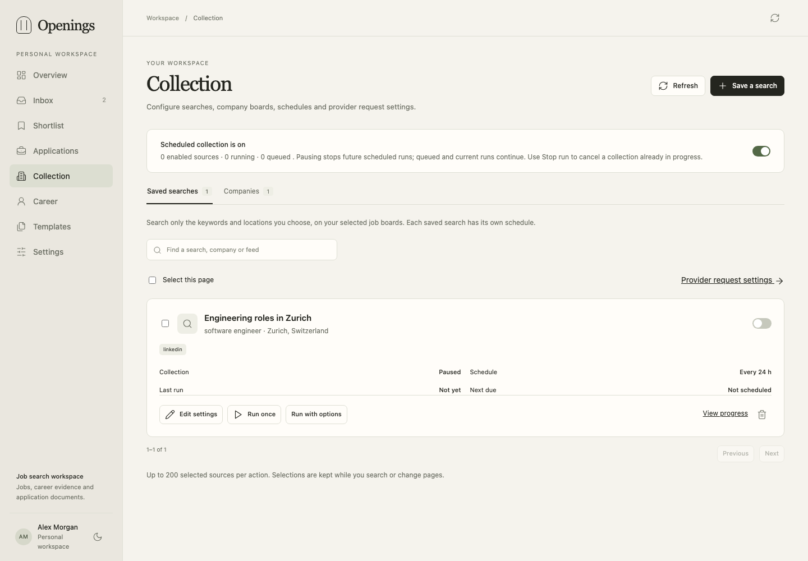
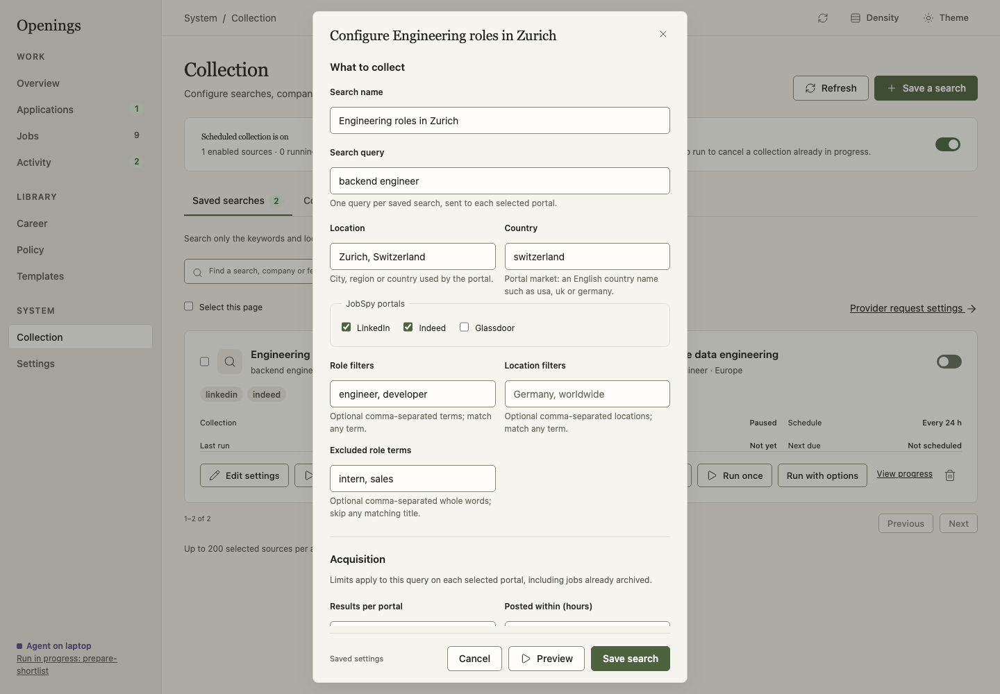

# Job sources

**Sources** (page title "Job sources") says where new jobs come from and
whether that works. Sources store their settings in SQLite. A source added in
the dashboard is checked on the schedule straight away; one added over REST or
MCP starts paused unless it says otherwise.

- **The top line:** "Checked every [24 h] · next check 14:00", with **Check all
  now**. The interval applies to every source; `…` pauses or resumes every
  automatic check.
- **One row per source:** its name and kind (search, company page or feed),
  what it searches ("Data engineer · Zurich · LinkedIn, Indeed"), how its last
  check went ("Checked 2h ago · 4 new", or in red "Last check failed: … ·
  Details") and what its jobs became. A paused source is greyed. On hover,
  **Check now** and `…` (Edit, Pause or Resume, Duplicate, Delete
  permanently…); the letters `j`/`k`, `e`, `c` and `p` do the same from the
  keyboard.
- **Add source** opens the form: the kind first (Search, Company careers page,
  RSS feed), then its own fields. **Test** shows the first ten results through
  the shared request gate before anything is saved.
- **Recent checks**, collapsed at the bottom: the last 20 checks with what they
  found or why they failed, with Stop for one in progress and Retry for one
  that failed.



## Choose what to collect

| Source | What it searches | Example |
|---|---|---|
| Saved search | One query and location on selected JobSpy portals | `backend engineer`, `Berlin`, LinkedIn and Indeed |
| Company | One supported ATS board or RSS/Atom feed | A company's Greenhouse board, filtered to engineering roles |
| Manual job | The URL or posting you supply | Jobs → Add a job |

Create another saved search for another query or location. Career preferences guide
your agent’s job review; the query controls what is requested from a portal.

### Saved searches

JobSpy searches **LinkedIn**, **Indeed** and **Glassdoor** through the attributed
1.4.1 subset. The form separates the query, acquisition settings and schedule.

| Setting | Meaning and default |
|---|---|
| Query | Required search text; one saved search per query/location combination. |
| Location | Portal search location; empty by default. Use a location the selected portal recognizes. |
| Country | The portal market, such as `switzerland`, `uk` or `usa`; empty by default. Indeed and Glassdoor search one country's site, so a search that includes them needs a country; LinkedIn uses the location alone. Available locations and capabilities vary by portal. |
| Portals | LinkedIn, Indeed and Glassdoor selected by default; select the ones you want. |
| Result limit | Up to **20 returned jobs per portal per run** by default; allowed range 1–50. Known jobs count toward it. |
| Age window | **72 hours** by default; allowed range 1–8760 hours. Applied through the portal's supported age filter. |
| Remote only | Off by default. Requests remote roles; eligibility still depends on each posting. |
| Job type | No restriction by default; choose a supported type when useful. |

Saved searches also accept the role, location and excluded role filters described
for company boards below; they apply to the returned titles and locations.

Description retrieval is automatic. LinkedIn and some other sources need an
additional request for each posting; complete cached descriptions can be reused.

Preview saves no jobs and requests at most three results per portal. Its request
estimate describes that preview; a complete configured run can need more requests.
The preview also reports a separate estimate for the configured full run.
Result limits bound returned matches, including already archived jobs. Portals can
sort by relevance, round age filters or return incomplete results. A 24-hour window
and a limit of 50 do not establish complete coverage of that day.

### Company boards and feeds

Automatic ATS collection supports Greenhouse, Lever, Ashby, Recruitee, Personio,
Workable, SmartRecruiters, BambooHR, Rippling, Workday, Oracle and join.com. RSS/Atom
feeds are also supported. Paste the official board/feed URL, preview it and check
the detected service and configuration.

| Setting | Meaning and default |
|---|---|
| Board | Required board identifier or supported board URL; depends on the ATS. |
| Region | Lever endpoint region, default `global`; choose `eu` for a European Lever board. |
| Result limit | Up to **100 matching jobs per run** by default; range 1–2000. |
| Candidate limit | Where supported: up to **2000 listings** inspected by default, range 20–10000, before local role/location filters. |
| Title filters | Optional terms for matching roles on the selected board. Empty means unrestricted. |
| Excluded role terms | Optional whole words; a title containing any of them is skipped (e.g. `sales`, `SAP`). Applied before role filters. |
| Location filters | Optional locations; unknown or region-only remote eligibility needs review. Empty means unrestricted. |

The form and discovered schema expose the options that each adapter uses. Lever,
Ashby, Recruitee, Personio and Workable provide descriptions in their listing
response. Greenhouse, BambooHR, Rippling, SmartRecruiters, Workday, Oracle and
join.com retrieve details separately and resume that work automatically. Run
options and bulk edits show fields supported by every selected source.

Breezy can be detected and previewed, but its adapter supplies only titles, links
and metadata. Its `automatic_collection: false` capability prevents saving or
running an automatic watch. Use a supported portal or add the posting manually.

Ashby uses its public [Job Postings API](https://developers.ashbyhq.com/docs/public-job-posting-api).
A 404 ends the attempt with a message to check the exact board URL and identifier.
It is distinct from a successful empty board. Ashby allows employers to
[disable the hosted board and unauthenticated API](https://docs.ashbyhq.com/can-i-disable-my-ashby-job-board).
If public access is unavailable, use a supported portal source or add the job manually.

Company boards can contain undated jobs; a saved-search age window does not apply
to them. RSS uses a feed URL and a result limit, without ATS detail controls.
Within each filter group, any matching term is sufficient; title and location
groups apply together. Unknown locations stay visible for review. Adapters report
listing/result caps and unsupported or blocked responses.

Complete cached descriptions become eligible for refresh after 24 hours. Pending
pages and descriptions continue through the same run from saved progress.
Automatic results enter the archive only when usable posting text is available.
Candidates awaiting text stay in collection progress; unavailable text is reported
there too. A manually added URL can remain **Needs text** until you complete it.

When a company board run reads the whole board (no result or candidate limit was
reached), a job from that board that still matches the source's filters and was
not listed again gets the signal **No longer listed**: the posting has probably
closed. The job shows the date under **Details**, **Sources**; a later run that
lists it again clears the signal. Saved searches never mark jobs this way,
because a search sees only part of a job board. The signal is a label and a
filter; it never dismisses a job.

## Set the schedule

The top line sets one interval for every source. Over REST and MCP each source
can keep its own schedule, in one of two modes:

- **Interval:** every configured number of minutes; default 1440 (one day), range
  15–43200. The first scheduled run waits that interval after enabling; use
  Check now to collect immediately. Useful when exact wall-clock times do not matter.
- **Daily times:** one to twelve unique local `HH:MM` times plus an IANA timezone,
  such as `08:00, 16:00` in `Europe/Berlin`. The timezone keeps local times meaningful
  across daylight-saving changes. The daily schedule defaults to `07:00` in `UTC`.

The next execution is shown on the source. Daily slots are tracked independently
from actual start/finish times. Delayed work continues as one active invocation;
missed slots coalesce instead of creating a queue of duplicate runs.

Pausing every automatic check preserves source settings and prevents new
scheduled runs. Queued or current checks continue; **Stop** under Recent checks
cancels one in progress. Pausing one source controls its future automation. Manual runs remain
available under the same provider pacing and cooldowns.

## Check now or change settings in bulk

**Check now** uses the saved settings. Over REST and MCP a run can change the
lookback or result limit for that invocation only. The run freezes its source
configuration when queued; later source edits affect subsequent runs.

REST `POST /sources/bulk` and MCP enable, pause, run, configure or delete
several sources together. Bulk
configuration changes only the chosen compatible fields and preserves untouched
settings. Configuration and filter keys merge; an empty filter list clears that
filter. A schedule replaces the whole schedule variant. Each source reports its
own outcome; failed items remain selected for
correction. Deleting a source retains its archived jobs. To use another source
service, create a new source; an existing source's service is fixed.

## Read progress

One collection run groups its source's provider tasks. Bounded batches resume
from stored progress, including after a provider cooldown. Counts are cumulative:

| Counter | Meaning |
|---|---|
| Processed | Complete observations processed once per provider identity in this run. Includes any rejected during ingestion. |
| New | Unique new archive records. |
| Already archived | Observations resolved to existing archive records. The same job can appear through another provider or another source run. |
| Invalid | Observations rejected during ingestion. |
| Waiting for text | Candidates still awaiting required detail work. |
| Text unavailable | Detail work ended without obtaining usable text; no new job was archived for that candidate. |

Provider status distinguishes active work, a wait with a resume time,
failed work and cancellation. Processing time measures active attempts; waiting
time and total elapsed time explain longer runs. REST `GET /collection/runs`
and `GET /tasks` show each provider task with its error and next attempt, and
the source settings and run-only limits the run froze. A **Partial** run reports bounded coverage or
unavailable descriptions; completion does not imply every matching job was fetched.



## What each source found

Each source row shows what the source found, for example "31 found ·
9 shortlisted · 3 applied": the jobs it found (each once), how many of them you
shortlisted or started an application for, and sent an application to. Zero counts are left out. A source that finds
many jobs and few you keep is a candidate to narrow or pause. **Applications →
Stats** shows replies by source once two sources have enough applications.

REST `GET /sources` and MCP `sources_list` return the same numbers as `counts`.

## Request pacing

**Settings › Advanced › Request limits per job site** shows the job sites your
sources use, with their state and the spacing between requests (saved when you
leave the field). The gate stores two provider-wide controls for previews, URL
imports, scheduled/manual runs, redirects and detail fetches, and shows where the
gate stands for each provider (ready, spacing requests, paused by the provider
until a time, off):

| Setting | Default | Scope |
|---|---|---|
| Enable provider | On for supported providers | Pause or allow requests across its sources. |
| Request interval | 5 seconds | Minimum spacing between requests to that provider; fractional seconds are accepted. |

Recent hourly, daily and total request counts are informational. A page of results
and each detail page are separate HTTP requests, including failed attempts.

An HTTP 429 response pauses requests; `Retry-After` sets the resume time when
provided, otherwise retries use increasing delays. Cooldowns survive restarts and
setting changes. Long waits release the collection lane. A login/challenge page
is reported as blocked access. Use a cross-provider redirect's destination URL
directly so its own policy applies.

A portal can still block requests or change its pages. Review failed/empty searches
and diagnostics; paste a posting when a public page cannot supply its full text.

## REST and MCP

`GET /api/v1/sources/schemas` or MCP `sources_schemas` exposes typed configuration,
defaults and capabilities. Discover the running schema before scripting.
Source changes, run requests and deletion use the last read `expected_version`.
For example, one temporary run:

```json
{"expected_version": 3, "overrides": {"hours_old": 168, "results_wanted": 50}}
```

Send it to `POST /api/v1/sources/{id}/run`. Saved settings remain unchanged.
Bulk configuration uses `POST /sources/bulk` with `action: "configure"`, versioned
`items` and `patch` containing compatible `schedule`, `config` or `filters` fields.
`GET /collection/runs` and `GET /collection/runs/{id}` expose grouped progress;
`POST /collection/runs/{id}/cancel` stops the run. Corresponding MCP tools are
`collection_runs_list`, `collection_runs_get` and `collection_runs_cancel`.

See [REST](api.md) and [MCP](agents.md) for authentication and document workflows.
